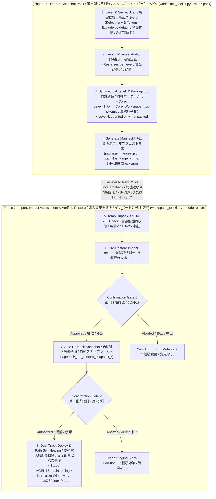

# Universal AI Agent Workspace Toolkit (v2.1.0)
**Universal Agent-Native Workspace Management, Migration & Disaster Recovery Hub**  
*通用 AI 智能體工作區全域管理、遷移與快照還原工具 (開源標準版)*  
*汎用 AI エージェント ワークスペース全域管理・移行・スナップショット復元ツール (オープンソース標準版)*

[](LICENSE)
[](https://www.python.org/downloads/)
[](https://github.com/ycaistudio/universal-agent-workspace-toolkit)
[](https://github.com/ycaistudio/universal-agent-workspace-toolkit)
[](https://github.com/ycaistudio/universal-agent-workspace-toolkit/pulls)

---

<p align="center">
  <b>🌐 Language Navigation / 多語言切換 / 言語切り替え:</b><br>
  <a href="README.md"><b>🇬🇧 English (Master)</b></a> •
  <a href="README_zh-TW.md"><b>🇹🇼 繁體中文手冊</b></a> •
  <a href="README_ja.md"><b>🇯🇵 日本語マニュアル</b></a>
</p>

---


## 📖 Overview / 專案簡介 / プロジェクト概要

### 🇬🇧 English
**Universal AI Agent Workspace Toolkit** is an enterprise-grade, agent-native workspace management toolkit designed for modern AI developers using **Google Antigravity**, **Claude Code / Desktop**, **Cursor**, and **VS Code (Cline / Roo)**.

It provides a unified, cross-platform engine (`workspace_toolkit.py`) for:
* **Export & Snapshot Backup**: Packaging neural skills, IDE configurations, and workspace documents into safe, self-contained capsules.
* **Import & Verified Restore**: Deploying to a new computer or rolling back to a known-good baseline with automatic path self-healing.
* **Integrity Audit**: SHA-256 checksum validation against the asset manifest (`package_manifest.json`). It detects corruption, not tampering.

### 🇹🇼 繁體中文
**Universal AI Agent 工作區全域管理中樞** 專為大型 AI 開發與工程團隊打造，支援跨 Windows / macOS / Linux 雙向遷移、日常快照備份與還原。目前僅在 **Google Antigravity** 目錄結構驗證；**Claude Code / Desktop**、**Cursor**、**VS Code (Cline / Roo)** 尚未測試。

提供單一跨平台控制台 (`workspace_toolkit.py`) 達成：
* **匯出與快照備份**：將智能體自定義技能、IDE 設定及工程文檔打包為安全自包含的資產包。
* **驗收與安全還原**：支援跨電腦遷移或同機基線回滾，具備全自動跨平台路徑自癒能力。
* **完整性審計**：依據發貨清單 (`package_manifest.json`) 執行 SHA-256 Checksum 驗證（可偵測損毀，不防竄改）。

### 🇯🇵 日本語
**Universal AI Agent ワークスペース管理ハブ**は、最新の AI 開発・エンジニアリングチーム向けに設計された、クロスプラットフォーム対応の環境管理・移行・スナップショット復元ツールです。**Google Antigravity**、**Claude Code / Desktop**、**Cursor**、**VS Code (Cline / Roo)** に対応予定です（動作確認済みは Google Antigravity のみ）。

統合エンジン (`workspace_toolkit.py`) により以下を提供します：
* **エクスポートとスナップショット出力**：カスタムスキル、IDE 設定、ワークスペース文書を安全な独立アーカイブに集約。
* **検証付きリストア**：新しい PC への移行や既知の正常ベースラインへのロールバックを、パス自動修復機能とともに実行。
* **整合性監査**：資産マニフェスト (`package_manifest.json`) に基づく SHA-256 チェックサム検証（破損検知用。改ざん防止ではありません）。


---

## 🏛️ Core Invariants / 六大核心支柱 / 6つの基本原則

### 🇬🇧 English
1. **Unified Agent Console (`workspace_toolkit.py`)**: One cross-platform Python CLI replacing legacy split A/B scripts and platform-locked `.bat`/`.sh` wrappers.
2. **Level_0 Secret Gatekeeper**: Pre-flight scan for known credential files (`.env`, `id_rsa`, `auth.json`, ...), private-key blocks and real-format API tokens. They are excluded by default and MCP secret values are replaced by a placeholder. `--include-secrets` packs them. Detection is by file name and pattern, so read the report.
3. **Strict Symmetrical Hierarchy**: Subfolders, archive zip files, and manifest keys strictly mirror Level 1 through Level 5 with zero AI hallucination.
4. **Atomic Core Capsule**: Core neural assets (Level 1-4) capped at $\le 100\text{ MB}$, packaged as a single atomic archive to guarantee zero piece loss.
5. **Level 5 heavy media**: counted in the audit but not packed (no chunking yet).
6. **Two-Step Confirmation Gate**: Pre-restore impact assessment report ➔ User Confirmation 1 ➔ Automatic rollback snapshot (`-/.gemini/_pre_restore_snapshot_*`) ➔ User Confirmation 2 ➔ Staging `AGENTS.md` as `.incoming` without clobbering live agent setups.

### 🇹🇼 繁體中文
1. **單一控制台 (`workspace_toolkit.py`)**：告別分散的 A/B 腳本與舊時代 `.bat` 批次檔，一套純 Python 核心全平台通用。
2. **Level_0 機密安全守門**：預設排除已知憑證檔案、私鑰區塊與真實格式的 API Token，MCP 設定內的機密值以佔位符取代；可用 `--include-secrets` 明確指定打包。偵測依檔名與格式比對，請檢視報告。
3. **全域 `Level_X` 絕對對齊**：封裝壓縮檔、子資料夾、Manifest 鍵名保持一致。
4. **單一封裝檔**：Level 1-4 打包成一個 ZIP，不分卷。
5. **Level 5 大檔**：只在審計表計數，目前不打包（尚無分卷功能）。
6. **兩次雙重確認門禁**：解壓前產出衝擊評估報告，第一次確認後自動建立本機防禦快照，第二次確認後始准寫入，`AGENTS.md` 預設存為 `.incoming`，絕不破壞本機現有 AI 靈魂！

### 🇯🇵 日本語
1. **単一コンソール統合 (`workspace_toolkit.py`)**：従来の散在した A/B スクリプトや OS 依存の `.bat`/`.sh` を廃止し、単一の純粋な Python スクリプトで全環境を横断サポート。
2. **Level_0 機密セキュリティゲート**：既知の認証情報ファイル、秘密鍵ブロック、実在形式の API トークンを既定で除外し、MCP 設定内の機密値はプレースホルダーに置換します。`--include-secrets` で明示的に含められます。検出はファイル名とパターンに基づくため、レポートを確認してください。
3. **階層構造の完全対称性**：圧縮ファイル名、内部サブディレクトリ、Manifest キー名を Level 1〜5 で統一。
4. **中核資産の原子化パッケージ**：エージェントの中核（Level 1〜4）は総容量 $\le 100\text{ MB}$ に制御し、単一 ZIP で出力して欠落リスクをゼロ化。
5. **Level 5 大容量メディア**：監査表に件数のみ表示し、梱包しません（分割機能は未実装）。
6. **2段階承認ゲートと自動保護**：展開前に影響評価レポートを出力 ➔ 第1承認 ➔ 自動スナップショット作成 ➔ 第2承認 ➔ `AGENTS.md` を `.incoming` として安全配置し、既存環境を破壊しません。


---

## 💡 Why This Toolkit? / 痛點分析與解決方案 / 開発背景と解決する課題

| # | Dimension / 痛點維度 / 課題分類 | Legacy Problem / 傳統工作區困境 / 従来の課題 | Our Solution / 本工具解決方案 / 本ツールの解決策 |
| :-: | :--- | :--- | :--- |
| **1** | **Multi-Device Setup<br>跨設備遷移耗時<br>環境移行の手間** | **🇬🇧 Fragmented Setup**: Rules, skills, and MCP configs are scattered across system paths, requiring hours of manual copying and path fixing on new machines.<br>**🇹🇼 分散碎片化**：Agent 規則、技能、MCP 配置散落各處，更換電腦需手動尋找路徑並重新配置數小時。<br>**🇯🇵 環境の断片化**：各種設定が散在し、端末切り替え時に手動コピーとパス修正に数時間を要する。 | **🇬🇧 1-Click Migration**: Single command collects Level 1-5 assets and auto-heals cross-OS paths (Windows ↔ macOS/Linux) quickly.<br>**🇹🇼 一鍵無痛遷移**：單一命令自動採集 Level 1-5 全棧資產，並動態自癒跨系統路徑。<br>**🇯🇵 ワンクリック移行**：単一コマンドで全階層資産を自動収集し、OS間のパス差分を自動吸収して即時復元。 |
| **2** | **Secret Leakage Risk<br>機密憑證外洩風險<br>機密情報漏洩リスク** | **🇬🇧 Accidental Key Leaks**: Full-folder archiving easily bundles `.env`, API keys, or private SSH keys into shared clouds or public repos.<br>**🇹🇼 誤打包 API Keys**：傳統整包壓縮常不慎包含 `.env`、私鑰或私人 Token，上傳至雲端引發嚴重資安危機。<br>**🇯🇵 秘密情報の誤混入**：全フォルダの一括圧縮により、`.env` や API キーが誤って共有ストレージへ流出する危険。 | **🇬🇧 Level_0 secret gate**: Known credential files and token patterns are excluded by default, MCP secret values are replaced by a placeholder, and the report lists every exclusion. `--include-secrets` overrides.<br>**🇹🇼 Level_0 機密守門**：已知憑證檔案與 Token 格式預設排除，MCP 機密值以佔位符取代，報告列出所有排除項目；`--include-secrets` 可覆寫。<br>**🇯🇵 Level_0 機密ゲート**：既知の認証情報ファイルとトークン形式を既定で除外し、MCP の機密値はプレースホルダーに置換、除外項目をレポートに一覧表示。`--include-secrets` で上書き可能。 |
| **3** | **Destructive Overwrite<br>粗暴覆蓋現有配置<br>既存設定の上書き破壊** | **🇬🇧 Blind Overwrite**: Standard extraction overwrites active files without warning, destroying existing rules with zero rollback.<br>**🇹🇼 盲目解壓覆蓋**：還原時直接蓋過目標目錄，抹殺現存最新規範與成果，且無法回滾撤銷。<br>**🇯🇵 無警告の上書き**：解凍時に既存の最新ルールや設定が無警告で上書きされ、復旧も不可能。 | **🇬🇧 2-Step Gate + Snapshot**: Pre-restore impact report, automatic rollback snapshot, and `.incoming` dual-track staging.<br>**🇹🇼 雙重門禁 + 自動快照**：還原前呈現衝擊評估，自動建立全環境備份快照，`AGENTS.md` 存為 `.incoming` 雙軌待審。<br>**🇯🇵 2段階承認 + 自動保護**：復元前に影響評価を提示し、自動スナップショット生成と `.incoming` 二重化保存を実行。 |
| **4** | **Platform Lock-in<br>平台與腳本依賴陷阱<br>プラットフォーム依存** | **🇬🇧 OS-Specific Scripts**: Heavy reliance on Windows `.bat` or Linux `.sh` scripts and external pip packages breaks cross-OS workflows.<br>**🇹🇼 綁定特定系統腳本**：過度依賴 `.bat` 或 `.sh` 及第三方依賴包，遇到跨平台環境時執行中斷。<br>**🇯🇵 OS 依存スクリプト**：特定の OS 向けスクリプトや外部ライブラリに依存し、別環境で動作不能になる。 | **🇬🇧 100% Pure Python**: Built strictly with Python standard library (zero external dependencies), driven natively via Agent prompts.<br>**🇹🇼 100% 純 Python 標準庫**：零外部依賴，跨 Windows/macOS/Linux 原生通用，Agent 可直接以自然語言驅動。<br>**🇯🇵 100% 標準 Python**：追加依存ゼロの純粋な Python 標準ライブラリで構築。自然言語で直接駆動可能。 |
| **5** | **Archive Bloat<br>輕重資產混雜超限<br>大容量アーカイブの破綻** | **🇬🇧 Monolithic Zip Failure**: Bundling multi-GB datasets with lightweight rules into one massive zip breaches cloud upload limits.<br>**🇹🇼 單一巨型壓縮包崩潰**：數十 GB 資料集與幾十 KB 核心規則混雜打包，超出雲端與 GitHub 上傳上限。<br>**🇯🇵 単一巨大 ZIP の破綻**：巨大データと軽量ルールを単一 ZIP に混載し、クラウド転送制限超過や破損を頻発。 | **🇬🇧 Core vs heavy assets**: Levels 1-4 go into one zip; heavy media (Level 5) is counted but not packed.<br>**🇹🇼 核心與大檔分流**：Level 1-4 打包成一個 ZIP；Level 5 大檔只計數、不打包。<br>**🇯🇵 中核と大容量素材の分離**：Level 1〜4 を 1 つの ZIP に梱包し、Level 5 は件数のみ表示して梱包しません。 |


---

## 🧩 Ecosystem Compatibility Matrix / 生態相容性矩陣 / エコシステム対応状況

| Platform / 開發環境 / プラットフォーム | Directives / 核心憲法 / 指示書 | MCP Servers / 工具擴充 / MCP設定 | Skills / 技能擴充 / スキル | Protocol Bypass / 協議免警告注入 / 警告回避注入 |
| :--- | :---: | :---: | :---: | :---: |
| **Google Antigravity** | `AGENTS.md` | `-/.gemini/antigravity/mcp/` | `-/.gemini/config/skills/` | ✅ Auto-Injected / 自動注入 / 自動注入 |
| **Cursor** | `.cursorrules` / `.cursor/rules` | `-/.cursor/mcp.json` | Rules Adaptation / 轉換規範 / ルール変換 | ✅ Auto-Injected / 自動注入 / 自動注入 |
| **Claude (Code / Desktop)** | `CLAUDE.md` | `claude_desktop_config.json` | Custom Commands / 支援命令 / コマンド対応 | ✅ Auto-Adapted / 自動適配 / 自動適合 |
| **VS Code (Cline / Roo)** | `.clinerules` | `cline_mcp_settings.json` | Incremental / 增量導入 / 増分導入 | ✅ Auto-Injected / 自動注入 / 自動注入 |
| **Windsurf** | `.windsurfrules` | Standard JSON / 通用規範 / 標準JSON | Incremental / 增量導入 / 増分導入 | ✅ Auto-Injected / 自動注入 / 自動注入 |


---

## 🛡️ Asset Defense Hierarchy / 六級資產防禦階梯 / 6段階の資産防護階層

| Level / 級別 / 階層 | Directory / 目錄名稱 / ディレクトリ | Contained Assets / 包含內容 / 構成要素 | Defense Strategy / 防禦策略 / 防護戦略 |
| :--- | :--- | :--- | :--- |
| **Level_0<br>Credentials<br>機密憑證<br>機密情報** | *(None / 不建立目錄 / 作成なし)* | `.env`, API Keys, Private Keys, Tokens (`id_rsa`, `auth.json`) | **❌ Excluded by default / 預設排除 / 既定で除外**<br>🇬🇧 Known credential files and token patterns are skipped; `--include-secrets` overrides.<br>🇹🇼 已知憑證檔案與 Token 格式預設略過；`--include-secrets` 可明確指定打包。<br>🇯🇵 既知の認証情報ファイルとトークン形式は既定でスキップ。`--include-secrets` で明示的に含められます。 |
| **Level_1<br>Directives<br>智能體憲法<br>基本指示書** | `Level_1_Agent_Directives/` | `AGENTS.md`, `CLAUDE.md`, `.cursorrules` | **🔴 Single-Instance Protection / 極高危單例保護 / 最高保護**<br>🇬🇧 In existing-agent mode the local file is kept and the incoming version is saved as `.incoming`.<br>🇹🇼 「現存環境」模式下保留本機舊檔，新版另存為 `.incoming`。<br>🇯🇵 「既存環境」モードでは現行ファイルを保持し、新しい版は `.incoming` として保存。 |
| **Level_2<br>System Settings<br>系統底層設定<br>システム設定** | `Level_2_System_Settings/` | `ide_user_settings.json`, MCP Configs | **🟠 Incremental Key Patch / 僅做 Patch 增補 / パッチ追記**<br>🇬🇧 Only injects protocol keys (e.g. `file:///` bypass); preserves UI/themes.<br>🇹🇼 僅注入通訊協議免警告設定，絕不覆蓋本機原有字型與外觀。<br>🇯🇵 プロトコル設定のみをパッチ注入し、既存のフォントや外観テーマを維持。 |
| **Level_3<br>Modular Skills<br>模組化技能庫<br>モジュールスキル** | `Level_3_Modular_Skills/` | Skill Folders (`SKILL.md`, `scripts/`, `manifest`) | **🟡 Merge Import / 合併導入 / マージ**<br>🇬🇧 New skills are added. Same-named skill files are overwritten by the packaged version (local-only files are kept); the rollback snapshot holds the previous copy.<br>🇹🇼 新技能會增補；同名技能檔案會被封裝版本覆寫（僅存在於本機的檔案保留），還原快照保存舊版。<br>🇯🇵 新しいスキルは追加されます。同名のスキルファイルはパッケージ版で上書きされ（ローカルのみのファイルは保持）、以前の内容はロールバック用スナップショットに残ります。 |
| **Level_4<br>Workspace Docs<br>專案工程文檔<br>プロジェクト文書** | `Level_4_Workspace_Docs/` | Markdown Notes, SOPs, Python Scripts | **🔵 Incremental Sync / 增量同步 / 増分同期**<br>🇬🇧 Syncs workspace files while preserving newer local files on target.<br>🇹🇼 工作區檔案增量同步，目標目錄已有之同名檔案保留本機最新版。<br>🇯🇵 ワークスペース文書を増分同期（移行先の新しい同名ファイルは維持）。 |
| **Level_5<br>Heavy Media<br>龐大素材資料<br>大容量メディア** | `Level_5_Heavy_References/` | Large PDFs, Videos, Datasets (>10MB - GBs) | **⚪ Not packed / 目前不打包 / 現在は梱包しません**<br>🇬🇧 Counted in the audit but not packed. There is no splitting yet.<br>🇹🇼 只在審計表計數，目前不打包，也尚無分卷功能。<br>🇯🇵 監査表に件数のみ表示し、梱包しません。分割機能は未実装です。 |


---

## 📊 Visual Architecture Flow / 視覺化架構流程圖 / アーキテクチャフロー




---

## 🚀 Quick Start / 快速上手 / クイックスタート

### 🇬🇧 English
#### 1. 🤖 Agent-Native Mode (Recommended)
No need to memorize terminal commands. Simply instruct your AI Agent (Antigravity, Cursor, Claude Code, Cline) in natural language:

* **Scenario A: Daily Snapshot Backup & Export**
  - 💬 `"Please export a snapshot backup of my AI workspace"`
  *(Agent scans Level_0 credentials, runs asset audit, and generates atomic packages in `packages/`)*

* **Scenario B: Safe Restore & Verified Migration**
  - 💬 `"Please inspect and restore the workspace package from packages/, perform impact assessment first"`
  *(Agent outputs impact report, creates pre-restore rollback snapshot upon Confirmation 1, and stages incoming files upon Confirmation 2)*

* **Scenario C: Integrity Audit & Health Check**
  - 💬 `"Audit package_manifest.json and verify SHA-256 checksums across all workspace files"`
  *(Agent verifies hashes with zero write operations)*

#### 2. 💻 Terminal CLI Mode (Advanced & Automation)
Designed for terminal workflows, automated scripts, and CI/CD pipelines:

```bash
# Launch interactive console (auto-detects system language)
python workspace_toolkit.py

# Export workspace snapshot package
python workspace_toolkit.py --mode pack

# Import and verified restore with 2-step confirmation gate
python workspace_toolkit.py --mode restore

# Scan and manifest audit (read-only, zero file mutation)
python workspace_toolkit.py --mode inspect

# Force specific language
python workspace_toolkit.py --lang en
```

---

### 🇹🇼 繁體中文
#### 1. 🤖 Agent-Native Mode (自然語言對答模式 · 推薦首選)
無需死記任何終端命令，直接在您習慣的 AI Agent 對話框（Antigravity / Cursor / Claude / VS Code）以日常語言吩咐即可：

* **【情境 A：日常快照備份與匯出】**
  - 💬 `「請幫我建立 AI 工作區快照備份 / 匯出封裝包」`
  *(AI Agent 會自動探測 Level_0 機密憑證守門、呈現資產審計，並自動封裝至 packages/ 目錄)*

* **【情境 B：安全導入與還原】**
  - 💬 `「請檢查 packages/ 目錄下的備份包並執行還原，先產出衝擊評估」`
  *(AI Agent 會產出詳細衝擊評估報告，於第一次確認後建立本機快照，第二次確認後安全展開)*

* **【情境 C：完整性審計與健康體檢】**
  - 💬 `「請讀取 package_manifest.json，比對全量資產 SHA-256 Checksum 並產出體檢報告」`
  *(純只讀安全操作，零檔案變更，防範檔案損毀)*

#### 2. 💻 Terminal CLI Mode (進階命令行與自動化)
適用於工程師直接在終端機操作或 CI/CD 無人值守自動化流程：

```bash
# 啟動交互式三語控制台 (自動偵測系統語系)
python workspace_toolkit.py

# 一鍵匯出中樞神經快照封裝包
python workspace_toolkit.py --mode pack

# 執行校驗與安全還原 (含衝擊評估與兩次確認門禁)
python workspace_toolkit.py --mode restore

# 僅做完整性審計與健康體檢 (純讀取，零檔案異動)
python workspace_toolkit.py --mode inspect

# 手動指定語言界面
python workspace_toolkit.py --lang zh-tw
```

---

### 🇯🇵 日本語
#### 1. 🤖 Agent-Native モード (自然言語対話 · 推奨)
コマンドを覚える必要はありません。普段利用している AI エージェント（Antigravity、Cursor、Claude Code、Cline）のチャット欄で指示するだけで自動実行されます：

* **【シナリオ A：日常のスナップショットバックアップとエクスポート】**
  - 💬 `「AI ワークスペースのスナップショットを作成・エクスポートしてください」`
  *(エージェントが Level_0 機密検知、資産監査を行い、packages/ ディレクトリへ自動圧縮出力)*

* **【シナリオ B：安全なインポートと検証付きリストア】**
  - 💬 `「packages/ のパッケージを確認して復元してください。まず影響評価を出力してください」`
  *(詳細な影響評価レポートを出力し、第1承認でバックアップスナップショットを作成、第2承認で安全に配置)*

* **【シナリオ C：整合性監査とヘルスチェック】**
  - 💬 `「package_manifest.json を読み込み、全ファイルの SHA-256 チェックサムを照合してください」`
  *(完全な読み取り専用検証。ファイル変更ゼロで破損を防止)*

#### 2. 💻 ターミナル CLI モード (高度な操作・自動化)
ターミナルでの直接操作や CI/CD パイプラインでの自動実行向け：

```bash
# 対話型コンソール起動 (システム言語を自動判定)
python workspace_toolkit.py

# ワークスペースのスナップショット出力
python workspace_toolkit.py --mode pack

# 検証付きリストア (影響評価と2段階承認ゲート付き)
python workspace_toolkit.py --mode restore

# 整合性監査 (読み取り専用・変更なし)
python workspace_toolkit.py --mode inspect

# 言語を手動指定
python workspace_toolkit.py --lang ja
```


---

## ❓ FAQ / 常見問題解答 / よくある質問

### 🇬🇧 English
#### Q1: Will my API keys or passwords accidentally be packaged or leaked to GitHub?
**Not by default, but read the report.** The Level_0 gate skips known credential files (`.env`, `id_rsa`, `auth.json`, ...), private-key blocks and real-format API tokens, replaces secret values in MCP JSON with a placeholder, and lists everything it excluded or redacted in the pack report and in `package_manifest.json`. Detection works by file name and pattern, so an unusual secret can slip through, and `--include-secrets` packs everything. What you do with the finished package is your responsibility. The `.gitignore` only covers files inside this repository.

#### Q2: If the target computer already has an active `AGENTS.md`, will it be overwritten during restore?
**Not the directives.** In existing-agent mode the local `AGENTS.md` and local MCP config are kept, and the incoming copies are saved as `.incoming`. Same-named skill files and workspace documents are overwritten, after a rollback snapshot of the previous versions is created.

#### Q3: Can I use this for local daily snapshot backups and disaster rollback on the same machine?
**Yes, natively supported!** The manifest embeds a `machine_fingerprint` (hostname + username). When the package comes from this same machine and user, no path rewriting is needed; the package is restored over the current files after a rollback snapshot of them is taken.

#### Q4: How are cross-platform path differences handled between Windows and macOS/Linux?
Built-in **Dynamic Path Self-Healing Engine**. During cross-machine restore, the toolkit regex-scans Markdown, JSON, and settings, intelligently translating legacy paths (e.g. `file:///C:/Users/UserA/`) into target platform paths (e.g. `file:///Users/UserB/` or `file:///home/user/`) while preserving text and hyperlink integrity.

---

### 🇹🇼 繁體中文
#### Q1: 我的 API Key、密碼會否不小心被打包或上傳到 GitHub？
**預設不會，但請檢視報告。** Level_0 守門機制會略過已知憑證檔案（`.env`、`id_rsa`、`auth.json` 等）、私鑰區塊與真實格式的 API Token，將 MCP JSON 內的機密值換成佔位符，並在封裝報告與 `package_manifest.json` 列出所有被排除或遮蔽的項目。偵測依檔名與格式比對，特殊格式的機密可能漏網；`--include-secrets` 會打包全部內容。封裝檔完成後的保管由使用者負責。`.gitignore` 只保護本專案儲存庫內的檔案。

#### Q2: 如果目標電腦原本就有一份使用中的 `AGENTS.md`，還原時會被覆蓋沖掉嗎？
**指令檔不會。** 「舊有現存環境」模式下，本機的 `AGENTS.md` 與 MCP 設定會保留，封裝版本另存為 `.incoming`。同名技能檔案與工作區文件則會被覆寫，覆寫前會先建立還原快照保存舊版。

#### Q3: 可以在同一部電腦上做日常快照與災難回滾嗎？
**可以，而且是原生支援！** 工具會讀取發貨單內嵌的 `machine_fingerprint`（主機名稱與使用者帳號）。若封裝來自同一台電腦與同一使用者，則不需改寫路徑，系統會先為現有檔案建立還原快照，再把封裝內容還原到現有檔案之上。

#### Q4: 跨平台遷移時，Windows 與 macOS / Linux 的路徑差異如何處理？
系統內建「動態路徑自癒引擎」，在跨平台遷移時會自動正則掃描 Markdown、JSON 與設定檔，將舊機路徑（例如 `file:///C:/Users/UserA/`）精準轉譯為新機路徑（例如 `file:///Users/UserB/`），並保留所有內文純文字與鏈接結構。

---

### 🇯🇵 日本語
#### Q1: APIキーやパスワードが誤ってアーカイブされたりGitHubに流出することはありますか？
**既定ではありません。ただしレポートを確認してください。** Level_0 ゲートは既知の認証情報ファイル（`.env`、`id_rsa`、`auth.json` など）、秘密鍵ブロック、実在形式の API トークンをスキップし、MCP JSON 内の機密値をプレースホルダーに置換し、除外・置換した項目をパック時のレポートと `package_manifest.json` に一覧表示します。検出はファイル名とパターンに基づくため、特殊な形式の機密は漏れる可能性があります。`--include-secrets` を指定すると全て梱包されます。パッケージ作成後の管理はユーザーの責任です。`.gitignore` が守るのはこのリポジトリ内のファイルだけです。

#### Q2: 復元先PCに既存の `AGENTS.md` がある場合、上書き破壊されますか？
**指示書は上書きされません。** 「既存環境」モードでは、現行の `AGENTS.md` と MCP 設定が保持され、パッケージ内の版は `.incoming` として保存されます。同名のスキルファイルとワークスペース文書は上書きされますが、その前にロールバック用スナップショットが作成されます。

#### Q3: 同一PC上での日常的なスナップショットバックアップとロールバックに利用できますか？
**はい、標準で対応しています。** パッケージのマニフェストに記録された `machine_fingerprint`（ホスト名とユーザー名）を照合し、同一端末・同一ユーザーであればパス書き換えは不要で、現行ファイルのスナップショットを作成した後、パッケージの内容を上書き復元します。

#### Q4: Windows と macOS/Linux 間でパス記述の差異はどのように処理されますか？
内蔵の**動的パス自己修復エンジン**が自動解決します。異なるOS間での移行時、Markdown や JSON 設定ファイル内の絶対パス（例: `file:///C:/Users/UserA/`）を正規表現で検知し、移行先PCのパス形式（例: `file:///Users/UserB/`）へと自動置換します。


---

## 📁 Repository Structure / 倉庫目錄結構 / ディレクトリ構造

```text
universal-agent-workspace-toolkit/
├── workspace_toolkit.py          # Unified Master CLI & Agent-Native Console (單一入口控制台 / 統合コンソール)
├── toolkit_i18n.py               # Trilingual Engine: en / zh-tw / ja (三語字典引擎 / 多言語エンジン)
├── toolkit_scanner.py            # Level_0 Secret Gate & Level_1-5 Scanner (資安與資產掃描器 / 監査スキャナー)
├── toolkit_pack.py               # Staging, Manifest & Zip Engine (階梯封裝引擎 / パッケージ化エンジン)
├── toolkit_restore.py            # Impact Report, Snapshot & Deployer (衝擊評估與還原引擎 / リストアエンジン)
├── SKILL.md                      # Antigravity Skill Specification (技能定義規範 / スキル定義仕様)
├── AGENTS.md                     # Universal Agent Bootstrap Directives (智能體自啟動憲法 / 起動指示書)
├── AI_GUIDED_WIZARD_PROMPTS.md   # Natural Language Prompt Templates (自然語言引導詞 / 対話プロンプト集)
├── README.md                     # Master Trilingual Documentation (三語總綱手冊 / 三言語統合マニュアル)
├── README_zh-TW.md               # Traditional Chinese Manual (繁體中文完整手冊)
├── README_ja.md                  # Japanese Manual (日本語完全マニュアル)
└── .gitignore                    # Security Exclusions & Cache Filters (資安排他過濾規則 / 除外ルール)
```

---

## 📄 License / 授權條款 / ライセンス

* **🇬🇧 English**: This project is licensed under the MIT License — see the [LICENSE](LICENSE) file for details.
* **🇹🇼 繁體中文**：本專案採用 MIT 開源授權條款 — 詳情請參閱 [LICENSE](LICENSE) 檔案。
* **🇯🇵 日本語**：本プロジェクトは MIT ライセンスの下で公開されています — 詳細は [LICENSE](LICENSE) ファイルをご参照ください。

---

## Behaviour notes / 行為說明 / 動作仕様

* **Secrets**: by default known credential files, private-key blocks and real-format API tokens are not packed, and MCP secret values are replaced by `__REDACTED_RESTORE_MANUALLY__`. Pack with `--include-secrets` to carry them. Every exclusion and redaction is listed in the pack report and in `package_manifest.json`. Handling the finished package is the user's responsibility.
* **Restore**: uses only the newest package it finds (by `created_at`), extracts to a fresh temporary folder that is deleted afterwards, and always creates a rollback snapshot (with or without `-y`) of everything it may overwrite. Same-named skill files and workspace documents are overwritten; in `existing` mode `AGENTS.md` and MCP config are kept and the incoming copies saved as `.incoming`.
* **IDE settings**: restore adds `"security.promptForLocalFileProtocolHandling": false` to the settings of IDEs already installed on the target (pass `--skip-ide-protocol-patch` to disable). Files that are not plain JSON (for example VS Code settings with comments) are never edited; the line to add is printed instead. A backup `settings.json.bak-<time>` is made before any edit.
* **Level 5** heavy media is counted in the audit but not packed.
* **Status**: verified on the Google Antigravity directory layout. Other agents are untested. Automated tests were run on Linux only.

* **機密**：預設不打包已知憑證檔案、私鑰區塊與真實格式的 API Token，MCP 機密值以 `__REDACTED_RESTORE_MANUALLY__` 取代；加上 `--include-secrets` 即可一併帶走。所有排除與遮蔽項目都列在封裝報告與 `package_manifest.json`。封裝檔完成後的保管由使用者負責。
* **還原**：只使用找到的最新封裝（依 `created_at`），解壓到每次全新的暫存資料夾並於結束後刪除；不論是否加 `-y`，都會先為可能被覆寫的內容建立還原快照。同名技能檔案與工作區文件會被覆寫；`existing` 模式下 `AGENTS.md` 與 MCP 設定保留，封裝版本另存為 `.incoming`。
* **IDE 設定**：還原時會在目標電腦已安裝的 IDE 設定中加入 `"security.promptForLocalFileProtocolHandling": false`（可用 `--skip-ide-protocol-patch` 關閉）。不是純 JSON 的檔案（例如含註解的 VS Code 設定）不會被修改，只會印出要手動加入的行；修改前會先備份為 `settings.json.bak-<時間>`。
* **Level 5** 大檔只在審計表計數，不打包。
* **狀態**：已在 Google Antigravity 目錄結構驗證，其他 Agent 尚未測試；自動化測試僅在 Linux 執行。

* **機密情報**：既定では既知の認証情報ファイル、秘密鍵ブロック、実在形式の API トークンは梱包されず、MCP の機密値は `__REDACTED_RESTORE_MANUALLY__` に置換されます。`--include-secrets` を付けると含められます。除外・置換した項目は、パック時のレポートと `package_manifest.json` に一覧表示されます。作成後のパッケージの管理はユーザーの責任です。
* **復元**：見つかった最新のパッケージ（`created_at` 基準）のみを使い、毎回新しい一時フォルダーに展開して終了後に削除します。`-y` の有無にかかわらず、上書きされる可能性のある内容のスナップショットを必ず作成します。同名のスキルファイルとワークスペース文書は上書きされ、`existing` モードでは `AGENTS.md` と MCP 設定が保持され、新しい版は `.incoming` として保存されます。
* **IDE 設定**：復元時、移行先にインストール済みの IDE の設定に `"security.promptForLocalFileProtocolHandling": false` を追加します（`--skip-ide-protocol-patch` で無効化）。通常の JSON でないファイル（コメント付きの VS Code 設定など）は編集せず、追加すべき行を表示します。編集前に `settings.json.bak-<時刻>` としてバックアップします。
* **Level 5** の大容量メディアは監査表に件数のみ表示し、梱包しません。
* **状況**：Google Antigravity のディレクトリ構成で動作確認済み。他のエージェントは未検証で、自動テストは Linux のみで実行しています。
