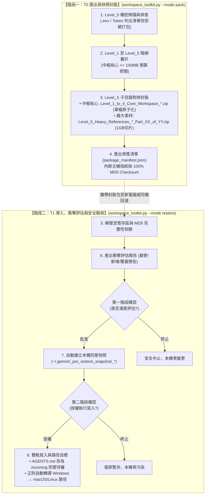

# Universal AI Agent Workspace Toolkit (v2.1.0)
**Universal Agent-Native Workspace Management, Migration & Disaster Recovery Hub**  
*通用 AI 智能體工作區全域管理、無損遷移與快照自癒中樞 (開源標準版)*  
*汎用 AI エージェント ワークスペース全域管理・無損失移行・スナップショット自己修復ハブ (オープンソース標準版)*

[](LICENSE)
[](https://www.python.org/downloads/)
[](https://github.com/ycaistudio/universal-agent-workspace-toolkit)
[](https://github.com/ycaistudio/universal-agent-workspace-toolkit)
[](https://github.com/ycaistudio/universal-agent-workspace-toolkit/pulls)

---

<p align="center">
  <b>🌐 Language Navigation / 多語言切換 / 言語切り替え:</b><br>
  <a href="README.md"><b>English (Master)</b></a> •
  <a href="README_zh-TW.md"><b>🇹🇼 繁體中文說明</b></a> •
  <a href="README_ja.md"><b>🇯🇵 日本語マニュアル</b></a>
</p>

---


## 📖 English Overview

**Universal AI Agent Workspace Toolkit** is an enterprise-grade, agent-native workspace management toolkit designed for modern AI developers using **Google Antigravity**, **Claude Code / Desktop**, **Cursor**, and **VS Code (Cline / Roo)**.

It provides a unified, cross-platform engine (`workspace_toolkit.py`) for:
* **Export & Snapshot Backup**: Packaging neural skills, IDE configurations, and workspace documents into safe, self-contained capsules.
* **Import & Verified Restore**: Deploying to a new computer or rolling back to a known-good baseline with automatic path self-healing.
* **Integrity Audit**: 100% MD5 checksum validation against the asset manifest (`package_manifest.json`).

### 6 Core Invariants
1. **Unified Agent Console (`workspace_toolkit.py`)**: One cross-platform Python CLI replacing legacy split A/B scripts and platform-locked `.bat`/`.sh` wrappers.
2. **Level_0 Secret Gatekeeper**: Active pre-flight heuristic scan of `.env`, API Keys, and SSH tokens. 100% strict refusal to bundle secrets, guiding password manager sync.
3. **Strict Symmetrical Hierarchy**: Subfolders, archive zip files, and manifest keys strictly mirror Level 1 through Level 5 with zero AI hallucination.
4. **Atomic Core Capsule**: Core neural assets (Level 1~4) capped at $\le 100\text{ MB}$, packaged as a single atomic archive to guarantee zero piece loss.
5. **Large Media Chunking (`Part_XX_of_YY`)**: Heavy assets (Level 5) chunked into 1GB volumes with explicit total counts (e.g., `Part_01_of_03.zip`) for foolproof transfer.
6. **Two-Step Confirmation Gate**: Pre-restore impact assessment report ➔ User Confirmation 1 ➔ Automatic rollback snapshot (`~/.gemini/_pre_restore_snapshot_*`) ➔ User Confirmation 2 ➔ Staging `AGENTS.md` as `.incoming` without clobbering live agent setups.


---

## 🇹🇼 繁體中文說明

**Universal AI Agent 工作區全域管理中樞** 專為大型 AI 開發與工程團隊打造，支援跨 Windows / macOS / Linux 雙向無損遷移、日常快照備份與災難快速自癒。

### 六大核心支柱 (Core Invariants)
1. **單一控制台 (`workspace_toolkit.py`)**：告別分散的 A/B 腳本與舊時代 `.bat` 批次檔，一套純 Python 核心全平台通用。
2. **Level_0 機密安全守門**：主動探測本機敏感憑證（.env、API Key、Token），嚴守開源資安標準拒絕打包，指引密碼管理器手動保管。
3. **全域 `Level_X` 絕對對齊**：封裝壓縮檔、子資料夾、Manifest 鍵名 100% 嚴格一致，無 AI 幻覺。
4. **中樞單檔原子化**：中樞神經（Level 1~4）總量 $\le 100\text{ MB}$，保持單一檔案不分卷，遺失風險直接歸零。
5. **大檔防丟件 `Part_XX_of_YY`**：龐大素材（Level 5）採用 1GB 大顆粒切片，檔名明確標註總數與序號（如 `Part_01_of_03.zip`），徹底防呆。
6. **兩次雙重確認門禁**：解壓前產出衝擊評估報告，第一次確認後自動建立本機防禦快照，第二次確認後始准寫入，`AGENTS.md` 預設存為 `.incoming`，絕不破壞本機現有 AI 靈魂！


---

## 🇯🇵 日本語の概要

**Universal AI Agent ワークスペース管理ハブ**は、最新の AI 開発・エンジニアリングチーム向けに設計された、クロスプラットフォーム対応の環境管理・無損失移行・スナップショット自己修復ツールです。Google Antigravity、Cursor、Claude Code、VS Code (Cline / Roo) をフルサポートします。

### 6つの基本原則 (Core Invariants)
1. **単一コンソール統合 (`workspace_toolkit.py`)**：従来の散在した A/B スクリプトや OS 依存の `.bat`/`.sh` を廃止し、単一の純粋な Python スクリプトで全環境を横断サポート。
2. **Level_0 機密セキュリティゲート**：`.env`、API キー、秘密鍵、トークンを自動検出し、アーカイブへの混入を 100% 遮断。パスワードマネージャーでの安全管理を案内。
3. **階層構造の完全対称性**：圧縮ファイル名、内部サブディレクトリ、Manifest キー名を Level 1〜5 で 100% 厳密に統一。
4. **中核資産の原子化パッケージ**：エージェントの中核（Level 1〜4）は総容量 $\le 100\text{ MB}$ に制御し、単一 ZIP で出力して欠落リスクをゼロ化。
5. **大容量メディアの分割管理 (`Part_XX_of_YY`)**：巨大素材（Level 5）は 1GB 単位で分割し、総数と連番を明記（例: `Part_01_of_03.zip`）して安全に転送。
6. **2段階承認ゲートと自動保護**：展開前に影響評価レポートを出力 ➔ 第1承認 ➔ 自動スナップショット作成 ➔ 第2承認 ➔ `AGENTS.md` を `.incoming` として安全配置し、既存環境を破壊しません。


---

## 💡 Why This Toolkit? / 痛點分析與解決方案 / 開発背景と解決する課題

| # | 痛點維度 / Dimension / 課題分類 | 傳統困境 / Legacy Problem / 従来の課題 | 本工具解決方案 / Our Solution / 本ツールの解決策 |
| :-: | :--- | :--- | :--- |
| **1** | **跨設備遷移耗時<br>Multi-Device Setup<br>環境移行の手間** | **分散碎片化**：Agent 規則、技能、MCP 配置散落各處，更換電腦或在多台工作站切換需手動尋找路徑並重新配置數小時。<br>*Fragmented configurations across paths require hours of manual copying and path patching on new machines.*<br>*各種設定が散在し、端末切り替え時に手動コピーとパス修正に数時間を要する。* | **一鍵無痛遷移**：單一命令自動採集 Level 1~5 全棧資產，並動態自癒跨系統路徑（自動轉譯 Windows ↔ macOS/Linux），5 秒完成還原。<br>*1-click packaging and deployment with automatic path normalization across OS platforms.*<br>*単一コマンドで全階層資産を自動収集し、OS間のパス差分を自動吸収して即時復元。* |
| **2** | **機密憑證外洩風險<br>Secret Leakage Risk<br>機密情報漏洩リスク** | **誤打包 API Keys**：傳統整包壓縮常不慎包含 `.env`、私鑰或私人 Token，上傳至雲端或公開代碼庫引發嚴重資安危機。<br>*Traditional full-folder archiving easily leaks `.env`, API keys, or private SSH keys into shared clouds.*<br>*全フォルダの一括圧縮により、.env や API キーが誤って共有ストレージへ流出する危険。* | **Level_0 零信任守門**：封裝前強制以正則深度掃描整個工作區，嚴格拒絕打包任何機密，並主動提示使用密碼管理器安全同步。<br>*Strict Level_0 pre-flight security scanner that refuses to bundle secrets and guides secure vault sync.*<br>*Level_0 セキュリティゲートが機密を検知してパッケージングを遮断、安全な同期を案内。* |
| **3** | **粗暴覆蓋踩死現有配置<br>Destructive Overwrite<br>既存設定の上書き破壊** | **盲目解壓覆蓋**：還原時直接蓋過目標目錄，抹殺現存的最新 Agent 規範與工作成果，且無法回滾撤銷。<br>*Blind extraction overwrites existing configurations without warning, destroying active work with zero rollback.*<br>*解凍時に既存の最新ルールや設定が無警告で上書きされ、復旧も不可能。* | **雙重門禁 + 自動回滾快照**：還原前呈現衝擊評估清單，自動建立全環境快照備份，且 Agent 憲章存為 `.incoming` 雙軌待審。<br>*2-step confirmation gate, automatic pre-restore backup snapshot, and `.incoming` dual-track staging.*<br>*2段階承認ゲート、復元前の自動スナップショット生成、および `.incoming` 二重化保存。* |
| **4** | **平台與 Shell 依賴陷阱<br>Platform & Shell Lock-in<br>プラットフォーム依存** | **綁定特定系統腳本**：過度依賴 Windows `.bat` 或 Linux `.sh`，遇到跨平台環境時執行中斷，且需安裝繁重的第三方依賴包。<br>*Dependent on OS-specific `.bat` or `.sh` scripts and heavy external dependencies, failing on cross-OS workflows.*<br>*特定の OS 向けシェルスクリプトや重い外部ライブラリに依存し、別環境で動作不能になる。* | **100% Agent-Native 純 Python**：僅使用標準函式庫（零外部依賴），跨 Windows/macOS/Linux 完全原生通用，Agent 可直接以自然語言驅動。<br>*100% pure Python standard library (zero external pip packages), fully agent-native and cross-platform.*<br>*100% Python 標準ライブラリのみで構築（追加依存ゼロ）。自然言語プロンプトで直接実行可能。* |
| **5** | **輕重資產混雜與容量超限<br>Monolithic Archive Bloat<br>大容量アーカイブの破綻** | **單一巨型壓縮包崩潰**：數十 GB 的資料集/PDF 與幾十 KB 的核心 Skills 混在一起打包，超出雲端與 GitHub 上傳上限，傳輸極易中斷。<br>*Bundling multi-GB datasets with lightweight rule files into a single huge zip breaches cloud limits and risks corruption.*<br>*巨大データと軽量ルールを単一 ZIP に混載し、クラウド転送制限超過や破損を頻発。* | **輕重資產智能分流**：核心神經層 ($\le 100\text{ MB}$) 單一原子封裝；海量素材層 (Level 5) 自動切為 1GB 獨立分卷 (`Part_XX_of_YY.zip`)，靈活傳輸。<br>*Separation of core workspace ($\le 100\text{ MB}$, unfragmented atomic package) and heavy media (1GB chunks).*<br>*中核設定（$\le 100$MB 原子パッケージ）と大容量素材（1GB 分割ボリューム）のスマート分離。* |


---

## 🧩 AI Agent 生態相容性矩陣 (Ecosystem Compatibility Matrix)

| AI Agent 環境 / Platform | 核心憲法指引 (Directives) | 工具擴充 (MCP Servers) | 技能擴充 (Skills) | IDE 協議免警告注入 (Bypass) |
| :--- | :---: | :---: | :---: | :---: |
| **Google Antigravity** | `AGENTS.md` | `~/.gemini/antigravity/mcp/` | `~/.gemini/config/skills/` | ✅ 自動注入 |
| **Cursor** | `.cursorrules` / `.cursor/rules` | `~/.cursor/mcp.json` | 轉換為 Rules 規範 | ✅ 自動注入 |
| **Claude (Code / Desktop)** | `CLAUDE.md` | `claude_desktop_config.json` | 支援 Custom Commands | ✅ 自動適配 |
| **VS Code (Cline / Roo)** | `.clinerules` | `cline_mcp_settings.json` | 增量導入 | ✅ 自動注入 |
| **Windsurf** | `.windsurfrules` | 通用 JSON 規範 | 增量導入 | ✅ 自動注入 |


---

## 🛡️ 六級資產防禦階梯 (Asset Defense Hierarchy)

| 級別 / Level | 目錄名稱 / Directory | 包含內容 / Contained Assets | 防禦策略 / Defense Strategy |
| :--- | :--- | :--- | :--- |
| **Level_0<br>(機密憑證)** | *(不建立目錄)* | `.env`, API Keys, 私鑰, 憑證 (`id_rsa`, `auth.json`) | **❌ 100% 拒絕打包 (Strict Exclusion)**：主動掃描路徑，提示使用者透過密碼管理器手動備份。<br>*Never packaged; strictly advises manual password manager sync.* |
| **Level_1<br>(智能體憲法)** | `Level_1_Agent_Directives/` | `AGENTS.md`, `CLAUDE.md`, `.cursorrules` | **🔴 極高危單例保護 (Single Instance Gate)**：預設 100% 保留本機舊檔，新版存為 `.incoming` 雙軌比對，需兩次確認始准覆蓋。<br>*100% preserve existing; incoming staged as `.incoming`.* |
| **Level_2<br>(系統底層設定)** | `Level_2_System_Settings/` | `ide_user_settings.json`, MCP 伺服器配置 | **🟠 僅做 Patch 增補 (Incremental Patch)**：僅注入通訊協議（如 `file:///` 免警告），絕不覆蓋本機原有外觀與個人化設定。<br>*Only patches protocol keys; preserves user UI/theme.* |
| **Level_3<br>(模組化技能庫)** | `Level_3_Modular_Skills/` | 各獨立 Skill 資料夾 (`SKILL.md`, scripts, manifest) | **🟢 無損導入 (Lossless Import)**：可插拔模組化元件，同名技能安全跳過，新技能自動增補。<br>*Pluggable modules; skips existing names, adds new skills.* |
| **Level_4<br>(專案工程文檔)** | `Level_4_Workspace_Docs/` | Markdown 筆記、SOP、S-Curve 腳本、日常工作檔 | **🔵 增量同步 (Incremental Sync)**：工作區檔案增量同步（目標目錄已有之同名檔案保留本機最新版）。<br>*Incremental sync; preserves target-newer files.* |
| **Level_5<br>(龐大素材資料)** | `Level_5_Heavy_References/` | 大型 PDF、影音多媒體、大資料庫 (>10MB 或數 GB) | **🟣 大檔可選分卷 (1GB Chunk Volumes)**：採用 1GB 大顆粒切片 (`Part_XX_of_YY.zip`)，由使用者自決是否傳輸與解壓。<br>*Auto-chunked 1GB parts; user chooses when to transfer.* |


---

## 📊 視覺化架構流程圖 (Visual Architecture Flow)




---

## 🚀 Quick Start (快速上手 · クイックスタート)

## 🚀 Quick Start

### 1. 🤖 Agent-Native Mode (Recommended)
No need to memorize terminal commands. Simply instruct your AI Agent (Antigravity, Cursor, Claude Code, Cline) in natural language:

* **Scenario A: Daily Snapshot Backup & Export**
  - 💬 `"Please export a snapshot backup of my AI workspace"`
  *(Agent scans Level_0 credentials, runs asset audit, and generates atomic packages in `packages/`)*

* **Scenario B: Safe Restore & Verified Migration**
  - 💬 `"Please inspect and restore the workspace package from packages/, perform impact assessment first"`
  *(Agent outputs impact report, creates pre-restore rollback snapshot upon Confirmation 1, and stages incoming files upon Confirmation 2)*

* **Scenario C: Integrity Audit & Health Check**
  - 💬 `"Audit package_manifest.json and verify MD5 checksums across all workspace files"`
  *(Agent verifies hashes with zero write operations)*

### 2. 💻 Terminal CLI Mode (Advanced & Automation)
Designed for terminal workflows, automated scripts, and CI/CD pipelines:

```bash
# Launch interactive console (auto-detects system language)
python workspace_toolkit.py

# Export workspace snapshot package
python workspace_toolkit.py --mode pack

# Import and verified restore with 2-step confirmation gate
python workspace_toolkit.py --mode restore

# Scan and manifest audit (read-only, zero file mutation)
python workspace_toolkit.py --mode inspect

# Force specific language
python workspace_toolkit.py --lang en
```


---

## 🚀 Quick Start (快速上手)

### 1. 🤖 Agent-Native Mode (自然語言對答模式 · 推薦首選)
無需死記任何終端命令，直接在您習慣的 AI Agent 對話框（Antigravity / Cursor / Claude / VS Code）以日常語言吩咐即可：

* **【情境 A：日常快照備份與匯出】**
  - 💬 `「請幫我建立 AI 工作區快照備份 / 匯出封裝包」`
  *(AI Agent 會自動探測 Level_0 機密憑證守門、呈現資產審計，並自動封裝至 packages/ 目錄)*

* **【情境 B：安全導入與無損還原】**
  - 💬 `「請檢查 packages/ 目錄下的備份包並執行還原，先產出衝擊評估」`
  *(AI Agent 會產出詳細衝擊評估報告，於第一次確認後建立本機快照，第二次確認後安全展開)*

* **【情境 C：完整性審計與健康體檢】**
  - 💬 `「請讀取 package_manifest.json，比對全量資產 MD5 Checksum 並產出體檢報告」`
  *(純只讀安全操作，零檔案變更，防範檔案損毀)*

### 2. 💻 Terminal CLI Mode (進階命令行與自動化)
適用於工程師直接在終端機操作或 CI/CD 無人值守自動化流程：

```bash
# 啟動交互式三語控制台 (自動偵測系統語系)
python workspace_toolkit.py

# 一鍵匯出中樞神經快照封裝包
python workspace_toolkit.py --mode pack

# 執行校驗與安全還原 (含衝擊評估與兩次確認門禁)
python workspace_toolkit.py --mode restore

# 僅做完整性審計與健康體檢 (純讀取，零檔案異動)
python workspace_toolkit.py --mode inspect

# 手動指定語言界面
python workspace_toolkit.py --lang zh-tw
```


---

## 🚀 Quick Start (クイックスタート)

### 1. 🤖 Agent-Native モード (自然言語対話 · 推奨)
コマンドを覚える必要はありません。普段利用している AI エージェント（Antigravity、Cursor、Claude Code、Cline）のチャット欄で指示するだけで自動実行されます：

* **【シナリオ A：日常のスナップショットバックアップとエクスポート】**
  - 💬 `「AI ワークスペースのスナップショットを作成・エクスポートしてください」`
  *(エージェントが Level_0 機密検知、資産監査を行い、packages/ ディレクトリへ自動圧縮出力)*

* **【シナリオ B：安全なインポートと検証付きリストア】**
  - 💬 `「packages/ のパッケージを確認して復元してください。まず影響評価を出力してください」`
  *(詳細な影響評価レポートを出力し、第1承認でバックアップスナップショットを作成、第2承認で安全に配置)*

* **【シナリオ C：整合性監査とヘルスチェック】**
  - 💬 `「package_manifest.json を読み込み、全ファイルの MD5 チェックサムを照合してください」`
  *(完全な読み取り専用検証。ファイル変更ゼロで破損を防止)*

### 2. 💻 ターミナル CLI モード (高度な操作・自動化)
ターミナルでの直接操作や CI/CD パイプラインでの自動実行向け：

```bash
# 対話型コンソール起動 (システム言語を自動判定)
python workspace_toolkit.py

# ワークスペースのスナップショット出力
python workspace_toolkit.py --mode pack

# 検証付きリストア (影響評価と2段階承認ゲート付き)
python workspace_toolkit.py --mode restore

# 整合性監査 (読み取り専用・変更なし)
python workspace_toolkit.py --mode inspect

# 言語を手動指定
python workspace_toolkit.py --lang ja
```


---

## ❓ FAQ (常問問題 · よくある質問)

## ❓ FAQ (Frequently Asked Questions)

### Q1: Will my API keys or passwords accidentally be packaged or leaked to GitHub?
**Absolutely not.** The toolkit enforces a mandatory "Level_0 Credential Security Gatekeeper". During scanning, all `.env`, API Keys, tokens, and SSH keys are explicitly detected, excluded from packaging, and reported to the user. A comprehensive `.gitignore` guarantees zero repository leakage.

### Q2: If the target computer already has an active `AGENTS.md`, will it be overwritten during restore?
**Absolutely not.** During restore, the toolkit checks the environment. For existing environments, it initiates highest-level defense: the target computer's existing active directives are 100% preserved. The incoming directives are safely staged as `AGENTS.md.incoming` for side-by-side review.

### Q3: Can I use this for local daily snapshot backups and disaster rollback on the same machine?
**Yes, natively supported!** The manifest embeds a `machine_fingerprint` (hostname + username). When local restore is detected, the toolkit switches to "Local Time-Machine Mode", bypassing path rewriting and performing a verified snapshot rollback.

### Q4: How are cross-platform path differences handled between Windows and macOS/Linux?
Built-in **Dynamic Path Self-Healing Engine**. During cross-machine restore, the toolkit regex-scans Markdown, JSON, and settings, intelligently translating legacy paths (e.g. `file:///C:/Users/UserA/`) into target platform paths (e.g. `file:///Users/UserB/` or `file:///home/user/`) while preserving text and hyperlink integrity.


---

## ❓ FAQ 常見問題解答

### Q1: 我的 API Key、密碼會否不小心被打包或上傳到 GitHub？
**絕對不會。** 本工具設有強制性「Level_0 機密安全守門機制」，在掃描階段自動探測 `.env`、API Key、Token、私鑰等機密檔案，將其列入嚴格排他清單，**100% 拒絕打包**。此外專案配有完整的 `.gitignore`，徹底杜絕金鑰外洩風險。

### Q2: 如果目標電腦原本就有一份使用中的 `AGENTS.md`，還原時會被覆蓋沖掉嗎？
**絕對不會。** 系統在還原時會詢問環境現狀。若為「舊有現存環境」，系統啟動最高防禦策略：**100% 保留目標電腦現行版本**，來源版本將安全命名為 `AGENTS.md.incoming` 雙軌落地，絕不破壞本機現有 AI 靈魂設定。

### Q3: 可以在同一部電腦上做日常快照與災難回滾嗎？
**可以，而且是原生支援！** 工具會讀取發貨單內嵌的 `machine_fingerprint`（主機名稱與使用者帳號）。若偵測到當前為主機本機，系統會自動切換為「本機時光機模式」，不執行不必要的路徑變更，直接進行安全回滾。

### Q4: 跨平台遷移時，Windows 與 macOS / Linux 的路徑差異如何處理？
系統內建「動態路徑自癒引擎」，在跨平台遷移時會自動正則掃描 Markdown、JSON 與設定檔，將舊機路徑（例如 `file:///C:/Users/UserA/`）精準轉譯為新機路徑（例如 `file:///Users/UserB/`），並保留所有內文純文字與鏈接結構。


---

## ❓ FAQ (よくある質問)

### Q1: APIキーやパスワードが誤ってアーカイブされたりGitHubに流出することはありますか？
**絶対にありません。** 本ツールには強制的な「Level_0 機密セキュリティゲート」が備わっており、スキャン段階で `.env`、API キー、トークン、秘密鍵を自動検知して除外リストに登録し、パッケージングを 100% 拒否します。また厳格な `.gitignore` によりリポジトリへの誤混入も防止します。

### Q2: 復元先PCに既存の `AGENTS.md` がある場合、上書き破壊されますか？
**絶対にありません。** リストア実行時に環境状態を判定します。「既存環境」の場合、最高レベルの保護ポリシーが発動し、復元先の現行ファイルが 100% 保持されます。アーカイブ内の指示書は `AGENTS.md.incoming` として二重化保存され、手動比較・マージが可能です。

### Q3: 同一PC上での日常的なスナップショットバックアップとロールバックに利用できますか？
**はい、標準で対応しています。** パッケージのマニフェストに記録された `machine_fingerprint`（ホスト名とユーザー名）を照合し、同一端末であることを検出すると自動的に「ローカルタイムマシンモード」に切り替わり、パス書き換えを行わずに安全なロールバックを実行します。

### Q4: Windows と macOS/Linux 間でパス記述の差異はどのように処理されますか？
内蔵の**動的パス自己修復エンジン**が自動解決します。異なるOS間での移行時、Markdown や JSON 設定ファイル内の絶対パス（例: `file:///C:/Users/UserA/`）を正規表現で検知し、移行先PCのパス形式（例: `file:///Users/UserB/`）へと自動置換します。


---

## 📁 Repository Structure (倉庫目錄結構)

```text
universal-agent-workspace-toolkit/
├── workspace_toolkit.py          # Unified Master CLI & Agent-Native Console
├── toolkit_i18n.py               # Internationalization Engine (EN / ZH-TW / JA)
├── toolkit_scanner.py            # Level_0 Credential & Level_1~5 Asset Scanner
├── toolkit_pack.py               # Staging, Manifest & Zip Compression Engine
├── toolkit_restore.py            # Impact Assessment, Rollback Snapshot & Deployer
├── SKILL.md                      # Antigravity Skill Definition & Metadata
├── AGENTS.md                     # Universal Agent Bootstrap Directives
├── AI_GUIDED_WIZARD_PROMPTS.md   # Prompt Templates for AI Assistants
├── README.md                     # Master Trilingual Documentation
├── README_zh-TW.md               # 繁體中文完整說明手冊
├── README_ja.md                  # 日本語完全マニュアル
└── .gitignore                    # Security Exclusions & Cache Filters
```

## 📄 License
This project is licensed under the MIT License - see the [LICENSE](LICENSE) file for details.

