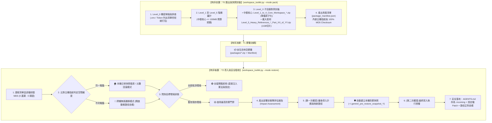

# Universal AI Agent Workspace Toolkit (v2.1.0)
**Universal Agent-Native Workspace Management, Migration & Disaster Recovery Hub**  
*通用 AI 智能體工作區全域管理、無損遷移與快照自癒中樞 (開源標準版)*

[](LICENSE)
[](https://www.python.org/downloads/)
[](https://github.com/ycaistudio/universal-agent-workspace-toolkit)
[](https://github.com/ycaistudio/universal-agent-workspace-toolkit)
[](https://github.com/ycaistudio/universal-agent-workspace-toolkit/pulls)

---

## 📖 English Overview

**Universal AI Agent Workspace Toolkit** is an enterprise-grade, agent-native workspace management toolkit designed for modern AI developers using **Google Antigravity**, **Claude Code / Desktop**, **Cursor**, and **VS Code (Cline / Roo)**.

It provides a unified, cross-platform engine (`workspace_toolkit.py`) for:
* **Export & Snapshot Backup**: Packaging neural skills, IDE configurations, and workspace documents into safe, self-contained capsules.
* **Import & Verified Restore**: Deploying to a new computer or rolling back to a known-good baseline with automatic path self-healing.
* **Integrity Audit**: 100% MD5 checksum validation against the asset manifest (`package_manifest.json`).

---

## 🇹🇼 繁體中文說明

**Universal AI Agent 工作區全域管理中樞** 專為大型 AI 開發與工程團隊打造，支援跨 Windows / macOS / Linux 雙向無損遷移、日常快照備份與災難快速自癒。

### 六大核心支柱 (Core Invariants)
1. **單一控制台 (`workspace_toolkit.py`)**：告別分散的 A/B 腳本與舊時代 `.bat` 批次檔，一套純 Python 核心全平台通用。
2. **Level_0 機密安全守門**：主動探測本機敏感憑證（.env、API Key、Token），嚴守開源資安標準拒絕打包，指引密碼管理器手動保管。
3. **全域 `Level_X` 絕對對齊**：封裝壓縮檔、子資料夾、Manifest 鍵名 100% 嚴格一致，無 AI 幻覺。
4. **中樞單檔原子化**：中樞神經（Level 1~4）總量 $\le 100$MB，保持單一檔案不分卷，遺失風險直接歸零。
5. **大檔防丟件 `Part_XX_of_YY`**：龐大素材（Level 5）採用 1GB 大顆粒切片，檔名明確標註總數與序號（如 `Part_01_of_03.zip`），徹底防呆。
6. **兩次雙重確認門禁**：解壓前產出衝擊評估報告，第一次確認後自動建立本機防禦快照，第二次確認後始准寫入，`AGENTS.md` 預設存為 `.incoming`，絕不破壞本機現有 AI 靈魂！

---

## 🇯🇵 日本語の概要

**Universal AI Agent ワークスペース管理ハブ**は、最新の AI エンジニア向けに設計された、クロスプラットフォーム対応の環境管理・移行ツールです。Google Antigravity、Cursor、Claude Code、VS Code (Cline / Roo) をサポートします。

* **安全なスナップショット出力**：エージェント指示書、MCP 設定、カスタムスキルを自己完結型パッケージに一括アーカイブ。
* **検証付きリストア**：新しい PC への移行や既知の正常ベースラインへのロールバックを、パス自動修復機能とともに実行。
* **Level_0 セキュリティ監査**：API キーや秘密情報を事前に検知し、安全な外部管理を徹底。

---

## 💡 Why This Toolkit? / 痛點分析與解決方案 / 開発背景と解決する課題

| # | 痛點維度 / Pain Point Dimension | 傳統工作區困境 (Legacy Problem) | 本工具解決方案 (Our Solution) |
| :-: | :--- | :--- | :--- |
| **1** | **跨設備遷移耗時<br>Multi-Device Setup<br>環境移行の手間** | **分散碎片化**：Agent 規則、自定義技能 (Skills)、MCP 配置散落各處，更換電腦或在多台工作站切換需手動尋找路徑並重新配置數小時。<br>*Fragmented configurations across paths require hours of manual copying and path patching on new machines.*<br>*各種設定が散在し、端末切り替え時に手動コピーとパス修正に数時間を要する。* | **一鍵無痛遷移**：單一命令自動採集 Level 1~5 全棧資產，並動態自癒跨系統路徑（自動轉譯 Windows ↔ macOS/Linux），5 秒完成還原。<br>*1-click packaging and deployment with automatic path normalization across OS platforms.*<br>*単一コマンドで全階層資産を自動収集し、OS間のパス差分を自動吸収して即時復元。* |
| **2** | **機密憑證外洩風險<br>Secret Leakage Risk<br>機密情報漏洩リスク** | **誤打包 API Keys**：傳統整包壓縮常不慎包含 .env、私鑰或私人 Token，上傳至雲端或公開代碼庫引發嚴重資安危機。<br>*Traditional full-folder archiving easily leaks .env, API keys, or private SSH keys into shared clouds.*<br>*全フォルダの一括圧縮により、.env や API キーが誤って共有ストレージへ流出する危険。* | **Level_0 零信任守門**：封裝前強制以正則深度掃描整個工作區，嚴格拒絕打包任何機密，並主動提示使用密碼管理器安全同步。<br>*Strict Level_0 pre-flight security scanner that refuses to bundle secrets and guides secure vault sync.*<br>*Level_0 セキュリティゲートが機密を検知してパッケージングを遮断、安全な同期を案内。* |
| **3** | **粗暴覆蓋踩死現有配置<br>Destructive Overwrite<br>既存設定の上書き破壊** | **盲目解壓覆蓋**：還原時直接蓋過目標目錄，抹殺現存的最新 Agent 規範與工作成果，且無法回滾撤銷。<br>*Blind extraction overwrites existing configurations without warning, destroying active work with zero rollback.*<br>*解凍時に既存の最新ルールや設定が無警告で上書きされ、復旧も不可能。* | **雙重門禁 + 自動回滾快照**：還原前呈現衝擊評估清單，自動建立全環境快照備份，且 Agent 憲章存為 .incoming 雙軌待審。<br>*2-step confirmation gate, automatic pre-restore backup snapshot, and .incoming dual-track staging.*<br>*2段階承認ゲート、復元前の自動スナップショット生成、および .incoming 二重化保存。* |
| **4** | **平台與 Shell 依賴陷阱<br>Platform & Shell Lock-in<br>プラットフォーム依存** | **綁定特定系統腳本**：過度依賴 Windows .bat 或 Linux .sh，遇到跨平台環境時執行中斷，且需安裝繁重的第三方依賴包。<br>*Dependent on OS-specific .bat or .sh scripts and heavy external dependencies, failing on cross-OS workflows.*<br>*特定の OS 向けシェルスクリプトや重い外部ライブラリに依存し、別環境で動作不能になる。* | **100% Agent-Native 純 Python**：僅使用標準函式庫（零外部依賴），跨 Windows/macOS/Linux 完全原生通用，Agent 可直接以自然語言驅動。<br>*100% pure Python standard library (zero external pip packages), fully agent-native and cross-platform.*<br>*100% Python 標準ライブラリのみで構築（追加依存ゼロ）。自然言語プロンプトで直接実行可能。* |
| **5** | **輕重資產混雜與容量超限<br>Monolithic Archive Bloat<br>大容量アーカイブの破綻** | **單一巨型壓縮包崩潰**：數十 GB 的資料集/PDF 與幾十 KB 的核心 Skills 混在一起打包，超出雲端與 GitHub 上傳上限，傳輸極易中斷。<br>*Bundling multi-GB datasets with lightweight rule files into a single huge zip breaches cloud limits and risks corruption.*<br>*巨大データと軽量ルールを単一 ZIP に混載し、クラウド転送制限超過や破損を頻発。* | **輕重資產智能分流**：核心神經層 ($\\le 100\\text{ MB}$) 單一原子封裝；海量素材層 (Level 5) 自動切為 1GB 獨立分卷 (Part_XX_of_YY.zip)，靈活傳輸。<br>*Separation of core workspace ($\\le 100\\text{ MB}$, unfragmented atomic package) and heavy media (1GB chunks).*<br>*中核設定（$\\le 100 原子パッケージ）と大容量素材（1GB 分割ボリューム）のスマート分離。* |

---

## 🧩 AI Agent 生態相容性矩陣 (Ecosystem Compatibility Matrix)

| AI Agent 開發環境 | 核心憲法指引 (Directives) | 工具擴充 (MCP Servers) | 技能擴充 (Skills) | IDE 協議免警告注入 |
| :--- | :---: | :---: | :---: | :---: |
| **Google Antigravity** | `AGENTS.md` | `~/.gemini/antigravity/mcp/` | `~/.gemini/config/skills/` | ✅ 自動注入 |
| **Cursor** | `.cursorrules` / `.cursor/rules` | `~/.cursor/mcp.json` | 轉換為 Rules 規範 | ✅ 自動注入 |
| **Claude (Code / Desktop)** | `CLAUDE.md` | `claude_desktop_config.json` | 支援 Custom Commands | ✅ 自動適配 |
| **VS Code (Cline / Roo)** | `.clinerules` | `cline_mcp_settings.json` | 增量導入 | ✅ 自動注入 |
| **Windsurf** | `.windsurfrules` | 通用 JSON 規範 | 增量導入 | ✅ 自動注入 |

---

## 🛡️ 六級資產防禦階梯 (Asset Defense Hierarchy)

| 資產防禦級別 | 對應子目錄與封裝命名 | 包含檔案內容 | 處理策略與防禦機制 |
| :--- | :--- | :--- | :--- |
| **Level_0<br>(機密憑證)** | *(不建立目錄)* | `.env`, API Keys, 私鑰, 憑證 (`id_rsa`, `auth.json`) | **❌ 100% 拒絕打包**：主動掃描路徑，提示使用者透過密碼管理器手動備份。 |
| **Level_1<br>(智能體憲法)** | `Level_1_Agent_Directives/` | `AGENTS.md`, `CLAUDE.md`, `.cursorrules` | **🔴 極高危單例保護**：預設 100% 保留本機舊檔，新版存為 `.incoming` 雙軌比對，需兩次確認始准覆蓋。 |
| **Level_2<br>(系統底層設定)** | `Level_2_System_Settings/` | `ide_user_settings.json`, MCP 伺服器配置 | **🟠 僅做 Patch 增補**：僅注入通訊協議（如 `file:///` 免警告），絕不覆蓋本機原有字型與外觀。 |
| **Level_3<br>(模組化技能庫)** | `Level_3_Modular_Skills/` | 各獨立 Skill 資料夾 (`SKILL.md`, scripts, manifest) | **🟢 無損導入**：可插拔模組化元件，同名技能安全跳過，新技能自動增補。 |
| **Level_4<br>(專案工程文檔)** | `Level_4_Workspace_Docs/` | Markdown 筆記、SOP、S-Curve 腳本、日常工作流 | **📘 增量同期**：工作區檔案增量解壓至目標目錄（同名檔案保留本機舊檔）。 |
| **Level_5<br>(龐大素材資料)** | `Level_5_Heavy_References/` | 大型 PDF、影音素材、大資料庫 (>10MB 或數 GB) | **⚪ 獨立可選分卷**：採用 1GB 大顆粒切片 (`Part_XX_of_YY.zip`)，由使用者自決是否打包或解壓。 |

---

## 📊 視覺化架構圖 (Visual Architecture Flow)



---

## 🚀 Quick Start (快速上手)

### 1. 🤖 Agent-Native Mode (Recommended · 自然語言對答模式 · 推薦首選)
無需死記任何終端命令，直接在您習慣的 AI Agent 對話框（Antigravity / Cursor / Claude / VS Code）以日常語言吩咐即可：

* **【情境 A：日常快照備份與匯出】(Snapshot Backup & Export)**
  - 💬 **English**: `"Please export a snapshot backup of my AI workspace"`
  - 💬 **繁體中文**: `「請幫我建立 AI 工作區快照備份 / 匯出封裝包」`
  - 💬 **日本語**: `「AI ワークスペースのスナップショットを作成・エクスポートしてください」`
  *(AI Agent 會自動探測 Level_0 機密憑證守門、呈現資產審計，並自動封裝至 packages/ 目錄)*

* **【情境 B：新機部署導入與安全還原】(Import & Verified Restore)**
  - 💬 **English**: `"I've placed the workspace package here, please verify and restore it"`
  - 💬 **繁體中文**: `「我已放好工作區封裝包，請幫我執行完整性校驗並安全還原」`
  - 💬 **日本語**: `「パッケージを配置しました。整合性を検証し、安全に復元してください」`
  *(AI Agent 會自動產出部署前衝擊評估報告、建立本機防禦快照、兩次確認門禁授權，並自癒跨平台路徑)*

---

### 2. 💻 Terminal CLI Mode (Advanced & Automation · 進階命令行與自動化)
適用於工程師直接在終端機操作或 CI/CD 無人值守自動化流程：

```bash
# 啟動交互式三語控制台 (Interactive Console with Auto-detected Language)
python workspace_toolkit.py

# 一鍵匯出中樞神經快照 (One-click Snapshot Export)
python workspace_toolkit.py --mode pack -y

# 執行校驗與安全還原 (Import & Verified Restore with 2-Step Gate)
python workspace_toolkit.py --mode restore

# 僅做完整性審計與健康體檢 (Scan & Manifest Audit, Zero File Mutation)
python workspace_toolkit.py --mode inspect

# 手動指定語言 (Manual Language Switch)
python workspace_toolkit.py --lang en      # English
python workspace_toolkit.py --lang zh-tw   # 繁體中文
python workspace_toolkit.py --lang ja      # 日本語
```

---

## ❓ FAQ 常見問題解答 (Frequently Asked Questions)

### Q1: 我的 API Key、密碼會否不小心被打包或上傳到 GitHub？
**絕對不會。** 本工具設有強制性「Level_0 機密安全守門機制」，在掃描階段自動探測 `.env`、API Key、Token、私鑰等機密檔案，將其列入嚴格排他清單，**100% 拒絕打包**。此外專案配有完整的 `.gitignore`，徹底杜絕金鑰外洩風險。

### Q2: 如果目標電腦原本就有一份使用中的 `AGENTS.md`，還原時會被覆蓋沖掉嗎？
**絕對不會。** 系統在還原時會詢問環境現狀。若為「舊有現存環境」，系統啟動最高防禦策略：**100% 保留目標電腦現行版本**，來源版本將安全命名為 `AGENTS.md.incoming` 雙軌落地，絕不破壞本機現有 AI 靈魂設定。

### Q3: 可以在同一部電腦上做日常快照與災難回滾嗎？
**可以，而且是原生支援！** 工具會讀取發貨單內嵌的 `machine_fingerprint`（主機名稱與使用者帳號）。若偵測到當前為主機本機，系統會自動切換為「本機時光機模式」，不執行不必要的路徑變更，直接進行安全回滾。

### Q4: 跨平台遷移時，Windows 與 macOS / Linux 的路徑差異如何處理？
系統內建「動態路徑自癒引擎」，在跨平台遷移時會自動正則掃描 Markdown、JSON 與設定檔，將舊機路徑（例如 `file:///C:/Users/UserA/`）精準轉譯為新機路徑（例如 `file:///Users/UserB/`），並保留所有內文純文字與鏈接結構。

---

## 📁 Repository Structure (倉庫目錄結構)

```text
universal-agent-workspace-toolkit/
├── workspace_toolkit.py          # Unified Master CLI & Agent-Native Console
├── toolkit_i18n.py               # Internationalization Engine (EN / ZH-TW / JA)
├── toolkit_scanner.py            # Level_0 Credential & Level_1~5 Asset Scanner
├── toolkit_pack.py               # Staging, Manifest & Zip Compression Engine
├── toolkit_restore.py            # Impact Assessment, Rollback Snapshot & Restore Engine
├── SKILL.md                      # Agent Skill Specification (Antigravity / Claude)
├── AI_GUIDED_WIZARD_PROMPTS.md   # Proactive Natural Language Dialogue Prompts
├── README.md                     # Bilingual Master Documentation
├── AGENTS.md                     # Agent Autonomous Bootstrapper & Directives
└── .gitignore                    # Git Ignore Rules
```

---

## 📄 License
This project is licensed under the MIT License - see the [LICENSE](LICENSE) file for details.
