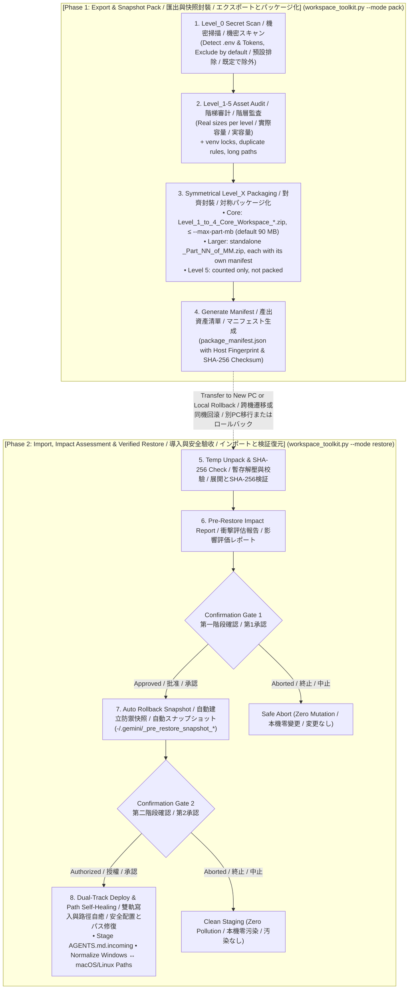

# Universal AI Agent Workspace Toolkit
**Universal Agent-Native Workspace Management, Migration & Disaster Recovery Hub**  
*通用 AI 智能體工作區全域管理、遷移與快照還原工具 (開源標準版)*  
*汎用 AI エージェント ワークスペース全域管理・移行・スナップショット復元ツール (オープンソース標準版)*  

Google Antigravity · Claude Code · Cursor · VS Code (Cline / Roo) · **Grok Bot**

[](https://www.python.org/downloads/)
[](https://github.com/ycaistudio/universal-agent-workspace-toolkit)
[](https://github.com/ycaistudio/universal-agent-workspace-toolkit)
[](https://github.com/ycaistudio/universal-agent-workspace-toolkit/pulls)

---

<p align="center">
  <b>🌐 Language Navigation / 多語言切換 / 言語切り替え:</b><br>
  <a href="README.md"><b>🇬🇧 English (Master)</b></a> •
  <a href="README_zh-TW.md"><b>🇹🇼 繁體中文手冊</b></a> •
  <a href="README_ja.md"><b>🇯🇵 日本語マニュアル</b></a>
</p>

---

---

## ⚠️ Disclaimer & Environment Notice / 免責聲明與環境說明 / 免責事項および利用環境

> [!WARNING]
> **🇬🇧 English: Data Privacy, User Responsibility & Agent Adaptation Notice**
> - **Purpose of this Project**: This toolkit was created with the sole intention of helping developers and AI users by providing an accessible, simplified, and convenient way to back up and restore AI agent workspaces and configuration files.
> - **Target Environment Baseline**: The current configuration, directory mappings, and restore plans are tailored based on the author's primary active AI Agent environments (**Google Antigravity** and **Grok Bot**). When using with other AI Agents (such as Cursor, Claude Code, VS Code / Cline / Roo, etc.), **you must consult with your specific AI Agent** to determine how best to adapt, map, and coordinate the directory structures and restoration workflows for that environment.
> - **User's Sole Responsibility for Data Security**: The backup archives generated by this tool may contain personal private data, confidential codebase files, sensitive configurations, API tokens, or environmental metadata. **Users must take full and exclusive responsibility for safeguarding, encrypting, properly storing, and managing their backup files.** Always use the built-in encryption feature (`--encrypt`) when packaging sensitive materials.
> - **Limitation of Liability**: The author and contributors assume **NO liability or legal responsibility whatsoever** for any data loss, leakage of confidential information, security incidents, unauthorized access, or any direct/indirect damages resulting from the use or misuse of this toolkit. All risks and responsibilities rest entirely with the user.

> [!WARNING]
> **🇹🇼 繁體中文：資料隱私、使用者責任與不同 AI Agent 協同提醒**
> - **本工具開發初衷**：我製作這個工具的初衷，純粹是希望為大家提供一個更簡單、便利且標準化的方式，來備份與還原 AI Agent 的工作區及各項設定檔。
> - **適用環境基準**：目前的各項設定、預設路徑與映射邏輯，主要是**根據我個人現時主要使用的 AI Agent（Google Antigravity 與 Grok Bot）的設定環境去量身製作**。若您使用其他 AI Agent（例如 Cursor、Claude Code、VS Code / Cline / Roo 等），**在使用前需要先與該 AI Agent 深入討論，確認如何針對其特定的目錄結構與需求來配合調整使用**。
> - **使用者自行保管與保密全責**：使用本工具打包生成的備份檔案中，可能包含您個人的私人資料、敏感資訊、專案核心原始碼或本機環境配置。**使用者必須自行全權負責妥善保管、加密與保密所有備份檔案**。處理敏感資產時，強烈建議啟用內建加密功能（`--encrypt`）。
> - **免責與責任限制**：作者及貢獻者**概不承擔任何責任**。若因使用本工具、檔案保管不當、未加密傳輸或任何意外而導致資料遺失、敏感資訊外洩、資安漏洞或任何損壞，所有後果與責任均由使用者自行承擔。

> [!WARNING]
> **🇯🇵 日本語：データプライバシー、利用者の自己責任および他エージェントとの協調について**
> - **本ツールの開発趣旨**：本ツールは、利用者の皆様が AI エージェントのワークスペースや各種設定ファイルを、より簡単かつ便利にバックアップ・復元できる手段を提供したいという思いから作成されました。
> - **対象環境の基準**：現在の各種設定、既定のパスおよびマッピング構造は、**作者が現在主に使用している AI エージェント（Google Antigravity および Grok Bot）の利用環境に基づいて構築されています**。その他の AI エージェント（Cursor、Claude Code、VS Code / Cline / Roo など）でご利用になる場合は、**その AI エージェントと事前に相談し、ディレクトリ構成や要件に合わせてどのように連携・調整すべきかを確認した上でご使用ください**。
> - **利用者の自己管理および機密保持責任**：本ツールで生成されたバックアップパッケージには、利用者の個人情報、機密データ、プロジェクトのソースコード、環境設定などが含まれる可能性があります。**生成されたすべてのバックアップファイルの適切な保管、暗号化、およびセキュリティ管理の責任は、すべて利用者自身が負うものとします**。機密資産を扱う際は、必ず内蔵の暗号化機能（`--encrypt`）をご活用ください。
> - **責任の制限（免責）**：作者および貢献者は、本ツールの使用、不適切な保管、暗号化されていない転送、またはその他の事由により生じたいかなるデータ損失、機密情報の漏洩、セキュリティ事故、または直接的・間接的損害について、**一切の責任を負いません**。すべての責任と結果は利用者自身に帰属します。


## 📖 Overview / 專案簡介 / プロジェクト概要

### 🇬🇧 English
**Universal AI Agent Workspace Toolkit** is an enterprise-grade, agent-native workspace management toolkit for **Google Antigravity**, **Claude Code / Desktop**, **Cursor**, **VS Code (Cline / Roo)**, and **Grok Bot**.

It provides a unified, cross-platform engine (`workspace_toolkit.py`) for:
* **Export & Snapshot Backup**: Packaging neural skills, IDE configurations, and workspace documents into safe, self-contained capsules.
* **Import & Verified Restore**: Deploying to a new computer or rolling back to a known-good baseline with automatic path self-healing.
* **Integrity Audit**: SHA-256 checksum validation against the asset manifest (`package_manifest.json`). It detects corruption, not tampering.

### 🇹🇼 繁體中文
**Universal AI Agent 工作區全域管理中樞** 支援 **Google Antigravity**、**Claude Code / Desktop**、**Cursor**、**VS Code (Cline / Roo)** 與 **Grok Bot**，可在 Windows / macOS / Linux 上做快照備份與還原。Antigravity 依其目錄結構使用；Grok Bot 是獨立設定檔（見下方專節）。Claude Code、Cursor、VS Code 尚未實機測試。

提供單一跨平台控制台 (`workspace_toolkit.py`) 達成：
* **匯出與快照備份**：將智能體自定義技能、IDE 設定及工程文檔打包為安全自包含的資產包。
* **驗收與安全還原**：支援跨電腦遷移或同機基線回滾，具備全自動跨平台路徑自癒能力。
* **完整性審計**：依據發貨清單 (`package_manifest.json`) 執行 SHA-256 Checksum 驗證（可偵測損毀，不防竄改）。

### 🇯🇵 日本語
**Universal AI Agent ワークスペース管理ハブ**は、**Google Antigravity**、**Claude Code / Desktop**、**Cursor**、**VS Code (Cline / Roo)**、**Grok Bot** 向けのクロスプラットフォームなスナップショットと復元ツールです。Antigravity はそのディレクトリ構成で使います。Grok Bot は別プロファイルです（下の節）。Claude Code、Cursor、VS Code は実機未確認です。

統合エンジン (`workspace_toolkit.py`) により以下を提供します：
* **エクスポートとスナップショット出力**：カスタムスキル、IDE 設定、ワークスペース文書を安全な独立アーカイブに集約。
* **検証付きリストア**：新しい PC への移行や既知の正常ベースラインへのロールバックを、パス自動修復機能とともに実行。
* **整合性監査**：資産マニフェスト (`package_manifest.json`) に基づく SHA-256 チェックサム検証（破損検知用。改ざん防止ではありません）。


---

## 🏛️ Core Invariants / 六大核心支柱 / 6つの基本原則

### 🇬🇧 English
1. **Unified Agent Console (`workspace_toolkit.py`)**: One cross-platform Python CLI replacing legacy split A/B scripts and platform-locked `.bat`/`.sh` wrappers.
2. **Level_0 Secret Gatekeeper**: Pre-flight scan for known credential files (`.env`, `id_rsa`, `auth.json`, ...), private-key blocks and real-format API tokens. They are excluded by default and MCP secret values are replaced by a placeholder. `--include-secrets` packs them. Detection is by file name and pattern, so read the report.
3. **Strict Symmetrical Hierarchy**: Subfolders, archive zip files, and manifest keys strictly mirror Level 1 through Level 5 with zero AI hallucination.
4. **Capped Core Capsule**: Core assets (Level 1-4) go into one zip when they fit under `--max-part-mb` (default 90, hard max 95 decimal MB). A larger kit is split into standalone `_Part_NN_of_MM.zip` files, each with its own manifest slice; restore needs every part and verifies all of them.
5. **Level 5 heavy media**: counted in the audit but not packed. Model weights (`.onnx`, `.pt`, `.ckpt`, `.safetensors`, `.bin`, ...) of 5 MB or more are Level 5 unless `--include-bulky`.
6. **Two-Step Confirmation Gate**: Pre-restore impact assessment report ➔ User Confirmation 1 ➔ Automatic rollback snapshot (`-/.gemini/_pre_restore_snapshot_*`) ➔ User Confirmation 2 ➔ Staging `AGENTS.md` as `.incoming` without clobbering live agent setups.

### 🇹🇼 繁體中文
1. **單一控制台 (`workspace_toolkit.py`)**：告別分散的 A/B 腳本與舊時代 `.bat` 批次檔，一套純 Python 核心全平台通用。
2. **Level_0 機密安全守門**：預設排除已知憑證檔案、私鑰區塊與真實格式的 API Token，MCP 設定內的機密值以佔位符取代；可用 `--include-secrets` 明確指定打包。偵測依檔名與格式比對，請檢視報告。
3. **全域 `Level_X` 絕對對齊**：封裝壓縮檔、子資料夾、Manifest 鍵名保持一致。
4. **每份設上限的核心封裝**：Level 1-4 放得進 `--max-part-mb`（預設 90，十進位上限 95）時打包成一個 ZIP；更大時拆成可獨立開啟的 `_Part_NN_of_MM.zip`，每份附自己的清單；還原需要全部分件並逐一驗證。
5. **Level 5 大檔**：只在審計表計數，不打包。5 MB 以上的模型權重（`.onnx`、`.pt`、`.ckpt`、`.safetensors`、`.bin` 等）除非加 `--include-bulky`，否則歸入 Level 5。
6. **兩次雙重確認門禁**：解壓前產出衝擊評估報告，第一次確認後自動建立本機防禦快照，第二次確認後始准寫入，`AGENTS.md` 預設存為 `.incoming`，絕不破壞本機現有 AI 靈魂！

### 🇯🇵 日本語
1. **単一コンソール統合 (`workspace_toolkit.py`)**：従来の散在した A/B スクリプトや OS 依存の `.bat`/`.sh` を廃止し、単一の純粋な Python スクリプトで全環境を横断サポート。
2. **Level_0 機密セキュリティゲート**：既知の認証情報ファイル、秘密鍵ブロック、実在形式の API トークンを既定で除外し、MCP 設定内の機密値はプレースホルダーに置換します。`--include-secrets` で明示的に含められます。検出はファイル名とパターンに基づくため、レポートを確認してください。
3. **階層構造の完全対称性**：圧縮ファイル名、内部サブディレクトリ、Manifest キー名を Level 1〜5 で統一。
4. **上限付きの中核パッケージ**：中核（Level 1〜4）は `--max-part-mb`（既定 90、10 進の上限 95）に収まれば 1 つの ZIP に、超えれば単独で開ける `_Part_NN_of_MM.zip` に分け、各パートに自分のマニフェストを持たせます。復元には全パートが必要で、すべて検証します。
5. **Level 5 大容量メディア**：監査表に件数のみ表示し、梱包しません。5 MB 以上のモデルの重み（`.onnx`、`.pt`、`.ckpt`、`.safetensors`、`.bin` など）は `--include-bulky` が無い限り Level 5 です。
6. **2段階承認ゲートと自動保護**：展開前に影響評価レポートを出力 ➔ 第1承認 ➔ 自動スナップショット作成 ➔ 第2承認 ➔ `AGENTS.md` を `.incoming` として安全配置し、既存環境を破壊しません。


---

## 💡 Why This Toolkit? / 痛點分析與解決方案 / 開発背景と解決する課題

| # | Dimension / 痛點維度 / 課題分類 | Legacy Problem / 傳統工作區困境 / 従来の課題 | Our Solution / 本工具解決方案 / 本ツールの解決策 |
| :-: | :--- | :--- | :--- |
| **1** | **Multi-Device Setup<br>跨設備遷移耗時<br>環境移行の手間** | **🇬🇧 Fragmented Setup**: Rules, skills, and MCP configs are scattered across system paths, requiring hours of manual copying and path fixing on new machines.<br>**🇹🇼 分散碎片化**：Agent 規則、技能、MCP 配置散落各處，更換電腦需手動尋找路徑並重新配置數小時。<br>**🇯🇵 環境の断片化**：各種設定が散在し、端末切り替え時に手動コピーとパス修正に数時間を要する。 | **🇬🇧 1-Click Migration**: Single command collects Level 1-5 assets and auto-heals cross-OS paths (Windows ↔ macOS/Linux) quickly.<br>**🇹🇼 一鍵無痛遷移**：單一命令自動採集 Level 1-5 全棧資產，並動態自癒跨系統路徑。<br>**🇯🇵 ワンクリック移行**：単一コマンドで全階層資産を自動収集し、OS間のパス差分を自動吸収して即時復元。 |
| **2** | **Secret Leakage Risk<br>機密憑證外洩風險<br>機密情報漏洩リスク** | **🇬🇧 Accidental Key Leaks**: Full-folder archiving easily bundles `.env`, API keys, or private SSH keys into shared clouds or public repos.<br>**🇹🇼 誤打包 API Keys**：傳統整包壓縮常不慎包含 `.env`、私鑰或私人 Token，上傳至雲端引發嚴重資安危機。<br>**🇯🇵 秘密情報の誤混入**：全フォルダの一括圧縮により、`.env` や API キーが誤って共有ストレージへ流出する危険。 | **🇬🇧 Level_0 secret gate**: Known credential files and token patterns are excluded by default, MCP secret values are replaced by a placeholder, and the report lists every exclusion. `--include-secrets` overrides.<br>**🇹🇼 Level_0 機密守門**：已知憑證檔案與 Token 格式預設排除，MCP 機密值以佔位符取代，報告列出所有排除項目；`--include-secrets` 可覆寫。<br>**🇯🇵 Level_0 機密ゲート**：既知の認証情報ファイルとトークン形式を既定で除外し、MCP の機密値はプレースホルダーに置換、除外項目をレポートに一覧表示。`--include-secrets` で上書き可能。 |
| **3** | **Destructive Overwrite<br>粗暴覆蓋現有配置<br>既存設定の上書き破壊** | **🇬🇧 Blind Overwrite**: Standard extraction overwrites active files without warning, destroying existing rules with zero rollback.<br>**🇹🇼 盲目解壓覆蓋**：還原時直接蓋過目標目錄，抹殺現存最新規範與成果，且無法回滾撤銷。<br>**🇯🇵 無警告の上書き**：解凍時に既存の最新ルールや設定が無警告で上書きされ、復旧も不可能。 | **🇬🇧 2-Step Gate + Snapshot**: Pre-restore impact report, automatic rollback snapshot, and `.incoming` dual-track staging.<br>**🇹🇼 雙重門禁 + 自動快照**：還原前呈現衝擊評估，自動建立全環境備份快照，`AGENTS.md` 存為 `.incoming` 雙軌待審。<br>**🇯🇵 2段階承認 + 自動保護**：復元前に影響評価を提示し、自動スナップショット生成と `.incoming` 二重化保存を実行。 |
| **4** | **Platform Lock-in<br>平台與腳本依賴陷阱<br>プラットフォーム依存** | **🇬🇧 OS-Specific Scripts**: Heavy reliance on Windows `.bat` or Linux `.sh` scripts and external pip packages breaks cross-OS workflows.<br>**🇹🇼 綁定特定系統腳本**：過度依賴 `.bat` 或 `.sh` 及第三方依賴包，遇到跨平台環境時執行中斷。<br>**🇯🇵 OS 依存スクリプト**：特定の OS 向けスクリプトや外部ライブラリに依存し、別環境で動作不能になる。 | **🇬🇧 100% Pure Python**: Built strictly with Python standard library (zero external dependencies), driven natively via Agent prompts.<br>**🇹🇼 100% 純 Python 標準庫**：零外部依賴，跨 Windows/macOS/Linux 原生通用，Agent 可直接以自然語言驅動。<br>**🇯🇵 100% 標準 Python**：追加依存ゼロの純粋な Python 標準ライブラリで構築。自然言語で直接駆動可能。 |
| **5** | **Archive Bloat<br>輕重資產混雜超限<br>大容量アーカイブの破綻** | **🇬🇧 Monolithic Zip Failure**: Bundling multi-GB datasets with lightweight rules into one massive zip breaches cloud upload limits.<br>**🇹🇼 單一巨型壓縮包崩潰**：數十 GB 資料集與幾十 KB 核心規則混雜打包，超出雲端與 GitHub 上傳上限。<br>**🇯🇵 単一巨大 ZIP の破綻**：巨大データと軽量ルールを単一 ZIP に混載し、クラウド転送制限超過や破損を頻発。 | **🇬🇧 Core vs heavy assets, capped parts**: Levels 1-4 are packed; no zip is larger than `--max-part-mb` (default 90, max 95). A bigger kit is split into standalone `_Part_NN_of_MM.zip` files. Heavy media and model weights (Level 5) are counted but not packed.<br>**🇹🇼 核心與大檔分流、每份設上限**：Level 1-4 會打包；每個 ZIP 不超過 `--max-part-mb`（預設 90，最大 95），超過就拆成可獨立開啟的 `_Part_NN_of_MM.zip`。Level 5 大檔與模型權重只計數、不打包。<br>**🇯🇵 中核と大容量素材の分離・上限付きパート**：Level 1〜4 を梱包し、どの ZIP も `--max-part-mb`（既定 90、最大 95）を超えません。超える場合は単独で開ける `_Part_NN_of_MM.zip` に分けます。Level 5 の大容量素材とモデルの重みは件数のみ表示して梱包しません。 |


---

## 🧩 Ecosystem Compatibility Matrix / 生態相容性矩陣 / エコシステム対応状況

| Support Tier / 支援層級 | Platform / 開發環境 / プラットフォーム | Directives / 核心憲法 / 指示書 | MCP Servers / 工具擴充 / MCP設定 | Skills / 技能擴充 / スキル | Status / 狀態與驗證說明 |
| :--- | :--- | :---: | :---: | :---: | :--- |
| **Implemented<br>實裝全量驗收<br>実装・検証済** | **Google Antigravity** | `AGENTS.md` | `~/.gemini/antigravity/mcp/` | `~/.gemini/config/skills/` | ✅ **Fully Implemented & E2E Verified**.<br>Native directory adapter, path self-healing, and automated tests. |
| **Implemented<br>實裝全量驗收<br>実装・検証済** | **Grok Bot** | `agents/<uuid>/profile.json` → `.incoming` | No MCP. Settings and routines to `.incoming` | `agent-data/workflows/` (user skills) | ✅ **Fully Implemented & E2E Verified**.<br>Dedicated Grok engine (`toolkit_grok.py`), memory-drop, and read-only DB snapshots. |
| **Experimental<br>實驗性支援<br>実験的対応** | **Cursor** | `.cursorrules` / `.cursor/rules` | `~/.cursor/mcp.json` | Rules Detection | 🟡 **Experimental**.<br>Rule and stores inspection supported. Not a standalone agent runtime adapter. |
| **Experimental<br>實驗性支援<br>実験的対応** | **VS Code (Cline / Roo)** | `.clinerules` | `cline_mcp_settings.json` | Incremental import | 🟡 **Experimental**.<br>Detects rules & MCP definitions. Security prompt bypass is explicit opt-in only. |
| **Experimental<br>實驗性支援<br>実験的対応** | **Claude (Code / Desktop)** | `CLAUDE.md` | `claude_desktop_config.json` | Custom commands | 🟡 **Experimental**.<br>Basic file detection and desktop JSON mapping. |
| **Planned<br>規劃中尚未實作<br>計画中・未実装** | **Windsurf** | `.windsurfrules` | Standard JSON | Planned | ⚪ **Planned**.<br>Full adapter planned for future releases. |

--- | :---: | :---: | :---: | :---: |
| **Google Antigravity** | `AGENTS.md` | `-/.gemini/antigravity/mcp/` | `-/.gemini/config/skills/` | ✅ Auto-Injected / 自動注入 / 自動注入 |
| **Cursor** | `.cursorrules` / `.cursor/rules` | `-/.cursor/mcp.json` | Rules Adaptation / 轉換規範 / ルール変換 | ✅ Auto-Injected / 自動注入 / 自動注入 |
| **Claude (Code / Desktop)** | `CLAUDE.md` | `claude_desktop_config.json` | Custom Commands / 支援命令 / コマンド対応 | ✅ Auto-Adapted / 自動適配 / 自動適合 |
| **VS Code (Cline / Roo)** | `.clinerules` | `cline_mcp_settings.json` | Incremental / 增量導入 / 増分導入 | ✅ Auto-Injected / 自動注入 / 自動注入 |
| **Windsurf** | `.windsurfrules` | Standard JSON / 通用規範 / 標準JSON | Incremental / 增量導入 / 増分導入 | ✅ Auto-Injected / 自動注入 / 自動注入 |
| **Grok Bot** | `agents/<uuid>/profile.json` → `.incoming` / 另存 `.incoming` / `.incoming` で保存 | No MCP. Settings and routines are `.incoming` only / 不覆蓋 live 設定 / 稼働中設定は上書きしない | `agent-data/workflows/` (user skills). `managed-skills/` and `plugin-skills/` are not packed | Not injected. Level_6 memory-drop + Level_7 read-only conversations / 不注入 / 注入しない |


---

## 🛡️ Asset Defense Hierarchy / 資產防禦階梯 / 資産防護階層

| Level / 級別 / 階層 | Directory / 目錄名稱 / ディレクトリ | Contained Assets / 包含內容 / 構成要素 | Defense Strategy / 防禦策略 / 防護戦略 |
| :--- | :--- | :--- | :--- |
| **Level_0<br>Credentials<br>機密憑證<br>機密情報** | *(None / 不建立目錄 / 作成なし)* | `.env`, API Keys, Private Keys, Tokens (`id_rsa`, `auth.json`); by name: `*secret*`, `*token*`, `*credential*`, `*cookie*`, `*key*.json`, `*.pem`, `*.key`, `credentials/` | **❌ Excluded by default / 預設排除 / 既定で除外**<br>🇬🇧 Known credential files and token patterns are skipped; `--include-secrets` overrides.<br>🇹🇼 已知憑證檔案與 Token 格式預設略過；`--include-secrets` 可明確指定打包。<br>🇯🇵 既知の認証情報ファイルとトークン形式は既定でスキップ。`--include-secrets` で明示的に含められます。 |
| **Level_1<br>Directives<br>智能體憲法<br>基本指示書** | `Level_1_Agent_Directives/` | `AGENTS.md`, `CLAUDE.md`, `.cursorrules` | **🔴 Single-Instance Protection / 極高危單例保護 / 最高保護**<br>🇬🇧 In existing-agent mode the local file is kept and the incoming version is saved as `.incoming`.<br>🇹🇼 「現存環境」模式下保留本機舊檔，新版另存為 `.incoming`。<br>🇯🇵 「既存環境」モードでは現行ファイルを保持し、新しい版は `.incoming` として保存。 |
| **Level_2<br>System Settings<br>系統底層設定<br>システム設定** | `Level_2_System_Settings/` | `ide_user_settings.json`, MCP Configs | **🟠 Incremental Key Patch / 僅做 Patch 增補 / パッチ追記**<br>🇬🇧 Only injects protocol keys (e.g. `file:///` bypass); preserves UI/themes.<br>🇹🇼 僅注入通訊協議免警告設定，絕不覆蓋本機原有字型與外觀。<br>🇯🇵 プロトコル設定のみをパッチ注入し、既存のフォントや外観テーマを維持。 |
| **Level_3<br>Modular Skills<br>模組化技能庫<br>モジュールスキル** | `Level_3_Modular_Skills/` | Skill Folders (`SKILL.md`, `scripts/`, `manifest`) | **🟡 Merge Import / 合併導入 / マージ**<br>🇬🇧 New skills are added. Same-named skill files are overwritten by the packaged version (local-only files are kept); the rollback snapshot holds the previous copy.<br>🇹🇼 新技能會增補；同名技能檔案會被封裝版本覆寫（僅存在於本機的檔案保留），還原快照保存舊版。<br>🇯🇵 新しいスキルは追加されます。同名のスキルファイルはパッケージ版で上書きされ（ローカルのみのファイルは保持）、以前の内容はロールバック用スナップショットに残ります。 |
| **Level_4<br>Workspace Docs<br>專案工程文檔<br>プロジェクト文書** | `Level_4_Workspace_Docs/` | Markdown Notes, SOPs, Python Scripts | **🔵 Incremental Sync / 增量同步 / 増分同期**<br>🇬🇧 Syncs workspace files while preserving newer local files on target.<br>🇹🇼 工作區檔案增量同步，目標目錄已有之同名檔案保留本機最新版。<br>🇯🇵 ワークスペース文書を増分同期（移行先の新しい同名ファイルは維持）。 |
| **Level_5<br>Heavy Media<br>龐大素材資料<br>大容量メディア** | `Level_5_Heavy_References/` | Large PDFs, Videos, Datasets (>10MB - GBs); model weights ≥ 5 MB (`.onnx` `.pt` `.ckpt` `.safetensors` `.bin` ...) | **⚪ Not packed / 目前不打包 / 現在は梱包しません**<br>🇬🇧 Counted in the audit but not packed. Model weights come back with `--include-bulky`. Levels 1-4 are split into parts when they exceed `--max-part-mb`.<br>🇹🇼 只在審計表計數，不打包。模型權重可用 `--include-bulky` 帶回。Level 1-4 超過 `--max-part-mb` 時會拆成分件。<br>🇯🇵 監査表に件数のみ表示し、梱包しません。モデルの重みは `--include-bulky` で戻せます。Level 1〜4 は `--max-part-mb` を超えるとパートに分けます。 |
| **Level_6<br>Memory drop<br>記憶匯出<br>メモリ書き出し** | `Level_6_Memory_Drop/` | Grok memory-drop JSONL (`shared-user/`, `agents/<uuid>/`) | **🟣 Incoming only / 只進 incoming / incoming のみ**<br>🇬🇧 Packed. Restore does not write platform memory. Each bot imports its own `fact` lines.<br>🇹🇼 會打包。還原不寫入平台記憶，需由各 Bot 自行匯入 `fact`。<br>🇯🇵 梱包します。復元はプラットフォームのメモリを書きません。各 Bot が自分の `fact` を取り込みます。 |
| **Level_7<br>Conversations<br>對話快照<br>会話スナップショット** | `Level_7_Conversations/` | Read-only `search-index.db` snapshot, each bot's `store.db` snapshot, + `agent-transcripts/` | **🔒 Not restored over live data / 不覆蓋 live 資料 / 稼働中データは上書きしない**<br>🇬🇧 SQLite `backup()` snapshots plus transcripts. Never replace the live index, `store.db`, or transcripts.<br>🇹🇼 以 SQLite `backup()` 做快照並附上逐字稿。絕不取代 live 索引、`store.db` 或逐字稿。<br>🇯🇵 SQLite `backup()` のスナップショットとトランスクリプト。稼働中の索引、`store.db`、逐字稿は置き換えません。 |
| **Level_8<br>Cursor stores<br>實驗性清單<br>実験的一覧** | `Level_8_Cursor_Stores_Experimental/` | `/cursor/stores` when `--include-cursor-stores` is set | **Opt-in / 選擇性 / 任意**<br>🇬🇧 Contents are packed only with that flag. Restore does not write `/cursor/stores`.<br>🇹🇼 只有加上該旗標才打包內容。還原不寫回 `/cursor/stores`。<br>🇯🇵 そのフラグがあるときだけ中身を梱包します。復元は `/cursor/stores` を書きません。 |


---

## Grok Bot profile / Grok Bot 設定檔 / Grok Bot プロファイル

### 🇬🇧 English

`--profile auto` is the default. It selects **Grok Bot** when the agent-data directory exists (`GROK_AGENT_DATA`, else `AGENT_DATA`, else `/home/box/agent-data`). If that directory is missing, the run stays on **Antigravity**, even when `/workspace` exists for another reason. `--profile grok` and `--profile antigravity` override `UAWT_PROFILE`. If `--profile` is omitted, `UAWT_PROFILE` may be `auto`, `grok`, or `antigravity`. An explicit `--profile auto` does not read `UAWT_PROFILE`.

| Level | What is packed |
| :--- | :--- |
| 1 | `profile.json`, `avatar.*`, `group.json`; workspace files named `AGENTS.md`, `CLAUDE.md`, `.cursorrules`, `.clinerules` |
| 2 | `settings.json`, `automations/` (an empty `automations/` is reported as routines 0), other files in the bot directory, loose files directly under `agents/`, and folders under `agents/` whose names are not agent ids. `store.db` is not packed at this level |
| 3 | `agent-data/workflows/` only |
| 4 | other workspace files; each bot's `notes/`, `reference/`, `attachments/`, `private/`; `agent-data/projects/` |
| 5 | Counted, not packed: larger than 10 MiB, or suffix `.mp4` `.mov` `.avi` `.iso` `.dmg` `.tar` `.gz`. Levels 1, 3, 6, 7, and 8 are not moved here |
| 6 | Files already in the memory-drop directory (JSONL, and other files there such as `memory-status.json`), plus `agent-data/user-memory/` and each bot's `memory/` |
| 7 | SQLite `backup()` of `agent-data/search-index.db`, stored as `search-index-snapshot.db`; each bot's `store.db`, stored as `agent-stores/<id>/store-snapshot.db` (`store.db-wal` and `store.db-shm` are omitted); plus `agent-transcripts/`. The pre-pack audit counts these snapshots and `conversation-stats.json` |
| 8 | `/cursor/stores` only with `--include-cursor-stores` |

Left out unless you opt in:

* Secrets, unless `--include-secrets`: `box-secrets.json`, `host-secrets.json`, `chrome-cookie-seed.json`, `gateway.json`, `teach-queue-key.json`, any top-level `*-secrets.json` in agent-data, and the Level_0 file-name and token rules. Secret-shaped JSON values that remain in a packed file are replaced with `__REDACTED_RESTORE_MANUALLY__`.
* `managed-skills/` and `plugin-skills/` are never packed. There is no flag for them.
* Directories named `sand-subagent-*`, unless `--include-subagents` or `INCLUDE_SUBAGENTS=1`.
* File contents under `/cursor/stores`, unless `--include-cursor-stores`. Without that flag the manifest records names only.
* Symlinks. They are not followed.
* Any directory that contains `pyvenv.cfg`, and any directory named `site-packages`. `node_modules` stays excluded. `INCLUDE_BULKY_DIRS=1` does not bring these back. Their requirements are frozen offline into `Level_2_System_Settings/python-envs/` (see the Large kits and pre-flight checks section).
* `credentials/` folders and pre-flight name rules (`*secret*`, `*token*`, `*credential*`, `*cookie*`, `*key*.json`, `*.pem`, `*.key`), unless `--include-secrets`.
* `package-lock.json`, `tokenizer_config.json`, `tokenizer.json`, and the other lockfile names in the packer are copied as they are. JSON key redaction does not rewrite them. Password/token warnings in the manifest are one row per folder and reason, with a count, instead of one row per file.

`--encrypt` is off unless you pass the flag. It runs OpenSSL `enc -aes-256-cbc -pbkdf2 -iter 200000 -salt`, then stores an HMAC-SHA256 of that ciphertext (encrypt-then-MAC; the MAC key is PBKDF2-HMAC-SHA256, 200000 iterations, its own salt). The passphrase is `UAWT_ENCRYPT_PASSPHRASE` or a prompt, never a command-line argument. OpenSSL must be on `PATH`. Success deletes the plaintext zip and leaves `*.zip.enc` (mode `600`). Failure leaves the plaintext zip and exits with an error. A wrong passphrase or a modified ciphertext stops restore before any decrypted file is written. An older `*.zip.enc` that is raw OpenSSL output, with no `UAWTENC1` header, is rejected. Pack it again with this version.

Restore asks for two confirmations. If `--target-env` is omitted, it also asks whether the destination is fresh or existing. `-y` skips those questions and treats a missing `--target-env` as `existing`. Before writing, any live file that would be overwritten is copied into `.grok-pre-restore-snapshot_*` in the workspace, with `ROLLBACK.txt`. Level 4 workspace files are written in place. `workflows/` is written when the agent-data directory exists; otherwise those skills stay in the kit. With `--target-env fresh`, workspace files named `AGENTS.md`, `CLAUDE.md`, `.cursorrules`, and `.clinerules` are written in place; with `existing` they are saved as `<name>.incoming`. `profile.json`, `settings.json`, `group.json`, and `avatar.*` become `.incoming` sidecars only inside a bot directory that already exists. Files under `automations/` become sidecars only when that `automations/` directory exists. A memory-drop file directly under `shared-user/` is saved as `<name>.incoming` inside `user-memory/` when that directory exists. A memory-drop file at `agents/<uuid>/<name>` (that file itself, not a file in a deeper folder) is saved as `<name>.incoming` in that bot directory when the directory exists. Copies of `agent-data/user-memory/` and of each bot's `memory/` stay in the kit. The packed tree and `MANUAL_REBUILD.md` always go to `.grok-restore-incoming/<tracking-id>/`. Live `profile.json`, settings, routines, `search-index.db`, `store.db`, transcripts, and `/cursor/stores` are left as they are. A missing bot directory is not created. `--uuid-map OLD=NEW` (repeat the flag) or `--uuid-map-file` (a JSON object of old id to new id) rewrites agent ids in text files. Recorded workspace and agent-data paths in those text files are rewritten to the destination. Both ids must be a hyphenated UUID or 32 hex digits. A pair that names the same id twice is ignored. The snapshot database file is left byte-for-byte. Grok restore runs when `package_manifest.json` contains `"profile": "grok"`.

| Variable | Also reads | Default |
| :--- | :--- | :--- |
| `GROK_AGENT_DATA` | `AGENT_DATA` | `/home/box/agent-data` |
| `GROK_WORKSPACE` | `WORKSPACE` | `/workspace`. `--workspace-dir` overrides the workspace for this run and leaves the memory-drop path unchanged |
| `GROK_MEMORY_DROP` | `MEMORY_DROP` | `$GROK_WORKSPACE/exports/memory-drop` |
| `GROK_CURSOR_STORES` | | `/cursor/stores` |
| `UAWT_PROFILE` | | used only when `--profile` is omitted |
| `UAWT_ENCRYPT_PASSPHRASE` | | prompt, when `--encrypt` is set and this is empty |
| `INCLUDE_SUBAGENTS` | | `0`; `1` is the same as `--include-subagents` |
| `INCLUDE_BULKY_DIRS` | | `0` skips directories whose names contain `venv` and model weights of 5 MB or more; `1` (or `--include-bulky`) packs those. `pyvenv.cfg` directories, `site-packages`, and `node_modules` are always skipped. Any other value exits |

The packer does not ask a bot for memories. Each bot must already have written its memory-drop files. See `AI_GUIDED_WIZARD_PROMPTS.md`.

```bash
python workspace_toolkit.py --mode pack --profile grok
UAWT_ENCRYPT_PASSPHRASE='choose-one' python workspace_toolkit.py --mode pack --profile grok --encrypt
python workspace_toolkit.py --mode restore --target-env existing \
  --uuid-map 11111111-1111-4111-8111-111111111111=22222222-2222-4222-8222-222222222222
```

Pack writes `./migration_output` unless `--output-dir` is set. Restore reads `./migration_output` unless `--input-dir` is set. If that path is missing, restore uses the current directory.

**Limitations.** The Grok Bot profile was built against a synthetic directory. A read-only pack on one Grok Bot host is what surfaced the virtualenv, `store.db`, and per-folder warning fixes; restore has not been run on that host. `/cursor/stores` is experimental and was not checked against a live Pages layout. Restore does not write Pages, `/cursor/stores`, or a live `store.db`. `--encrypt` stays off unless the flag is set. The HMAC checks the ciphertext before decrypt. After decrypt, each extracted file is checked against the SHA-256 stored in the manifest. Split kits and venv locks were checked on synthetic trees only; a real multi-GB kit has not been split and restored on a second machine yet.

### 🇹🇼 繁體中文

`--profile auto` 是預設。agent-data 目錄存在時（先看 `GROK_AGENT_DATA`，否則 `AGENT_DATA`，否則 `/home/box/agent-data`）選 **Grok Bot**；目錄不在就維持 **Antigravity**，即使別的理由已有 `/workspace` 也一樣。`--profile grok` 與 `--profile antigravity` 覆蓋 `UAWT_PROFILE`。省略 `--profile` 時，`UAWT_PROFILE` 可以是 `auto`、`grok` 或 `antigravity`。明確寫 `--profile auto` 時不讀 `UAWT_PROFILE`。

| 層級 | 打包內容 |
| :--- | :--- |
| 1 | `profile.json`、`avatar.*`、`group.json`；工作區裡名為 `AGENTS.md`、`CLAUDE.md`、`.cursorrules`、`.clinerules` 的檔案 |
| 2 | `settings.json`、`automations/`（空的 `automations/` 會回報 routines 0）、該 Bot 目錄裡的其他檔案、直接放在 `agents/` 下的檔案，以及 `agents/` 下名稱不是 agent id 的資料夾。`store.db` 不在這一層打包 |
| 3 | 只有 `agent-data/workflows/` |
| 4 | 其餘工作區檔案；各 Bot 的 `notes/`、`reference/`、`attachments/`、`private/`；`agent-data/projects/` |
| 5 | 只計數、不打包：大於 10 MiB，或副檔名 `.mp4` `.mov` `.avi` `.iso` `.dmg` `.tar` `.gz`。Level 1、3、6、7、8 不會被改列到這裡 |
| 6 | memory-drop 目錄裡已經存在的檔案（JSONL，以及同目錄的其他檔，例如 `memory-status.json`），加上 `agent-data/user-memory/` 與各 Bot 的 `memory/` |
| 7 | 對 `agent-data/search-index.db` 做 SQLite `backup()`，存成 `search-index-snapshot.db`；各 Bot 的 `store.db` 存成 `agent-stores/<id>/store-snapshot.db`（不含 `store.db-wal` 與 `store.db-shm`）；並附上 `agent-transcripts/`。打包前的審計會計入這些快照與 `conversation-stats.json` |
| 8 | 只有加上 `--include-cursor-stores` 才打包 `/cursor/stores` |

預設排除、要另外打開的項目：

* 機密，除非 `--include-secrets`：`box-secrets.json`、`host-secrets.json`、`chrome-cookie-seed.json`、`gateway.json`、`teach-queue-key.json`、agent-data 頂層的 `*-secrets.json`，以及 Level_0 的檔名與 Token 規則。仍被打包的 JSON 裡，形如機密的值會換成 `__REDACTED_RESTORE_MANUALLY__`。
* `managed-skills/` 與 `plugin-skills/` 一律不打包，沒有對應旗標。
* 名為 `sand-subagent-*` 的目錄，除非 `--include-subagents` 或 `INCLUDE_SUBAGENTS=1`。
* `/cursor/stores` 的檔案內容，除非 `--include-cursor-stores`。沒有這個旗標時，清單只記錄名稱。
* 符號連結。打包時不跟隨。
* 內含 `pyvenv.cfg` 的目錄，以及名為 `site-packages` 的目錄。`node_modules` 仍然排除。`INCLUDE_BULKY_DIRS=1` 不會把它們加回來。其套件清單會離線匯出到 `Level_2_System_Settings/python-envs/`（見「大型封裝與打包前檢查」一節）。
* `credentials/` 資料夾與 打包預檢檔名規則（`*secret*`、`*token*`、`*credential*`、`*cookie*`、`*key*.json`、`*.pem`、`*.key`），除非加上 `--include-secrets`。
* `package-lock.json`、`tokenizer_config.json`、`tokenizer.json` 與打包程式裡的其他 lockfile 名稱會原樣複製，JSON 鍵值替換不會改寫它們。清單裡的密碼/Token 警告是每個資料夾、每種原因一列並附上數量，不是每個檔案一列。

`--encrypt` 預設關閉，要加上旗標才會執行。它呼叫 OpenSSL `enc -aes-256-cbc -pbkdf2 -iter 200000 -salt`，再為該密文存放 HMAC-SHA256（先加密再做 MAC；MAC 金鑰是 PBKDF2-HMAC-SHA256、200000 次、自有 salt）。密碼放在 `UAWT_ENCRYPT_PASSPHRASE` 或提示輸入，不接受命令列參數。系統 `PATH` 上要有 OpenSSL。成功時刪除明文 zip、留下 `*.zip.enc`（權限 `600`）。失敗時保留明文 zip 並以錯誤結束。密碼錯誤或密文被改過時，還原會在寫出任何解密檔之前停止。舊版直接寫出的 OpenSSL 密文（沒有 `UAWTENC1` 標頭）會被拒絕，需要用這個版本重新打包。

還原會做兩次確認。若省略 `--target-env`，還會先問目的地是全新還是既有環境。`-y` 跳過這些提問，並把省略的 `--target-env` 當成 `existing`。寫入前，任何會被覆蓋的既有檔案會先複製到工作區的 `.grok-pre-restore-snapshot_*`，並附上 `ROLLBACK.txt`。Level 4 的工作區檔案直接寫入原位。agent-data 目錄存在時寫入 `workflows/`；否則那些技能留在還原套件裡。`--target-env fresh` 時，名為 `AGENTS.md`、`CLAUDE.md`、`.cursorrules`、`.clinerules` 的工作區檔案寫入原位；`existing` 時存成 `<name>.incoming`。`profile.json`、`settings.json`、`group.json` 與 `avatar.*` 只有在該 Bot 目錄已經存在時才寫成 `.incoming`。`automations/` 底下的檔案，只有該 `automations/` 目錄存在時才寫成附檔。直接放在 `shared-user/` 下的 memory-drop 檔，會在 `user-memory/` 存在時存成 `<name>.incoming`。路徑為 `agents/<uuid>/<name>` 的 memory-drop 檔（該檔本身，不含更深的子目錄）會在該 Bot 目錄存在時存成 `<name>.incoming`。`agent-data/user-memory/` 的複本，以及各 Bot 的 `memory/`，留在套件裡。封裝樹與 `MANUAL_REBUILD.md` 一律放到 `.grok-restore-incoming/<tracking-id>/`。live 的 `profile.json`、設定、例行工作、`search-index.db`、`store.db`、逐字稿與 `/cursor/stores` 維持原樣。不會建立不存在的 Bot 目錄。`--uuid-map OLD=NEW`（可重複）或 `--uuid-map-file`（舊 id 對新 id 的 JSON 物件）會改寫文字檔裡的 Bot id。那些文字檔裡記錄的工作區與 agent-data 路徑會改成目的地路徑。兩個 id 都必須是帶連字號的 UUID 或 32 位十六進位。兩個 id 相同的一對會被略過。快照資料庫檔的位元組保持原樣。`package_manifest.json` 含有 `"profile": "grok"` 時走 Grok 還原。

| 變數 | 也接受 | 預設 |
| :--- | :--- | :--- |
| `GROK_AGENT_DATA` | `AGENT_DATA` | `/home/box/agent-data` |
| `GROK_WORKSPACE` | `WORKSPACE` | `/workspace`。`--workspace-dir` 只覆蓋這次的工作區，不改 memory-drop 路徑 |
| `GROK_MEMORY_DROP` | `MEMORY_DROP` | `$GROK_WORKSPACE/exports/memory-drop` |
| `GROK_CURSOR_STORES` | | `/cursor/stores` |
| `UAWT_PROFILE` | | 只有省略 `--profile` 時才使用 |
| `UAWT_ENCRYPT_PASSPHRASE` | | 有 `--encrypt` 且此變數是空的時候改為提示輸入 |
| `INCLUDE_SUBAGENTS` | | `0`；`1` 等同 `--include-subagents` |
| `INCLUDE_BULKY_DIRS` | | `0` 略過名稱含 `venv` 的目錄與 5 MB 以上的模型權重；`1`（或 `--include-bulky`）會打包那些內容。含 `pyvenv.cfg` 的目錄、`site-packages` 與 `node_modules` 一律略過。其他值會結束程式 |

封裝程式不會替 Bot 查記憶。每個 Bot 要事先把 memory-drop 寫好。見 `AI_GUIDED_WIZARD_PROMPTS.md`。

```bash
python workspace_toolkit.py --mode pack --profile grok
UAWT_ENCRYPT_PASSPHRASE='choose-one' python workspace_toolkit.py --mode pack --profile grok --encrypt
python workspace_toolkit.py --mode restore --target-env existing \
  --uuid-map 11111111-1111-4111-8111-111111111111=22222222-2222-4222-8222-222222222222
```

未指定 `--output-dir` 時，打包寫入 `./migration_output`。未指定 `--input-dir` 時，還原讀取 `./migration_output`。該路徑不存在時，還原改用目前目錄。

**限制。** Grok Bot 設定檔以合成目錄開發。有一次在 Grok Bot 主機上做過唯讀打包，因而發現虛擬環境、`store.db` 與警告清單過大的問題；該主機上還沒有執行還原。`/cursor/stores` 是實驗性路徑，沒有對過 live Pages 的實際配置。還原不會寫入 Pages、`/cursor/stores` 或正在使用的 `store.db`。`--encrypt` 沒有旗標就保持關閉。HMAC 會在解密前檢查密文。解密成功後，每個解出的檔案會對照清單裡的 SHA-256。分件封裝與虛擬環境鎖定檔（v2.3.0）只在合成目錄上檢查過；尚未在第二部電腦上拆分並還原真正數 GB 的封裝。

### 🇯🇵 日本語

`--profile auto` が既定です。agent-data ディレクトリがあるとき（`GROK_AGENT_DATA`、無ければ `AGENT_DATA`、それも無ければ `/home/box/agent-data`）に **Grok Bot** を選びます。そのディレクトリが無いときは、`/workspace` が別の理由で存在していても **Antigravity** のままです。`--profile grok` と `--profile antigravity` は `UAWT_PROFILE` より優先します。`--profile` を省略したとき、`UAWT_PROFILE` は `auto`、`grok`、`antigravity` のいずれかです。`--profile auto` を明示した実行は `UAWT_PROFILE` を読みません。

| レベル | 梱包するもの |
| :--- | :--- |
| 1 | `profile.json`、`avatar.*`、`group.json`。ワークスペース内の `AGENTS.md`、`CLAUDE.md`、`.cursorrules`、`.clinerules` |
| 2 | `settings.json`、`automations/`（空の `automations/` は routines 0 と報告）、その Bot ディレクトリ内のその他のファイル、`agents/` 直下のファイル、名前が agent id ではない `agents/` 配下のフォルダ。`store.db` はこのレベルには入れない |
| 3 | `agent-data/workflows/` のみ |
| 4 | それ以外のワークスペースファイル。各 Bot の `notes/`、`reference/`、`attachments/`、`private/`。`agent-data/projects/` |
| 5 | 件数のみで梱包しない: 10 MiB を超えるファイル、または拡張子 `.mp4` `.mov` `.avi` `.iso` `.dmg` `.tar` `.gz`。Level 1、3、6、7、8 はここへ移さない |
| 6 | memory-drop ディレクトリに既にあるファイル（JSONL と、`memory-status.json` のような同じ場所の他のファイル）、加えて `agent-data/user-memory/` と各 Bot の `memory/` |
| 7 | `agent-data/search-index.db` の SQLite `backup()` を `search-index-snapshot.db` として保存。各 Bot の `store.db` は `agent-stores/<id>/store-snapshot.db`（`store.db-wal` と `store.db-shm` は含めない）。`agent-transcripts/` も同梱。パック前の監査はこれらのスナップショットと `conversation-stats.json` を件数に含める |
| 8 | `--include-cursor-stores` を付けたときだけ `/cursor/stores` |

既定では入れず、指定したときだけ入れるもの:

* 機密。`--include-secrets` が無い限り `box-secrets.json`、`host-secrets.json`、`chrome-cookie-seed.json`、`gateway.json`、`teach-queue-key.json`、agent-data 直下の `*-secrets.json`、および Level_0 のファイル名とトークン規則で除外します。梱包される JSON に残った機密らしい値は `__REDACTED_RESTORE_MANUALLY__` に置き換わります。
* `managed-skills/` と `plugin-skills/` は梱包しません。対応するフラグはありません。
* 名前が `sand-subagent-*` のディレクトリ。`--include-subagents` または `INCLUDE_SUBAGENTS=1` のときだけ含めます。
* `/cursor/stores` のファイル中身。`--include-cursor-stores` が無いときは、マニフェストに名前だけを記録します。
* シンボリックリンク。辿りません。
* `pyvenv.cfg` を含むディレクトリと、名前が `site-packages` のディレクトリ。`node_modules` も除外したままです。`INCLUDE_BULKY_DIRS=1` では戻りません。依存関係はオフラインで `Level_2_System_Settings/python-envs/` に書き出します（「大きなキットとパック前チェック」の節）。
* `credentials/` フォルダと パック前検査の名前ルール（`*secret*`、`*token*`、`*credential*`、`*cookie*`、`*key*.json`、`*.pem`、`*.key`）。`--include-secrets` で含められます。
* `package-lock.json`、`tokenizer_config.json`、`tokenizer.json`、およびパッカーが知る他の lockfile 名はそのままコピーします。JSON の鍵の置換はこれらを書き換えません。マニフェストのパスワード/トークン警告は、ファイルごとではなく、フォルダと理由ごとの件数です。

`--encrypt` はフラグを付けたときだけ動きます。OpenSSL の `enc -aes-256-cbc -pbkdf2 -iter 200000 -salt` を実行し、その暗号文の HMAC-SHA256 を保存します（encrypt-then-MAC。MAC 鍵は PBKDF2-HMAC-SHA256、200000 回、専用の salt）。パスフレーズは `UAWT_ENCRYPT_PASSPHRASE` かプロンプトで、引数では受け取りません。`PATH` 上に OpenSSL が必要です。成功すると平文 zip を消し、`*.zip.enc`（モード `600`）を残します。失敗すると平文 zip を残してエラーで終了します。パスフレーズが違う、または暗号文が変わっているときは、復号したファイルを書く前に復元を止めます。以前の版がそのまま書いた OpenSSL の暗号文（`UAWTENC1` ヘッダが無いもの）は拒否します。この版でパックし直してください。

復元は確認を 2 回求めます。`--target-env` を省略したときは、移行先が新規か既存かも尋ねます。`-y` はこれらの質問を飛ばし、省略された `--target-env` を `existing` として扱います。書き込む前に、上書きされる既存ファイルをワークスペースの `.grok-pre-restore-snapshot_*` へコピーし、`ROLLBACK.txt` を置きます。Level 4 のワークスペースファイルはその場所へ書きます。agent-data ディレクトリがあるときは `workflows/` を書き、無いときはそのスキルをキットに残します。`--target-env fresh` では、`AGENTS.md`、`CLAUDE.md`、`.cursorrules`、`.clinerules` という名前のワークスペースファイルをその場所へ書きます。`existing` では `<name>.incoming` として保存します。`profile.json`、`settings.json`、`group.json`、`avatar.*` は、その Bot ディレクトリが既にあるときだけ `.incoming` になります。`automations/` 配下のファイルは、その `automations/` ディレクトリがあるときだけサイドカーになります。`shared-user/` 直下の memory-drop ファイルは、`user-memory/` があるとき `<name>.incoming` として保存します。`agents/<uuid>/<name>` にある memory-drop ファイル（そのファイル自体。より深いフォルダ内のファイルは対象外）は、その Bot ディレクトリがあるとき `<name>.incoming` として保存します。`agent-data/user-memory/` のコピーと、各 Bot の `memory/` はキットに残します。梱包ツリーと `MANUAL_REBUILD.md` は必ず `.grok-restore-incoming/<tracking-id>/` に置きます。稼働中の `profile.json`、設定、ルーチン、`search-index.db`、`store.db`、トランスクリプト、`/cursor/stores` はそのまま残します。無い Bot ディレクトリは作りません。`--uuid-map OLD=NEW`（繰り返し可）または `--uuid-map-file`（旧 id から新 id への JSON オブジェクト）は、テキスト中の Bot id を書き換えます。それらのテキストに記録されたワークスペースと agent-data のパスは、移行先のパスに書き換えます。両方の id はハイフン付き UUID か 32 桁の十六進です。同じ id を二度書いた組は無視します。スナップショットのデータベースファイルのバイト列はそのままです。`package_manifest.json` に `"profile": "grok"` があるとき、Grok の復元を実行します。

| 変数 | 併読 | 既定 |
| :--- | :--- | :--- |
| `GROK_AGENT_DATA` | `AGENT_DATA` | `/home/box/agent-data` |
| `GROK_WORKSPACE` | `WORKSPACE` | `/workspace`。`--workspace-dir` はこの実行のワークスペースだけを替え、memory-drop のパスは変えません |
| `GROK_MEMORY_DROP` | `MEMORY_DROP` | `$GROK_WORKSPACE/exports/memory-drop` |
| `GROK_CURSOR_STORES` | | `/cursor/stores` |
| `UAWT_PROFILE` | | `--profile` を省略したときだけ使う |
| `UAWT_ENCRYPT_PASSPHRASE` | | `--encrypt` で空ならプロンプト |
| `INCLUDE_SUBAGENTS` | | `0`。`1` は `--include-subagents` と同じ |
| `INCLUDE_BULKY_DIRS` | | `0` は名前に `venv` を含むディレクトリと 5 MB 以上のモデルの重みを省く。`1`（または `--include-bulky`）はそれらを梱包する。`pyvenv.cfg` があるディレクトリ、`site-packages`、`node_modules` は常に省く。それ以外の値は終了する |

パッキングは Bot に記憶を問い合わせません。各 Bot が memory-drop を先に書いておく必要があります。`AI_GUIDED_WIZARD_PROMPTS.md` を参照してください。

```bash
python workspace_toolkit.py --mode pack --profile grok
UAWT_ENCRYPT_PASSPHRASE='choose-one' python workspace_toolkit.py --mode pack --profile grok --encrypt
python workspace_toolkit.py --mode restore --target-env existing \
  --uuid-map 11111111-1111-4111-8111-111111111111=22222222-2222-4222-8222-222222222222
```

`--output-dir` が無いとき、パックは `./migration_output` に書きます。`--input-dir` が無いとき、復元は `./migration_output` を読みます。そのパスが無いときは、復元はカレントディレクトリを使います。

**制限。** Grok Bot プロファイルは合成ディレクトリで開発しています。Grok Bot ホストで読み取り専用のパックを一度実行し、仮想環境、`store.db`、警告一覧の大きさが見つかりました。そのホストでは復元は未実行です。`/cursor/stores` は実験的で、live の Pages 配置とは照合していません。復元は Pages、`/cursor/stores`、稼働中の `store.db` を書きません。`--encrypt` はフラグが無い限りオフです。HMAC は復号の前に暗号文を確認します。復号に成功したあと、展開した各ファイルをマニフェストの SHA-256 と照合します。分割キットと仮想環境ロック（v2.3.0）は合成ツリーでのみ確認しています。実際の数 GB のキットを分割して別のマシンで復元したことはまだありません。

---

### Large kits and pre-flight checks

These apply to both profiles.

* **Part cap.** No zip is larger than `--max-part-mb` (decimal MB: 1 MB = 1,000,000 bytes). The default is 90. Anything above 95, or 0 or less, is rejected and the run exits with code 2. A kit that fits is still one `<name>.zip`, as before. A larger kit is written as standalone `<name>_Part_01_of_03.zip`, `<name>_Part_02_of_03.zip`, ... Each part is an ordinary zip that opens on its own (not a multi-volume archive). It holds relative paths and its own `package_manifest.json` with the slice of the file list in that part. A single file larger than the cap is stored as `<path>.uawt-chunk-001-of-00N` pieces across parts, each with its own SHA-256. Restore and inspect take any one part, find the others in the same folder, verify every part, join the pieces, and check the joined file against its original SHA-256. A missing part stops the run with exit code 2 before anything is written. `--encrypt` encrypts every part.
* **Secret names.** The Level_0 gate also excludes these by file name only (the file is never opened): names containing `secret`, `token`, `credential`, or `cookie`; `*key*.json`; `gateway.json`; `mcp_config.json`; `.env`; `*.pem`; `*.key`; and whole `credentials/` or `.credentials/` folders. Documents and code (`.md`, `.py`, `.ipynb`, ...) are not excluded by these name rules, so `Secretariat.md` or `token_budget.md` is still packed and still gets the content scan. `tokenizer*.json`, the lockfile names, and `keybindings.json` / `keyboard*.json` are kept. The Antigravity MCP folder keeps its old behaviour: values are redacted, not whole files dropped.
* **Virtual environments.** Folders named `*venv*` (including `.venv`), folders that contain `pyvenv.cfg`, and `site-packages` are not packed. For each such environment, pack runs `uv pip freeze --offline` with that environment's own Python, or `<venv python> -m pip freeze` if uv is missing or fails, and writes `requirements-<parent>_<name>.txt` into `Level_2_System_Settings/python-envs/`. It also writes `pip-user-packages.txt` from `pip list --user`. Nothing is downloaded (`PIP_NO_INDEX=1`, `UV_OFFLINE=1`). A failure is recorded in `package_manifest.json` (`env_locks`) and does not stop the pack. `--skip-env-lock` turns this off. Restore does not install anything: the lock files stay in the kit (Antigravity) or in `.grok-restore-incoming/` (Grok) for you to run `pip install -r`.
* **Duplicate skills and rules.** When `SKILL.md`, `AGENTS.md`, `CLAUDE.md`, `.cursorrules`, or `.clinerules` exists in more than one place, the audit lists the copies (same content, or same skill name with different content) and asks you to decide which copy is canonical. Every copy is still packed; `-y` does not stop. The list is saved as `duplicates` in the manifest.
* **Long paths.** If the longest path inside the kit is over 200 characters, pack prints a warning and the manifest records `long_paths`. On Windows, extract near the drive root (for example `C:\GB\`) or enable `LongPathsEnabled`.
* **No overwrite.** If an output name (`.zip`, `.zip.enc`, or any part name) already exists, the new kit is named `_v2`, `_v3`, ... `--encrypt` refuses to replace an existing `.zip.enc`.
* **Model weights.** `.onnx`, `.pt`, `.pth`, `.ckpt`, `.safetensors`, `.gguf`, and `.bin` files of 5 MB or more go to Level 5 (not packed) unless `--include-bulky` is set. `--include-bulky` is the same as `INCLUDE_BULKY_DIRS=1` and also brings back `.venv`-style folders without `pyvenv.cfg` in the Grok profile.

```bash
python workspace_toolkit.py --mode pack --max-part-mb 45      # smaller parts
python workspace_toolkit.py --mode pack --include-bulky       # keep model weights
python workspace_toolkit.py --mode restore --input-dir migration_output/packages/Kit_Part_01_of_03.zip
```

### 大型封裝與打包前檢查

兩種設定檔都適用。

* **每份上限。** 每個 ZIP 都不會大於 `--max-part-mb`（十進位 MB：1 MB = 1,000,000 bytes），預設 90。大於 95、或小於等於 0 會被拒絕，程式以代碼 2 結束。放得下的封裝仍是一個 `<名稱>.zip`，與舊版相同。較大的封裝會寫成多個可獨立開啟的 `<名稱>_Part_01_of_03.zip`、`<名稱>_Part_02_of_03.zip`……每個分件都是普通 ZIP（不是分卷壓縮），使用相對路徑，並附有自己那一份檔案清單的 `package_manifest.json`。單一檔案大於上限時，會切成 `<路徑>.uawt-chunk-001-of-00N` 分段放在不同分件，每段有自己的 SHA-256。還原與檢查只要指向任一分件，就會在同一資料夾找出其餘分件、逐一驗證、接回分段，並以原檔 SHA-256 核對。缺少分件時，在寫入任何東西之前以代碼 2 停止。`--encrypt` 會加密每一個分件。
* **機密檔名。** Level_0 守門另外只依檔名排除（不會開啟檔案）：檔名含 `secret`、`token`、`credential`、`cookie`；`*key*.json`；`gateway.json`；`mcp_config.json`；`.env`；`*.pem`；`*.key`；以及整個 `credentials/`、`.credentials/` 資料夾。文件與程式碼（`.md`、`.py`、`.ipynb` 等）不受這些檔名規則排除，所以 `Secretariat.md`、`token_budget.md` 仍會打包，並照常做內容掃描。`tokenizer*.json`、各種 lockfile、`keybindings.json` / `keyboard*.json` 會保留。Antigravity 的 MCP 資料夾維持舊行為：只遮蔽數值，不整檔排除。
* **虛擬環境。** 名稱含 `venv` 的資料夾（包括 `.venv`）、內含 `pyvenv.cfg` 的資料夾，以及 `site-packages` 都不會打包。每個這類環境會用它自己的 Python 執行 `uv pip freeze --offline`；沒有 uv 或失敗時改用 `<venv python> -m pip freeze`，寫成 `Level_2_System_Settings/python-envs/requirements-<上層>_<名稱>.txt`。另外以 `pip list --user` 寫出 `pip-user-packages.txt`。過程不連網（`PIP_NO_INDEX=1`、`UV_OFFLINE=1`）。失敗會記錄在 `package_manifest.json` 的 `env_locks`，不會中止打包。`--skip-env-lock` 可關閉此功能。還原不會安裝任何套件：鎖定檔留在封裝內（Antigravity）或 `.grok-restore-incoming/`（Grok），由你自行 `pip install -r`。
* **重複的技能與規則。** `SKILL.md`、`AGENTS.md`、`CLAUDE.md`、`.cursorrules`、`.clinerules` 若在多個位置出現，審計會列出各副本（內容相同，或同名技能內容不同），並請你決定哪一份是正本。所有副本照樣打包；`-y` 不會因此停止。清單會存入 manifest 的 `duplicates`。
* **過長路徑。** 封裝內最長路徑超過 200 個字元時會顯示警告，manifest 記錄 `long_paths`。在 Windows 請解壓到磁碟根目錄附近（例如 `C:\GB\`），或開啟 `LongPathsEnabled`。
* **不覆寫。** 輸出檔名（`.zip`、`.zip.enc` 或任一分件名稱）已存在時，新封裝會命名為 `_v2`、`_v3`……`--encrypt` 不會取代已存在的 `.zip.enc`。
* **模型權重。** 5 MB 以上的 `.onnx`、`.pt`、`.pth`、`.ckpt`、`.safetensors`、`.gguf`、`.bin` 會歸入 Level 5（不打包），除非加上 `--include-bulky`。`--include-bulky` 等同 `INCLUDE_BULKY_DIRS=1`，在 Grok 設定檔中也會帶回沒有 `pyvenv.cfg` 的 `.venv` 類資料夾。

```bash
python workspace_toolkit.py --mode pack --max-part-mb 45      # 較小的分件
python workspace_toolkit.py --mode pack --include-bulky       # 保留模型權重
python workspace_toolkit.py --mode restore --input-dir migration_output/packages/Kit_Part_01_of_03.zip
```

### 大きなキットとパック前チェック

両方のプロファイルに適用されます。

* **1 ファイルの上限。** どの ZIP も `--max-part-mb`（10 進 MB：1 MB = 1,000,000 バイト）を超えません。既定は 90 です。95 を超える値、または 0 以下は拒否され、終了コード 2 で終わります。収まるキットは従来どおり 1 つの `<名前>.zip` です。大きいキットは、単独で開ける `<名前>_Part_01_of_03.zip`、`<名前>_Part_02_of_03.zip` … に分けて書き出します。各パートは普通の ZIP（マルチボリュームではありません）で、相対パスと、そのパートに入るファイル一覧だけの `package_manifest.json` を持ちます。上限より大きい 1 ファイルは `<パス>.uawt-chunk-001-of-00N` の断片に分けて複数パートに入れ、断片ごとに SHA-256 を持ちます。復元と検査はどれか 1 つのパートを指定すれば、同じフォルダの他のパートを見つけ、全パートを検証し、断片をつなぎ、元の SHA-256 と照合します。パートが欠けていると、何も書く前に終了コード 2 で止まります。`--encrypt` は全パートを暗号化します。
* **機密ファイル名。** Level_0 ゲートは、ファイル名だけで次も除外します（ファイルは開きません）：`secret`、`token`、`credential`、`cookie` を含む名前、`*key*.json`、`gateway.json`、`mcp_config.json`、`.env`、`*.pem`、`*.key`、そして `credentials/`・`.credentials/` フォルダ全体。文書とコード（`.md`、`.py`、`.ipynb` など）はこの名前ルールでは除外しないため、`Secretariat.md` や `token_budget.md` は梱包され、通常どおり内容スキャンを受けます。`tokenizer*.json`、各 lockfile、`keybindings.json` / `keyboard*.json` は残します。Antigravity の MCP フォルダは従来どおりで、値を置換するだけでファイルごとは除外しません。
* **仮想環境。** 名前に `venv` を含むフォルダ（`.venv` を含む）、`pyvenv.cfg` を含むフォルダ、`site-packages` は梱包しません。そうした環境ごとに、その環境自身の Python で `uv pip freeze --offline` を実行し、uv が無いか失敗したら `<venv の python> -m pip freeze` を使い、`Level_2_System_Settings/python-envs/requirements-<親>_<名前>.txt` に書きます。`pip list --user` から `pip-user-packages.txt` も書きます。ネットワークは使いません（`PIP_NO_INDEX=1`、`UV_OFFLINE=1`）。失敗は `package_manifest.json` の `env_locks` に記録され、パックは止まりません。`--skip-env-lock` で無効にできます。復元は何もインストールしません。ロックファイルはキット内（Antigravity）か `.grok-restore-incoming/`（Grok）に残るので、`pip install -r` で入れてください。
* **重複したスキルとルール。** `SKILL.md`、`AGENTS.md`、`CLAUDE.md`、`.cursorrules`、`.clinerules` が複数の場所にあると、監査はコピーの一覧（内容が同じ、または同名スキルで内容が異なる）を表示し、どれを正本にするか決めるよう促します。全コピーは梱包され、`-y` でも止まりません。一覧は manifest の `duplicates` に保存されます。
* **長いパス。** キット内の最長パスが 200 文字を超えると警告を出し、manifest に `long_paths` を記録します。Windows ではドライブ直下（例: `C:\GB\`）に展開するか、`LongPathsEnabled` を有効にしてください。
* **上書きしない。** 出力名（`.zip`、`.zip.enc`、どれかのパート名）が既にあれば、新しいキットは `_v2`、`_v3` … と名付けます。`--encrypt` は既存の `.zip.enc` を置き換えません。
* **モデルの重み。** 5 MB 以上の `.onnx`、`.pt`、`.pth`、`.ckpt`、`.safetensors`、`.gguf`、`.bin` は、`--include-bulky` が無い限り Level 5（梱包しない）になります。`--include-bulky` は `INCLUDE_BULKY_DIRS=1` と同じで、Grok プロファイルでは `pyvenv.cfg` の無い `.venv` 系フォルダも戻します。

```bash
python workspace_toolkit.py --mode pack --max-part-mb 45      # パートを小さく
python workspace_toolkit.py --mode pack --include-bulky       # モデルの重みも梱包
python workspace_toolkit.py --mode restore --input-dir migration_output/packages/Kit_Part_01_of_03.zip
```

---


## 📊 Visual Architecture Flow / 視覺化架構流程圖 / アーキテクチャフロー




---

## 🚀 Quick Start / 快速上手 / クイックスタート

### 🇬🇧 English
#### 1. 🤖 Agent-Native Mode (Recommended)
No need to memorize terminal commands. Simply instruct your AI Agent (Antigravity, Grok Bot, Cursor, Claude Code, Cline) in natural language:

* **Scenario A: Daily Snapshot Backup & Export**
  - 💬 `"Please export a snapshot backup of my AI workspace"`
  *(Agent scans Level_0 credentials, runs asset audit, and generates atomic packages in `packages/`)*

* **Scenario B: Safe Restore & Verified Migration**
  - 💬 `"Please inspect and restore the workspace package from packages/, perform impact assessment first"`
  *(Agent outputs impact report, creates pre-restore rollback snapshot upon Confirmation 1, and stages incoming files upon Confirmation 2)*

* **Scenario C: Integrity Audit & Health Check**
  - 💬 `"Audit package_manifest.json and verify SHA-256 checksums across all workspace files"`
  *(Agent verifies hashes with zero write operations)*

#### 2. 💻 Terminal CLI Mode (Advanced & Automation)
Designed for terminal workflows, automated scripts, and CI/CD pipelines:

```bash
# Launch interactive console (auto-detects system language)
python workspace_toolkit.py

# Export workspace snapshot package
python workspace_toolkit.py --mode pack

# Import and verified restore with 2-step confirmation gate
python workspace_toolkit.py --mode restore

# Scan and manifest audit (read-only, zero file mutation)
python workspace_toolkit.py --mode inspect

# Force specific language
python workspace_toolkit.py --lang en

# Grok Bot box: pack, then restore (omit -y to keep the questions)
python workspace_toolkit.py --mode pack --profile grok
python workspace_toolkit.py --mode restore --target-env existing \
  --uuid-map 11111111-1111-4111-8111-111111111111=22222222-2222-4222-8222-222222222222
```

---

### 🇹🇼 繁體中文
#### 1. 🤖 Agent-Native Mode (自然語言對答模式 · 推薦首選)
無需死記任何終端命令，直接在您習慣的 AI Agent 對話框（Antigravity / Cursor / Claude / VS Code）以日常語言吩咐即可：

* **【情境 A：日常快照備份與匯出】**
  - 💬 `「請幫我建立 AI 工作區快照備份 / 匯出封裝包」`
  *(AI Agent 會自動探測 Level_0 機密憑證守門、呈現資產審計，並自動封裝至 packages/ 目錄)*

* **【情境 B：安全導入與還原】**
  - 💬 `「請檢查 packages/ 目錄下的備份包並執行還原，先產出衝擊評估」`
  *(AI Agent 會產出詳細衝擊評估報告，於第一次確認後建立本機快照，第二次確認後安全展開)*

* **【情境 C：完整性審計與健康體檢】**
  - 💬 `「請讀取 package_manifest.json，比對全量資產 SHA-256 Checksum 並產出體檢報告」`
  *(純只讀安全操作，零檔案變更，防範檔案損毀)*

#### 2. 💻 Terminal CLI Mode (進階命令行與自動化)
適用於工程師直接在終端機操作或 CI/CD 無人值守自動化流程：

```bash
# 啟動交互式三語控制台 (自動偵測系統語系)
python workspace_toolkit.py

# 一鍵匯出中樞神經快照封裝包
python workspace_toolkit.py --mode pack

# 執行校驗與安全還原 (含衝擊評估與兩次確認門禁)
python workspace_toolkit.py --mode restore

# 僅做完整性審計與健康體檢 (純讀取，零檔案異動)
python workspace_toolkit.py --mode inspect

# 手動指定語言界面
python workspace_toolkit.py --lang zh-tw
```

---

### 🇯🇵 日本語
#### 1. 🤖 Agent-Native モード (自然言語対話 · 推奨)
コマンドを覚える必要はありません。普段利用している AI エージェント（Antigravity、Cursor、Claude Code、Cline）のチャット欄で指示するだけで自動実行されます：

* **【シナリオ A：日常のスナップショットバックアップとエクスポート】**
  - 💬 `「AI ワークスペースのスナップショットを作成・エクスポートしてください」`
  *(エージェントが Level_0 機密検知、資産監査を行い、packages/ ディレクトリへ自動圧縮出力)*

* **【シナリオ B：安全なインポートと検証付きリストア】**
  - 💬 `「packages/ のパッケージを確認して復元してください。まず影響評価を出力してください」`
  *(詳細な影響評価レポートを出力し、第1承認でバックアップスナップショットを作成、第2承認で安全に配置)*

* **【シナリオ C：整合性監査とヘルスチェック】**
  - 💬 `「package_manifest.json を読み込み、全ファイルの SHA-256 チェックサムを照合してください」`
  *(完全な読み取り専用検証。ファイル変更ゼロで破損を防止)*

#### 2. 💻 ターミナル CLI モード (高度な操作・自動化)
ターミナルでの直接操作や CI/CD パイプラインでの自動実行向け：

```bash
# 対話型コンソール起動 (システム言語を自動判定)
python workspace_toolkit.py

# ワークスペースのスナップショット出力
python workspace_toolkit.py --mode pack

# 検証付きリストア (影響評価と2段階承認ゲート付き)
python workspace_toolkit.py --mode restore

# 整合性監査 (読み取り専用・変更なし)
python workspace_toolkit.py --mode inspect

# 言語を手動指定
python workspace_toolkit.py --lang ja
```


---

## ❓ FAQ / 常見問題解答 / よくある質問

### 🇬🇧 English
#### Q1: Will my API keys or passwords accidentally be packaged or leaked to GitHub?
**Not by default, but read the report.** The Level_0 gate skips known credential files (`.env`, `id_rsa`, `auth.json`, ...), private-key blocks and real-format API tokens, replaces secret values in MCP JSON with a placeholder, and lists everything it excluded or redacted in the pack report and in `package_manifest.json`. Detection works by file name and pattern, so an unusual secret can slip through, and `--include-secrets` packs everything. What you do with the finished package is your responsibility. The `.gitignore` only covers files inside this repository.

#### Q2: If the target computer already has an active `AGENTS.md`, will it be overwritten during restore?
**Not the directives.** In existing-agent mode the local `AGENTS.md` and local MCP config are kept, and the incoming copies are saved as `.incoming`. Same-named skill files and workspace documents are overwritten, after a rollback snapshot of the previous versions is created.

#### Q3: Can I use this for local daily snapshot backups and disaster rollback on the same machine?
**Yes, natively supported!** The manifest embeds a `machine_fingerprint` (hostname + username). When the package comes from this same machine and user, no path rewriting is needed; the package is restored over the current files after a rollback snapshot of them is taken.

#### Q4: How are cross-platform path differences handled between Windows and macOS/Linux?
Built-in **Dynamic Path Self-Healing Engine**. During cross-machine restore, the toolkit regex-scans Markdown, JSON, and settings, intelligently translating legacy paths (e.g. `file:///C:/Users/UserA/`) into target platform paths (e.g. `file:///Users/UserB/` or `file:///home/user/`) while preserving text and hyperlink integrity.

---

### 🇹🇼 繁體中文
#### Q1: 我的 API Key、密碼會否不小心被打包或上傳到 GitHub？
**預設不會，但請檢視報告。** Level_0 守門機制會略過已知憑證檔案（`.env`、`id_rsa`、`auth.json` 等）、私鑰區塊與真實格式的 API Token，將 MCP JSON 內的機密值換成佔位符，並在封裝報告與 `package_manifest.json` 列出所有被排除或遮蔽的項目。偵測依檔名與格式比對，特殊格式的機密可能漏網；`--include-secrets` 會打包全部內容。封裝檔完成後的保管由使用者負責。`.gitignore` 只保護本專案儲存庫內的檔案。

#### Q2: 如果目標電腦原本就有一份使用中的 `AGENTS.md`，還原時會被覆蓋沖掉嗎？
**指令檔不會。** 「舊有現存環境」模式下，本機的 `AGENTS.md` 與 MCP 設定會保留，封裝版本另存為 `.incoming`。同名技能檔案與工作區文件則會被覆寫，覆寫前會先建立還原快照保存舊版。

#### Q3: 可以在同一部電腦上做日常快照與災難回滾嗎？
**可以，而且是原生支援！** 工具會讀取發貨單內嵌的 `machine_fingerprint`（主機名稱與使用者帳號）。若封裝來自同一台電腦與同一使用者，則不需改寫路徑，系統會先為現有檔案建立還原快照，再把封裝內容還原到現有檔案之上。

#### Q4: 跨平台遷移時，Windows 與 macOS / Linux 的路徑差異如何處理？
系統內建「動態路徑自癒引擎」，在跨平台遷移時會自動正則掃描 Markdown、JSON 與設定檔，將舊機路徑（例如 `file:///C:/Users/UserA/`）精準轉譯為新機路徑（例如 `file:///Users/UserB/`），並保留所有內文純文字與鏈接結構。

---

### 🇯🇵 日本語
#### Q1: APIキーやパスワードが誤ってアーカイブされたりGitHubに流出することはありますか？
**既定ではありません。ただしレポートを確認してください。** Level_0 ゲートは既知の認証情報ファイル（`.env`、`id_rsa`、`auth.json` など）、秘密鍵ブロック、実在形式の API トークンをスキップし、MCP JSON 内の機密値をプレースホルダーに置換し、除外・置換した項目をパック時のレポートと `package_manifest.json` に一覧表示します。検出はファイル名とパターンに基づくため、特殊な形式の機密は漏れる可能性があります。`--include-secrets` を指定すると全て梱包されます。パッケージ作成後の管理はユーザーの責任です。`.gitignore` が守るのはこのリポジトリ内のファイルだけです。

#### Q2: 復元先PCに既存の `AGENTS.md` がある場合、上書き破壊されますか？
**指示書は上書きされません。** 「既存環境」モードでは、現行の `AGENTS.md` と MCP 設定が保持され、パッケージ内の版は `.incoming` として保存されます。同名のスキルファイルとワークスペース文書は上書きされますが、その前にロールバック用スナップショットが作成されます。

#### Q3: 同一PC上での日常的なスナップショットバックアップとロールバックに利用できますか？
**はい、標準で対応しています。** パッケージのマニフェストに記録された `machine_fingerprint`（ホスト名とユーザー名）を照合し、同一端末・同一ユーザーであればパス書き換えは不要で、現行ファイルのスナップショットを作成した後、パッケージの内容を上書き復元します。

#### Q4: Windows と macOS/Linux 間でパス記述の差異はどのように処理されますか？
内蔵の**動的パス自己修復エンジン**が自動解決します。異なるOS間での移行時、Markdown や JSON 設定ファイル内の絶対パス（例: `file:///C:/Users/UserA/`）を正規表現で検知し、移行先PCのパス形式（例: `file:///Users/UserB/`）へと自動置換します。


---

## 📁 Repository Structure / 倉庫目錄結構 / ディレクトリ構造

```text
universal-agent-workspace-toolkit/
├── workspace_toolkit.py          # Unified Master CLI & Agent-Native Console (單一入口控制台 / 統合コンソール)
├── toolkit_i18n.py               # Trilingual Engine: en / zh-tw / ja (三語字典引擎 / 多言語エンジン)
├── toolkit_scanner.py            # Level_0 Secret Gate & Level_1-5 Scanner (資安與資產掃描器 / 監査スキャナー)
├── toolkit_pack.py               # Staging, Manifest & Zip Engine (階梯封裝引擎 / パッケージ化エンジン)
├── toolkit_restore.py            # Impact Report, Snapshot & Deployer (衝擊評估與還原引擎 / リストアエンジン)
├── toolkit_grok.py               # Grok Bot profile: scan, pack, conservative restore
├── toolkit_crypto.py             # Optional --encrypt: AES-256-CBC plus HMAC-SHA256 (off by default)
├── toolkit_parts.py              # Part cap, standalone _Part_NN_of_MM.zip, re-join, long paths, _v2 naming
├── toolkit_preflight.py          # Offline venv requirement locks, duplicate skill/rules detection
├── CHANGELOG.md                  # Release notes
├── SKILL.md                      # Antigravity Skill Specification (技能定義規範 / スキル定義仕様)
├── AGENTS.md                     # Universal Agent Bootstrap Directives (智能體自啟動憲法 / 起動指示書)
├── AI_GUIDED_WIZARD_PROMPTS.md   # Natural Language Prompt Templates (自然語言引導詞 / 対話プロンプト集)
├── README.md                     # Master Trilingual Documentation (三語總綱手冊 / 三言語統合マニュアル)
├── README_zh-TW.md               # Traditional Chinese Manual (繁體中文完整手冊)
├── README_ja.md                  # Japanese Manual (日本語完全マニュアル)
└── .gitignore                    # Security Exclusions & Cache Filters (資安排他過濾規則 / 除外ルール)
```

---

## Behaviour notes / 行為說明 / 動作仕様

* **Secrets**: by default known credential files, private-key blocks and real-format API tokens are not packed, and MCP secret values are replaced by `__REDACTED_RESTORE_MANUALLY__`. Pack with `--include-secrets` to carry them. Every exclusion and redaction is listed in the pack report and in `package_manifest.json`. Handling the finished package is the user's responsibility.
* **Restore**: uses only the newest package it finds (by `created_at`), extracts to a fresh temporary folder that is deleted afterwards, and always creates a rollback snapshot (with or without `-y`) of everything it may overwrite. Same-named skill files and workspace documents are overwritten; in `existing` mode `AGENTS.md` and MCP config are kept and the incoming copies saved as `.incoming`.
* **IDE settings**: user security settings are preserved by default. Passing `--enable-ide-prompt-bypass` explicitly allows adding `"security.promptForLocalFileProtocolHandling": false` to target IDE settings. A backup `settings.json.bak-<time>` is made before any edit, and settings can be restored using `revert_ide_patch()`.
* **Level 5** heavy media is counted in the audit but not packed.
* **Part cap**: no zip is larger than `--max-part-mb` (default 90, max 95 decimal MB). Larger kits become standalone `_Part_NN_of_MM.zip` files; keep them in one folder. Existing outputs are never overwritten (`_v2`, `_v3`, ...).
* **Status**: verified on the Google Antigravity directory layout. The Grok Bot profile was checked on a synthetic box. A read-only pack was also run on one Grok Bot host; restore has not been run there. `/cursor/stores` listing is experimental. Other agents are untested.

* **機密**：預設不打包已知憑證檔案、私鑰區塊與真實格式的 API Token，MCP 機密值以 `__REDACTED_RESTORE_MANUALLY__` 取代；加上 `--include-secrets` 即可一併帶走。所有排除與遮蔽項目都列在封裝報告與 `package_manifest.json`。封裝檔完成後的保管由使用者負責。
* **還原**：只使用找到的最新封裝（依 `created_at`），解壓到每次全新的暫存資料夾並於結束後刪除；不論是否加 `-y`，都會先為可能被覆寫的內容建立還原快照。同名技能檔案與工作區文件會被覆寫；`existing` 模式下 `AGENTS.md` 與 MCP 設定保留，封裝版本另存為 `.incoming`。
* **IDE 設定**：預設完整保留使用者原有安全設定。僅在顯式傳入 `--enable-ide-prompt-bypass` 時，才會在目標電腦已安裝的 IDE 設定中加入 `"security.promptForLocalFileProtocolHandling": false`。修改前會先備份為 `settings.json.bak-<時間>`，並支援還原復原。
* **Level 5** 大檔只在審計表計數，不打包。
* **每份上限**：每個 ZIP 不超過 `--max-part-mb`（預設 90，十進位上限 95）。更大的封裝會變成可獨立開啟的 `_Part_NN_of_MM.zip`，請放在同一資料夾。已存在的輸出不會被覆寫（改用 `_v2`、`_v3`……）。
* **狀態**：已在 Google Antigravity 目錄結構驗證。Grok Bot 設定檔以合成目錄檢查過。另有一次在 Grok Bot 主機上做過唯讀打包；該主機上還沒有執行還原。`/cursor/stores` 清單為實驗性。其他 Agent 尚未測試。

* **機密情報**：既定では既知の認証情報ファイル、秘密鍵ブロック、実在形式の API トークンは梱包されず、MCP の機密値は `__REDACTED_RESTORE_MANUALLY__` に置換されます。`--include-secrets` を付けると含められます。除外・置換した項目は、パック時のレポートと `package_manifest.json` に一覧表示されます。作成後のパッケージの管理はユーザーの責任です。
* **復元**：見つかった最新のパッケージ（`created_at` 基準）のみを使い、毎回新しい一時フォルダーに展開して終了後に削除します。`-y` の有無にかかわらず、上書きされる可能性のある内容のスナップショットを必ず作成します。同名のスキルファイルとワークスペース文書は上書きされ、`existing` モードでは `AGENTS.md` と MCP 設定が保持され、新しい版は `.incoming` として保存されます。
* **IDE 設定**：既定ではユーザーの元のセキュリティ設定を保持します。明示的に `--enable-ide-prompt-bypass` を指定した場合のみ、移行先にインストール済みの IDE 設定に `"security.promptForLocalFileProtocolHandling": false` を追加します。変更前に `settings.json.bak-<時刻>` としてバックアップされ、元に戻すことも可能です。
* **Level 5** の大容量メディアは監査表に件数のみ表示し、梱包しません。
* **1 ファイルの上限**：どの ZIP も `--max-part-mb`（既定 90、10 進の上限 95）を超えません。大きいキットは単独で開ける `_Part_NN_of_MM.zip` になるので、同じフォルダに置いてください。既存の出力は上書きしません（`_v2`、`_v3` …）。
* **状況**：Google Antigravity のディレクトリ構成で動作確認済み。Grok Bot プロファイルは合成ツリーで確認しています。Grok Bot ホストで読み取り専用のパックも一度実行済みで、そのホストでの復元は未実行です。`/cursor/stores` の一覧は実験的です。他のエージェントは未検証です。

## License

MIT. See [LICENSE](LICENSE).
