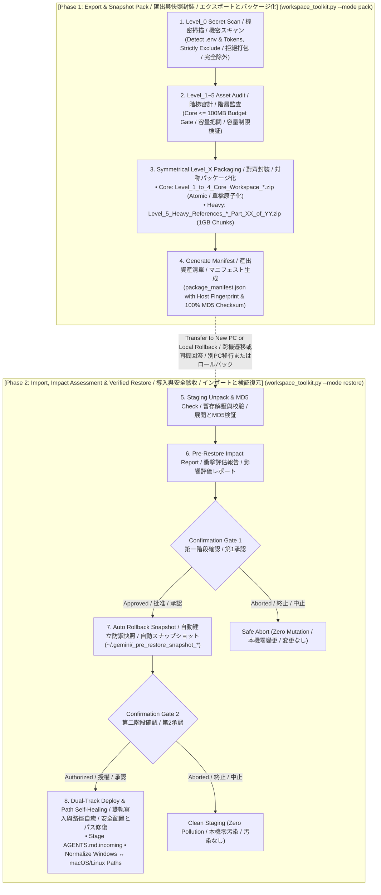

# Universal AI Agent Workspace Toolkit (v2.1.0)
**Universal Agent-Native Workspace Management, Migration & Disaster Recovery Hub**  
*通用 AI 智能體工作區全域管理、無損遷移與快照自癒中樞 (開源標準版)*  
*汎用 AI エージェント ワークスペース全域管理・無損失移行・スナップショット自己修復ハブ (オープンソース標準版)*

[](LICENSE)
[](https://www.python.org/downloads/)
[](https://github.com/ycaistudio/universal-agent-workspace-toolkit)
[](https://github.com/ycaistudio/universal-agent-workspace-toolkit)
[](https://github.com/ycaistudio/universal-agent-workspace-toolkit/pulls)

---

<p align="center">
  <b>🌐 Language Navigation / 多語言切換 / 言語切り替え:</b><br>
  <a href="README.md"><b>🇬🇧 English (Master)</b></a> •
  <a href="README_zh-TW.md"><b>🇹🇼 繁體中文手冊</b></a> •
  <a href="README_ja.md"><b>🇯🇵 日本語マニュアル</b></a>
</p>

---


## 📖 Overview / 專案簡介 / プロジェクト概要

### 🇬🇧 English
**Universal AI Agent Workspace Toolkit** is an enterprise-grade, agent-native workspace management toolkit designed for modern AI developers using **Google Antigravity**, **Claude Code / Desktop**, **Cursor**, and **VS Code (Cline / Roo)**.

It provides a unified, cross-platform engine (`workspace_toolkit.py`) for:
* **Export & Snapshot Backup**: Packaging neural skills, IDE configurations, and workspace documents into safe, self-contained capsules.
* **Import & Verified Restore**: Deploying to a new computer or rolling back to a known-good baseline with automatic path self-healing.
* **Integrity Audit**: 100% MD5 checksum validation against the asset manifest (`package_manifest.json`).

### 🇹🇼 繁體中文
**Universal AI Agent 工作區全域管理中樞** 專為大型 AI 開發與工程團隊打造，支援跨 Windows / macOS / Linux 雙向無損遷移、日常快照備份與災難快速自癒。原生支援 **Google Antigravity**、**Claude Code / Desktop**、**Cursor**、**VS Code (Cline / Roo)** 等主流 AI 環境。

提供單一跨平台控制台 (`workspace_toolkit.py`) 達成：
* **匯出與快照備份**：將智能體自定義技能、IDE 設定及工程文檔打包為安全自包含的資產包。
* **驗收與安全還原**：支援跨電腦遷移或同機基線回滾，具備全自動跨平台路徑自癒能力。
* **完整性審計**：依據發貨清單 (`package_manifest.json`) 執行 100% MD5 Checksum 驗證。

### 🇯🇵 日本語
**Universal AI Agent ワークスペース管理ハブ**は、最新の AI 開発・エンジニアリングチーム向けに設計された、クロスプラットフォーム対応の環境管理・無損失移行・スナップショット自己修復ツールです。**Google Antigravity**、**Claude Code / Desktop**、**Cursor**、**VS Code (Cline / Roo)** をフルサポートします。

統合エンジン (`workspace_toolkit.py`) により以下を提供します：
* **エクスポートとスナップショット出力**：カスタムスキル、IDE 設定、ワークスペース文書を安全な独立アーカイブに集約。
* **検証付きリストア**：新しい PC への移行や既知の正常ベースラインへのロールバックを、パス自動修復機能とともに実行。
* **整合性監査**：資産マニフェスト (`package_manifest.json`) に基づく 100% MD5 チェックサム検証。


---

## 🏛️ Core Invariants / 六大核心支柱 / 6つの基本原則

### 🇬🇧 English
1. **Unified Agent Console (`workspace_toolkit.py`)**: One cross-platform Python CLI replacing legacy split A/B scripts and platform-locked `.bat`/`.sh` wrappers.
2. **Level_0 Secret Gatekeeper**: Active pre-flight heuristic scan of `.env`, API Keys, and SSH tokens. 100% strict refusal to bundle secrets, guiding password manager sync.
3. **Strict Symmetrical Hierarchy**: Subfolders, archive zip files, and manifest keys strictly mirror Level 1 through Level 5 with zero AI hallucination.
4. **Atomic Core Capsule**: Core neural assets (Level 1~4) capped at $\le 100\text{ MB}$, packaged as a single atomic archive to guarantee zero piece loss.
5. **Large Media Chunking (`Part_XX_of_YY`)**: Heavy assets (Level 5) chunked into 1GB volumes with explicit total counts (e.g., `Part_01_of_03.zip`) for foolproof transfer.
6. **Two-Step Confirmation Gate**: Pre-restore impact assessment report ➔ User Confirmation 1 ➔ Automatic rollback snapshot (`~/.gemini/_pre_restore_snapshot_*`) ➔ User Confirmation 2 ➔ Staging `AGENTS.md` as `.incoming` without clobbering live agent setups.

### 🇹🇼 繁體中文
1. **單一控制台 (`workspace_toolkit.py`)**：告別分散的 A/B 腳本與舊時代 `.bat` 批次檔，一套純 Python 核心全平台通用。
2. **Level_0 機密安全守門**：主動探測本機敏感憑證（.env、API Key、Token），嚴守開源資安標準拒絕打包，指引密碼管理器手動保管。
3. **全域 `Level_X` 絕對對齊**：封裝壓縮檔、子資料夾、Manifest 鍵名 100% 嚴格一致，無 AI 幻覺。
4. **中樞單檔原子化**：中樞神經（Level 1~4）總量 $\le 100\text{ MB}$，保持單一檔案不分卷，遺失風險直接歸零。
5. **大檔防丟件 `Part_XX_of_YY`**：龐大素材（Level 5）採用 1GB 大顆粒切片，檔名明確標註總數與序號（如 `Part_01_of_03.zip`），徹底防呆。
6. **兩次雙重確認門禁**：解壓前產出衝擊評估報告，第一次確認後自動建立本機防禦快照，第二次確認後始准寫入，`AGENTS.md` 預設存為 `.incoming`，絕不破壞本機現有 AI 靈魂！

### 🇯🇵 日本語
1. **単一コンソール統合 (`workspace_toolkit.py`)**：従来の散在した A/B スクリプトや OS 依存の `.bat`/`.sh` を廃止し、単一の純粋な Python スクリプトで全環境を横断サポート。
2. **Level_0 機密セキュリティゲート**：`.env`、API キー、秘密鍵、トークンを自動検出し、アーカイブへの混入を 100% 遮断。パスワードマネージャーでの安全管理を案内。
3. **階層構造の完全対称性**：圧縮ファイル名、内部サブディレクトリ、Manifest キー名を Level 1〜5 で 100% 厳密に統一。
4. **中核資産の原子化パッケージ**：エージェントの中核（Level 1〜4）は総容量 $\le 100\text{ MB}$ に制御し、単一 ZIP で出力して欠落リスクをゼロ化。
5. **大容量メディアの分割管理 (`Part_XX_of_YY`)**：巨大素材（Level 5）は 1GB 単位で分割し、総数と連番を明記（例: `Part_01_of_03.zip`）して安全に転送。
6. **2段階承認ゲートと自動保護**：展開前に影響評価レポートを出力 ➔ 第1承認 ➔ 自動スナップショット作成 ➔ 第2承認 ➔ `AGENTS.md` を `.incoming` として安全配置し、既存環境を破壊しません。


---

## 💡 Why This Toolkit? / 痛點分析與解決方案 / 開発背景と解決する課題

| # | Dimension / 痛點維度 / 課題分類 | Legacy Problem / 傳統工作區困境 / 従来の課題 | Our Solution / 本工具解決方案 / 本ツールの解決策 |
| :-: | :--- | :--- | :--- |
| **1** | **Multi-Device Setup<br>跨設備遷移耗時<br>環境移行の手間** | **🇬🇧 Fragmented Setup**: Rules, skills, and MCP configs are scattered across system paths, requiring hours of manual copying and path fixing on new machines.<br>**🇹🇼 分散碎片化**：Agent 規則、技能、MCP 配置散落各處，更換電腦需手動尋找路徑並重新配置數小時。<br>**🇯🇵 環境の断片化**：各種設定が散在し、端末切り替え時に手動コピーとパス修正に数時間を要する。 | **🇬🇧 1-Click Migration**: Single command collects Level 1~5 assets and auto-heals cross-OS paths (Windows ↔ macOS/Linux) in 5 seconds.<br>**🇹🇼 一鍵無痛遷移**：單一命令自動採集 Level 1~5 全棧資產，並動態自癒跨系統路徑，5 秒完成還原。<br>**🇯🇵 ワンクリック移行**：単一コマンドで全階層資産を自動収集し、OS間のパス差分を自動吸収して即時復元。 |
| **2** | **Secret Leakage Risk<br>機密憑證外洩風險<br>機密情報漏洩リスク** | **🇬🇧 Accidental Key Leaks**: Full-folder archiving easily bundles `.env`, API keys, or private SSH keys into shared clouds or public repos.<br>**🇹🇼 誤打包 API Keys**：傳統整包壓縮常不慎包含 `.env`、私鑰或私人 Token，上傳至雲端引發嚴重資安危機。<br>**🇯🇵 秘密情報の誤混入**：全フォルダの一括圧縮により、`.env` や API キーが誤って共有ストレージへ流出する危険。 | **🇬🇧 Level_0 Zero-Trust Gate**: Pre-flight regex scanner strictly blocks bundling secrets and guides secure password manager sync.<br>**🇹🇼 Level_0 零信任守門**：封裝前強制正則深度掃描，嚴格拒絕打包任何機密，並提示使用密碼管理器同步。<br>**🇯🇵 Level_0 セキュリティゲート**：機密を事前検知してパッケージングを 100% 遮断し、安全な外部管理を案内。 |
| **3** | **Destructive Overwrite<br>粗暴覆蓋現有配置<br>既存設定の上書き破壊** | **🇬🇧 Blind Overwrite**: Standard extraction overwrites active files without warning, destroying existing rules with zero rollback.<br>**🇹🇼 盲目解壓覆蓋**：還原時直接蓋過目標目錄，抹殺現存最新規範與成果，且無法回滾撤銷。<br>**🇯🇵 無警告の上書き**：解凍時に既存の最新ルールや設定が無警告で上書きされ、復旧も不可能。 | **🇬🇧 2-Step Gate + Snapshot**: Pre-restore impact report, automatic rollback snapshot, and `.incoming` dual-track staging.<br>**🇹🇼 雙重門禁 + 自動快照**：還原前呈現衝擊評估，自動建立全環境備份快照，`AGENTS.md` 存為 `.incoming` 雙軌待審。<br>**🇯🇵 2段階承認 + 自動保護**：復元前に影響評価を提示し、自動スナップショット生成と `.incoming` 二重化保存を実行。 |
| **4** | **Platform Lock-in<br>平台與腳本依賴陷阱<br>プラットフォーム依存** | **🇬🇧 OS-Specific Scripts**: Heavy reliance on Windows `.bat` or Linux `.sh` scripts and external pip packages breaks cross-OS workflows.<br>**🇹🇼 綁定特定系統腳本**：過度依賴 `.bat` 或 `.sh` 及第三方依賴包，遇到跨平台環境時執行中斷。<br>**🇯🇵 OS 依存スクリプト**：特定の OS 向けスクリプトや外部ライブラリに依存し、別環境で動作不能になる。 | **🇬🇧 100% Pure Python**: Built strictly with Python standard library (zero external dependencies), driven natively via Agent prompts.<br>**🇹🇼 100% 純 Python 標準庫**：零外部依賴，跨 Windows/macOS/Linux 原生通用，Agent 可直接以自然語言驅動。<br>**🇯🇵 100% 標準 Python**：追加依存ゼロの純粋な Python 標準ライブラリで構築。自然言語で直接駆動可能。 |
| **5** | **Archive Bloat<br>輕重資產混雜超限<br>大容量アーカイブの破綻** | **🇬🇧 Monolithic Zip Failure**: Bundling multi-GB datasets with lightweight rules into one massive zip breaches cloud upload limits.<br>**🇹🇼 單一巨型壓縮包崩潰**：數十 GB 資料集與幾十 KB 核心規則混雜打包，超出雲端與 GitHub 上傳上限。<br>**🇯🇵 単一巨大 ZIP の破綻**：巨大データと軽量ルールを単一 ZIP に混載し、クラウド転送制限超過や破損を頻発。 | **🇬🇧 Smart Asset Split**: Core workspace ($\le 100\text{ MB}$) in one atomic zip; heavy media (Level 5) auto-split into 1GB volumes (`Part_XX_of_YY.zip`).<br>**🇹🇼 輕重資產智能分流**：核心神經層 ($\le 100\text{ MB}$) 單一原子封裝；海量素材層自動切為 1GB 獨立分卷。<br>**🇯🇵 軽重資産のスマート分離**：中核設定（$\le 100\text{ MB}$ 原子パッケージ）と大容量素材（1GB 分割ボリューム）を分離。 |


---

## 🧩 Ecosystem Compatibility Matrix / 生態相容性矩陣 / エコシステム対応状況

| Platform / 開發環境 / プラットフォーム | Directives / 核心憲法 / 指示書 | MCP Servers / 工具擴充 / MCP設定 | Skills / 技能擴充 / スキル | Protocol Bypass / 協議免警告注入 / 警告回避注入 |
| :--- | :---: | :---: | :---: | :---: |
| **Google Antigravity** | `AGENTS.md` | `~/.gemini/antigravity/mcp/` | `~/.gemini/config/skills/` | ✅ Auto-Injected / 自動注入 / 自動注入 |
| **Cursor** | `.cursorrules` / `.cursor/rules` | `~/.cursor/mcp.json` | Rules Adaptation / 轉換規範 / ルール変換 | ✅ Auto-Injected / 自動注入 / 自動注入 |
| **Claude (Code / Desktop)** | `CLAUDE.md` | `claude_desktop_config.json` | Custom Commands / 支援命令 / コマンド対応 | ✅ Auto-Adapted / 自動適配 / 自動適合 |
| **VS Code (Cline / Roo)** | `.clinerules` | `cline_mcp_settings.json` | Incremental / 增量導入 / 増分導入 | ✅ Auto-Injected / 自動注入 / 自動注入 |
| **Windsurf** | `.windsurfrules` | Standard JSON / 通用規範 / 標準JSON | Incremental / 增量導入 / 増分導入 | ✅ Auto-Injected / 自動注入 / 自動注入 |


---

## 🛡️ Asset Defense Hierarchy / 六級資產防禦階梯 / 6段階の資産防護階層

| Level / 級別 / 階層 | Directory / 目錄名稱 / ディレクトリ | Contained Assets / 包含內容 / 構成要素 | Defense Strategy / 防禦策略 / 防護戦略 |
| :--- | :--- | :--- | :--- |
| **Level_0<br>Credentials<br>機密憑證<br>機密情報** | *(None / 不建立目錄 / 作成なし)* | `.env`, API Keys, Private Keys, Tokens (`id_rsa`, `auth.json`) | **❌ Strict Exclusion / 100% 拒絕打包 / 100% 除外**<br>🇬🇧 Actively scanned and excluded; advises manual password manager sync.<br>🇹🇼 主動掃描路徑並拒絕打包，提示透過密碼管理器手動備份。<br>🇯🇵 パスを事前検知してアーカイブから完全除外。パスワード管理ツールでの同期を案内。 |
| **Level_1<br>Directives<br>智能體憲法<br>基本指示書** | `Level_1_Agent_Directives/` | `AGENTS.md`, `CLAUDE.md`, `.cursorrules` | **🔴 Single-Instance Protection / 極高危單例保護 / 最高保護**<br>🇬🇧 100% preserves existing file; stages incoming version as `.incoming`.<br>🇹🇼 預設 100% 保留本機舊檔，新版存為 `.incoming` 雙軌比對。<br>🇯🇵 既存ファイルを 100% 保護し、新規版は `.incoming` として二重化保存。 |
| **Level_2<br>System Settings<br>系統底層設定<br>システム設定** | `Level_2_System_Settings/` | `ide_user_settings.json`, MCP Configs | **🟠 Incremental Key Patch / 僅做 Patch 增補 / パッチ追記**<br>🇬🇧 Only injects protocol keys (e.g. `file:///` bypass); preserves UI/themes.<br>🇹🇼 僅注入通訊協議免警告設定，絕不覆蓋本機原有字型與外觀。<br>🇯🇵 プロトコル設定のみをパッチ注入し、既存のフォントや外観テーマを維持。 |
| **Level_3<br>Modular Skills<br>模組化技能庫<br>モジュールスキル** | `Level_3_Modular_Skills/` | Skill Folders (`SKILL.md`, `scripts/`, `manifest`) | **🟢 Lossless Import / 無損導入 / 無損失インポート**<br>🇬🇧 Pluggable modules; safely skips identical names and adds new skills.<br>🇹🇼 可插拔模組化元件，同名技能安全跳過，新技能自動增補。<br>🇯🇵 プラガブルなモジュール構造。同名スキルは保護スキップし、新規スキルを追加。 |
| **Level_4<br>Workspace Docs<br>專案工程文檔<br>プロジェクト文書** | `Level_4_Workspace_Docs/` | Markdown Notes, SOPs, Python Scripts | **🔵 Incremental Sync / 增量同步 / 増分同期**<br>🇬🇧 Syncs workspace files while preserving newer local files on target.<br>🇹🇼 工作區檔案增量同步，目標目錄已有之同名檔案保留本機最新版。<br>🇯🇵 ワークスペース文書を増分同期（移行先の新しい同名ファイルは維持）。 |
| **Level_5<br>Heavy Media<br>龐大素材資料<br>大容量メディア** | `Level_5_Heavy_References/` | Large PDFs, Videos, Datasets (>10MB ~ GBs) | **🟣 1GB Split Volumes / 大檔可選分卷 / 1GB分割アーカイブ**<br>🇬🇧 Auto-chunked into 1GB parts (`Part_XX_of_YY.zip`) for optional transfer.<br>🇹🇼 採用 1GB 大顆粒切片 (`Part_XX_of_YY.zip`)，由使用者自決是否傳輸。<br>🇯🇵 1GB 単位の分割ボリューム (`Part_XX_of_YY.zip`) として出力し、任意転送に対応。 |


---

## 📊 Visual Architecture Flow / 視覺化架構流程圖 / アーキテクチャフロー




---

## 🚀 Quick Start / 快速上手 / クイックスタート

### 🇬🇧 English
#### 1. 🤖 Agent-Native Mode (Recommended)
No need to memorize terminal commands. Simply instruct your AI Agent (Antigravity, Cursor, Claude Code, Cline) in natural language:

* **Scenario A: Daily Snapshot Backup & Export**
  - 💬 `"Please export a snapshot backup of my AI workspace"`
  *(Agent scans Level_0 credentials, runs asset audit, and generates atomic packages in `packages/`)*

* **Scenario B: Safe Restore & Verified Migration**
  - 💬 `"Please inspect and restore the workspace package from packages/, perform impact assessment first"`
  *(Agent outputs impact report, creates pre-restore rollback snapshot upon Confirmation 1, and stages incoming files upon Confirmation 2)*

* **Scenario C: Integrity Audit & Health Check**
  - 💬 `"Audit package_manifest.json and verify MD5 checksums across all workspace files"`
  *(Agent verifies hashes with zero write operations)*

#### 2. 💻 Terminal CLI Mode (Advanced & Automation)
Designed for terminal workflows, automated scripts, and CI/CD pipelines:

```bash
# Launch interactive console (auto-detects system language)
python workspace_toolkit.py

# Export workspace snapshot package
python workspace_toolkit.py --mode pack

# Import and verified restore with 2-step confirmation gate
python workspace_toolkit.py --mode restore

# Scan and manifest audit (read-only, zero file mutation)
python workspace_toolkit.py --mode inspect

# Force specific language
python workspace_toolkit.py --lang en
```

---

### 🇹🇼 繁體中文
#### 1. 🤖 Agent-Native Mode (自然語言對答模式 · 推薦首選)
無需死記任何終端命令，直接在您習慣的 AI Agent 對話框（Antigravity / Cursor / Claude / VS Code）以日常語言吩咐即可：

* **【情境 A：日常快照備份與匯出】**
  - 💬 `「請幫我建立 AI 工作區快照備份 / 匯出封裝包」`
  *(AI Agent 會自動探測 Level_0 機密憑證守門、呈現資產審計，並自動封裝至 packages/ 目錄)*

* **【情境 B：安全導入與無損還原】**
  - 💬 `「請檢查 packages/ 目錄下的備份包並執行還原，先產出衝擊評估」`
  *(AI Agent 會產出詳細衝擊評估報告，於第一次確認後建立本機快照，第二次確認後安全展開)*

* **【情境 C：完整性審計與健康體檢】**
  - 💬 `「請讀取 package_manifest.json，比對全量資產 MD5 Checksum 並產出體檢報告」`
  *(純只讀安全操作，零檔案變更，防範檔案損毀)*

#### 2. 💻 Terminal CLI Mode (進階命令行與自動化)
適用於工程師直接在終端機操作或 CI/CD 無人值守自動化流程：

```bash
# 啟動交互式三語控制台 (自動偵測系統語系)
python workspace_toolkit.py

# 一鍵匯出中樞神經快照封裝包
python workspace_toolkit.py --mode pack

# 執行校驗與安全還原 (含衝擊評估與兩次確認門禁)
python workspace_toolkit.py --mode restore

# 僅做完整性審計與健康體檢 (純讀取，零檔案異動)
python workspace_toolkit.py --mode inspect

# 手動指定語言界面
python workspace_toolkit.py --lang zh-tw
```

---

### 🇯🇵 日本語
#### 1. 🤖 Agent-Native モード (自然言語対話 · 推奨)
コマンドを覚える必要はありません。普段利用している AI エージェント（Antigravity、Cursor、Claude Code、Cline）のチャット欄で指示するだけで自動実行されます：

* **【シナリオ A：日常のスナップショットバックアップとエクスポート】**
  - 💬 `「AI ワークスペースのスナップショットを作成・エクスポートしてください」`
  *(エージェントが Level_0 機密検知、資産監査を行い、packages/ ディレクトリへ自動圧縮出力)*

* **【シナリオ B：安全なインポートと検証付きリストア】**
  - 💬 `「packages/ のパッケージを確認して復元してください。まず影響評価を出力してください」`
  *(詳細な影響評価レポートを出力し、第1承認でバックアップスナップショットを作成、第2承認で安全に配置)*

* **【シナリオ C：整合性監査とヘルスチェック】**
  - 💬 `「package_manifest.json を読み込み、全ファイルの MD5 チェックサムを照合してください」`
  *(完全な読み取り専用検証。ファイル変更ゼロで破損を防止)*

#### 2. 💻 ターミナル CLI モード (高度な操作・自動化)
ターミナルでの直接操作や CI/CD パイプラインでの自動実行向け：

```bash
# 対話型コンソール起動 (システム言語を自動判定)
python workspace_toolkit.py

# ワークスペースのスナップショット出力
python workspace_toolkit.py --mode pack

# 検証付きリストア (影響評価と2段階承認ゲート付き)
python workspace_toolkit.py --mode restore

# 整合性監査 (読み取り専用・変更なし)
python workspace_toolkit.py --mode inspect

# 言語を手動指定
python workspace_toolkit.py --lang ja
```


---

## ❓ FAQ / 常見問題解答 / よくある質問

### 🇬🇧 English
#### Q1: Will my API keys or passwords accidentally be packaged or leaked to GitHub?
**Absolutely not.** The toolkit enforces a mandatory "Level_0 Credential Security Gatekeeper". During scanning, all `.env`, API Keys, tokens, and SSH keys are explicitly detected, excluded from packaging, and reported to the user. A comprehensive `.gitignore` guarantees zero repository leakage.

#### Q2: If the target computer already has an active `AGENTS.md`, will it be overwritten during restore?
**Absolutely not.** During restore, the toolkit checks the environment. For existing environments, it initiates highest-level defense: the target computer's existing active directives are 100% preserved. The incoming directives are safely staged as `AGENTS.md.incoming` for side-by-side review.

#### Q3: Can I use this for local daily snapshot backups and disaster rollback on the same machine?
**Yes, natively supported!** The manifest embeds a `machine_fingerprint` (hostname + username). When local restore is detected, the toolkit switches to "Local Time-Machine Mode", bypassing path rewriting and performing a verified snapshot rollback.

#### Q4: How are cross-platform path differences handled between Windows and macOS/Linux?
Built-in **Dynamic Path Self-Healing Engine**. During cross-machine restore, the toolkit regex-scans Markdown, JSON, and settings, intelligently translating legacy paths (e.g. `file:///C:/Users/UserA/`) into target platform paths (e.g. `file:///Users/UserB/` or `file:///home/user/`) while preserving text and hyperlink integrity.

---

### 🇹🇼 繁體中文
#### Q1: 我的 API Key、密碼會否不小心被打包或上傳到 GitHub？
**絕對不會。** 本工具設有強制性「Level_0 機密安全守門機制」，在掃描階段自動探測 `.env`、API Key、Token、私鑰等機密檔案，將其列入嚴格排他清單，**100% 拒絕打包**。此外專案配有完整的 `.gitignore`，徹底杜絕金鑰外洩風險。

#### Q2: 如果目標電腦原本就有一份使用中的 `AGENTS.md`，還原時會被覆蓋沖掉嗎？
**絕對不會。** 系統在還原時會詢問環境現狀。若為「舊有現存環境」，系統啟動最高防禦策略：**100% 保留目標電腦現行版本**，來源版本將安全命名為 `AGENTS.md.incoming` 雙軌落地，絕不破壞本機現有 AI 靈魂設定。

#### Q3: 可以在同一部電腦上做日常快照與災難回滾嗎？
**可以，而且是原生支援！** 工具會讀取發貨單內嵌的 `machine_fingerprint`（主機名稱與使用者帳號）。若偵測到當前為主機本機，系統會自動切換為「本機時光機模式」，不執行不必要的路徑變更，直接進行安全回滾。

#### Q4: 跨平台遷移時，Windows 與 macOS / Linux 的路徑差異如何處理？
系統內建「動態路徑自癒引擎」，在跨平台遷移時會自動正則掃描 Markdown、JSON 與設定檔，將舊機路徑（例如 `file:///C:/Users/UserA/`）精準轉譯為新機路徑（例如 `file:///Users/UserB/`），並保留所有內文純文字與鏈接結構。

---

### 🇯🇵 日本語
#### Q1: APIキーやパスワードが誤ってアーカイブされたりGitHubに流出することはありますか？
**絶対にありません。** 本ツールには強制的な「Level_0 機密セキュリティゲート」が備わっており、スキャン段階で `.env`、API キー、トークン、秘密鍵を自動検知して除外リストに登録し、パッケージングを 100% 拒否します。また厳格な `.gitignore` によりリポジトリへの誤混入も防止します。

#### Q2: 復元先PCに既存の `AGENTS.md` がある場合、上書き破壊されますか？
**絶対にありません。** リストア実行時に環境状態を判定します。「既存環境」の場合、最高レベルの保護ポリシーが発動し、復元先の現行ファイルが 100% 保持されます。アーカイブ内の指示書は `AGENTS.md.incoming` として二重化保存され、手動比較・マージが可能です。

#### Q3: 同一PC上での日常的なスナップショットバックアップとロールバックに利用できますか？
**はい、標準で対応しています。** パッケージのマニフェストに記録された `machine_fingerprint`（ホスト名とユーザー名）を照合し、同一端末であることを検出すると自動的に「ローカルタイムマシンモード」に切り替わり、パス書き換えを行わずに安全なロールバックを実行します。

#### Q4: Windows と macOS/Linux 間でパス記述の差異はどのように処理されますか？
内蔵の**動的パス自己修復エンジン**が自動解決します。異なるOS間での移行時、Markdown や JSON 設定ファイル内の絶対パス（例: `file:///C:/Users/UserA/`）を正規表現で検知し、移行先PCのパス形式（例: `file:///Users/UserB/`）へと自動置換します。


---

## 📁 Repository Structure / 倉庫目錄結構 / ディレクトリ構造

```text
universal-agent-workspace-toolkit/
├── workspace_toolkit.py          # Unified Master CLI & Agent-Native Console (單一入口控制台 / 統合コンソール)
├── toolkit_i18n.py               # Trilingual Engine: en / zh-tw / ja (三語字典引擎 / 多言語エンジン)
├── toolkit_scanner.py            # Level_0 Secret Gate & Level_1~5 Scanner (資安與資產掃描器 / 監査スキャナー)
├── toolkit_pack.py               # Staging, Manifest & Zip Engine (階梯封裝引擎 / パッケージ化エンジン)
├── toolkit_restore.py            # Impact Report, Snapshot & Deployer (衝擊評估與還原引擎 / リストアエンジン)
├── SKILL.md                      # Antigravity Skill Specification (技能定義規範 / スキル定義仕様)
├── AGENTS.md                     # Universal Agent Bootstrap Directives (智能體自啟動憲法 / 起動指示書)
├── AI_GUIDED_WIZARD_PROMPTS.md   # Natural Language Prompt Templates (自然語言引導詞 / 対話プロンプト集)
├── README.md                     # Master Trilingual Documentation (三語總綱手冊 / 三言語統合マニュアル)
├── README_zh-TW.md               # Traditional Chinese Manual (繁體中文完整手冊)
├── README_ja.md                  # Japanese Manual (日本語完全マニュアル)
└── .gitignore                    # Security Exclusions & Cache Filters (資安排他過濾規則 / 除外ルール)
```

---

## 📄 License / 授權條款 / ライセンス

* **🇬🇧 English**: This project is licensed under the MIT License — see the [LICENSE](LICENSE) file for details.
* **🇹🇼 繁體中文**：本專案採用 MIT 開源授權條款 — 詳情請參閱 [LICENSE](LICENSE) 檔案。
* **🇯🇵 日本語**：本プロジェクトは MIT ライセンスの下で公開されています — 詳細は [LICENSE](LICENSE) ファイルをご参照ください。

