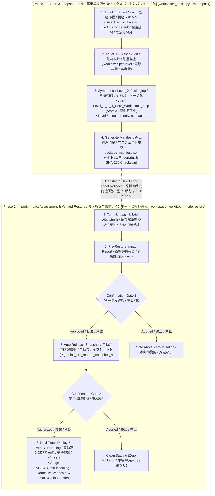

# Universal AI Agent Workspace Toolkit (日本語完全マニュアル)
**汎用 AI エージェント ワークスペース全域管理・移行・スナップショット復元ツール**  
Google Antigravity、Claude Code、Cursor、VS Code（Cline / Roo）、**Grok Bot** に対応します。

<p align="center">
  <a href="README.md"><b>English (Master)</b></a> •
  <a href="README_zh-TW.md"><b>🇹🇼 繁體中文說明</b></a> •
  <a href="README_ja.md"><b>🇯🇵 日本語マニュアル</b></a>
</p>

---

## 🇯🇵 日本語の概要

**Universal AI Agent ワークスペース管理ハブ**は、**Google Antigravity**、**Claude Code**、**Cursor**、**VS Code (Cline / Roo)**、**Grok Bot** 向けのスナップショットと復元ツールです。Grok Bot は別プロファイルです。詳細は下の節にあります。

### 6つの基本原則 (Core Invariants)
1. **単一コンソール統合 (`workspace_toolkit.py`)**：従来の散在した A/B スクリプトや OS 依存の `.bat`/`.sh` を廃止し、単一の純粋な Python スクリプトで全環境を横断サポート。
2. **Level_0 機密セキュリティゲート**：既知の認証情報ファイル、秘密鍵ブロック、実在形式の API トークンを既定で除外し、MCP 設定内の機密値はプレースホルダーに置換します。`--include-secrets` で明示的に含められます。検出はファイル名とパターンに基づくため、レポートを確認してください。
3. **階層構造の完全対称性**：圧縮ファイル名、内部サブディレクトリ、Manifest キー名を Level 1〜5 で統一。
4. **中核資産の原子化パッケージ**：エージェントの中核（Level 1〜4）は総容量 $\le 100\text{ MB}$ に制御し、単一 ZIP で出力して欠落リスクをゼロ化。
5. **Level 5 大容量メディア**：監査表に件数のみ表示し、梱包しません（分割機能は未実装）。
6. **2段階承認ゲートと自動保護**：展開前に影響評価レポートを出力 ➔ 第1承認 ➔ 自動スナップショット作成 ➔ 第2承認 ➔ `AGENTS.md` を `.incoming` として安全配置し、既存環境を破壊しません。


---

## 💡 Why This Toolkit? / 痛點分析與解決方案 / 開発背景と解決する課題

| # | Dimension / 痛點維度 / 課題分類 | Legacy Problem / 傳統工作區困境 / 従来の課題 | Our Solution / 本工具解決方案 / 本ツールの解決策 |
| :-: | :--- | :--- | :--- |
| **1** | **Multi-Device Setup<br>跨設備遷移耗時<br>環境移行の手間** | **🇬🇧 Fragmented Setup**: Rules, skills, and MCP configs are scattered across system paths, requiring hours of manual copying and path fixing on new machines.<br>**🇹🇼 分散碎片化**：Agent 規則、技能、MCP 配置散落各處，更換電腦需手動尋找路徑並重新配置數小時。<br>**🇯🇵 環境の断片化**：各種設定が散在し、端末切り替え時に手動コピーとパス修正に数時間を要する。 | **🇬🇧 1-Click Migration**: Single command collects Level 1-5 assets and auto-heals cross-OS paths (Windows ↔ macOS/Linux) quickly.<br>**🇹🇼 一鍵無痛遷移**：單一命令自動採集 Level 1-5 全棧資產，並動態自癒跨系統路徑。<br>**🇯🇵 ワンクリック移行**：単一コマンドで全階層資産を自動収集し、OS間のパス差分を自動吸収して即時復元。 |
| **2** | **Secret Leakage Risk<br>機密憑證外洩風險<br>機密情報漏洩リスク** | **🇬🇧 Accidental Key Leaks**: Full-folder archiving easily bundles `.env`, API keys, or private SSH keys into shared clouds or public repos.<br>**🇹🇼 誤打包 API Keys**：傳統整包壓縮常不慎包含 `.env`、私鑰或私人 Token，上傳至雲端引發嚴重資安危機。<br>**🇯🇵 秘密情報の誤混入**：全フォルダの一括圧縮により、`.env` や API キーが誤って共有ストレージへ流出する危険。 | **🇬🇧 Level_0 secret gate**: Known credential files and token patterns are excluded by default, MCP secret values are replaced by a placeholder, and the report lists every exclusion. `--include-secrets` overrides.<br>**🇹🇼 Level_0 機密守門**：已知憑證檔案與 Token 格式預設排除，MCP 機密值以佔位符取代，報告列出所有排除項目；`--include-secrets` 可覆寫。<br>**🇯🇵 Level_0 機密ゲート**：既知の認証情報ファイルとトークン形式を既定で除外し、MCP の機密値はプレースホルダーに置換、除外項目をレポートに一覧表示。`--include-secrets` で上書き可能。 |
| **3** | **Destructive Overwrite<br>粗暴覆蓋現有配置<br>既存設定の上書き破壊** | **🇬🇧 Blind Overwrite**: Standard extraction overwrites active files without warning, destroying existing rules with zero rollback.<br>**🇹🇼 盲目解壓覆蓋**：還原時直接蓋過目標目錄，抹殺現存最新規範與成果，且無法回滾撤銷。<br>**🇯🇵 無警告の上書き**：解凍時に既存の最新ルールや設定が無警告で上書きされ、復旧も不可能。 | **🇬🇧 2-Step Gate + Snapshot**: Pre-restore impact report, automatic rollback snapshot, and `.incoming` dual-track staging.<br>**🇹🇼 雙重門禁 + 自動快照**：還原前呈現衝擊評估，自動建立全環境備份快照，`AGENTS.md` 存為 `.incoming` 雙軌待審。<br>**🇯🇵 2段階承認 + 自動保護**：復元前に影響評価を提示し、自動スナップショット生成と `.incoming` 二重化保存を実行。 |
| **4** | **Platform Lock-in<br>平台與腳本依賴陷阱<br>プラットフォーム依存** | **🇬🇧 OS-Specific Scripts**: Heavy reliance on Windows `.bat` or Linux `.sh` scripts and external pip packages breaks cross-OS workflows.<br>**🇹🇼 綁定特定系統腳本**：過度依賴 `.bat` 或 `.sh` 及第三方依賴包，遇到跨平台環境時執行中斷。<br>**🇯🇵 OS 依存スクリプト**：特定の OS 向けスクリプトや外部ライブラリに依存し、別環境で動作不能になる。 | **🇬🇧 100% Pure Python**: Built strictly with Python standard library (zero external dependencies), driven natively via Agent prompts.<br>**🇹🇼 100% 純 Python 標準庫**：零外部依賴，跨 Windows/macOS/Linux 原生通用，Agent 可直接以自然語言驅動。<br>**🇯🇵 100% 標準 Python**：追加依存ゼロの純粋な Python 標準ライブラリで構築。自然言語で直接駆動可能。 |
| **5** | **Archive Bloat<br>輕重資產混雜超限<br>大容量アーカイブの破綻** | **🇬🇧 Monolithic Zip Failure**: Bundling multi-GB datasets with lightweight rules into one massive zip breaches cloud upload limits.<br>**🇹🇼 單一巨型壓縮包崩潰**：數十 GB 資料集與幾十 KB 核心規則混雜打包，超出雲端與 GitHub 上傳上限。<br>**🇯🇵 単一巨大 ZIP の破綻**：巨大データと軽量ルールを単一 ZIP に混載し、クラウド転送制限超過や破損を頻発。 | **🇬🇧 Core vs heavy assets**: Levels 1-4 go into one zip; heavy media (Level 5) is counted but not packed.<br>**🇹🇼 核心與大檔分流**：Level 1-4 打包成一個 ZIP；Level 5 大檔只計數、不打包。<br>**🇯🇵 中核と大容量素材の分離**：Level 1〜4 を 1 つの ZIP に梱包し、Level 5 は件数のみ表示して梱包しません。 |


---

## 🧩 Ecosystem Compatibility Matrix / 生態相容性矩陣 / エコシステム対応状況

| Platform / 開發環境 / プラットフォーム | Directives / 核心憲法 / 指示書 | MCP Servers / 工具擴充 / MCP設定 | Skills / 技能擴充 / スキル | Protocol Bypass / 協議免警告注入 / 警告回避注入 |
| :--- | :---: | :---: | :---: | :---: |
| **Google Antigravity** | `AGENTS.md` | `-/.gemini/antigravity/mcp/` | `-/.gemini/config/skills/` | ✅ Auto-Injected / 自動注入 / 自動注入 |
| **Cursor** | `.cursorrules` / `.cursor/rules` | `-/.cursor/mcp.json` | Rules Adaptation / 轉換規範 / ルール変換 | ✅ Auto-Injected / 自動注入 / 自動注入 |
| **Claude (Code / Desktop)** | `CLAUDE.md` | `claude_desktop_config.json` | Custom Commands / 支援命令 / コマンド対応 | ✅ Auto-Adapted / 自動適配 / 自動適合 |
| **VS Code (Cline / Roo)** | `.clinerules` | `cline_mcp_settings.json` | Incremental / 增量導入 / 増分導入 | ✅ Auto-Injected / 自動注入 / 自動注入 |
| **Windsurf** | `.windsurfrules` | Standard JSON / 通用規範 / 標準JSON | Incremental / 增量導入 / 増分導入 | ✅ Auto-Injected / 自動注入 / 自動注入 |
| **Grok Bot** | `agents/<uuid>/profile.json` → `.incoming` / 另存 `.incoming` / `.incoming` で保存 | No MCP. Settings and routines are `.incoming` only / 不覆蓋 live 設定 / 稼働中設定は上書きしない | `agent-data/workflows/` (user skills). `managed-skills/` and `plugin-skills/` are not packed | Not injected. Level_6 memory-drop + Level_7 read-only conversations / 不注入 / 注入しない |


---

## 🛡️ Asset Defense Hierarchy / 資產防禦階梯 / 資産防護階層

| Level / 級別 / 階層 | Directory / 目錄名稱 / ディレクトリ | Contained Assets / 包含內容 / 構成要素 | Defense Strategy / 防禦策略 / 防護戦略 |
| :--- | :--- | :--- | :--- |
| **Level_0<br>Credentials<br>機密憑證<br>機密情報** | *(None / 不建立目錄 / 作成なし)* | `.env`, API Keys, Private Keys, Tokens (`id_rsa`, `auth.json`) | **❌ Excluded by default / 預設排除 / 既定で除外**<br>🇬🇧 Known credential files and token patterns are skipped; `--include-secrets` overrides.<br>🇹🇼 已知憑證檔案與 Token 格式預設略過；`--include-secrets` 可明確指定打包。<br>🇯🇵 既知の認証情報ファイルとトークン形式は既定でスキップ。`--include-secrets` で明示的に含められます。 |
| **Level_1<br>Directives<br>智能體憲法<br>基本指示書** | `Level_1_Agent_Directives/` | `AGENTS.md`, `CLAUDE.md`, `.cursorrules` | **🔴 Single-Instance Protection / 極高危單例保護 / 最高保護**<br>🇬🇧 In existing-agent mode the local file is kept and the incoming version is saved as `.incoming`.<br>🇹🇼 「現存環境」模式下保留本機舊檔，新版另存為 `.incoming`。<br>🇯🇵 「既存環境」モードでは現行ファイルを保持し、新しい版は `.incoming` として保存。 |
| **Level_2<br>System Settings<br>系統底層設定<br>システム設定** | `Level_2_System_Settings/` | `ide_user_settings.json`, MCP Configs | **🟠 Incremental Key Patch / 僅做 Patch 增補 / パッチ追記**<br>🇬🇧 Only injects protocol keys (e.g. `file:///` bypass); preserves UI/themes.<br>🇹🇼 僅注入通訊協議免警告設定，絕不覆蓋本機原有字型與外觀。<br>🇯🇵 プロトコル設定のみをパッチ注入し、既存のフォントや外観テーマを維持。 |
| **Level_3<br>Modular Skills<br>模組化技能庫<br>モジュールスキル** | `Level_3_Modular_Skills/` | Skill Folders (`SKILL.md`, `scripts/`, `manifest`) | **🟡 Merge Import / 合併導入 / マージ**<br>🇬🇧 New skills are added. Same-named skill files are overwritten by the packaged version (local-only files are kept); the rollback snapshot holds the previous copy.<br>🇹🇼 新技能會增補；同名技能檔案會被封裝版本覆寫（僅存在於本機的檔案保留），還原快照保存舊版。<br>🇯🇵 新しいスキルは追加されます。同名のスキルファイルはパッケージ版で上書きされ（ローカルのみのファイルは保持）、以前の内容はロールバック用スナップショットに残ります。 |
| **Level_4<br>Workspace Docs<br>專案工程文檔<br>プロジェクト文書** | `Level_4_Workspace_Docs/` | Markdown Notes, SOPs, Python Scripts | **🔵 Incremental Sync / 增量同步 / 増分同期**<br>🇬🇧 Syncs workspace files while preserving newer local files on target.<br>🇹🇼 工作區檔案增量同步，目標目錄已有之同名檔案保留本機最新版。<br>🇯🇵 ワークスペース文書を増分同期（移行先の新しい同名ファイルは維持）。 |
| **Level_5<br>Heavy Media<br>龐大素材資料<br>大容量メディア** | `Level_5_Heavy_References/` | Large PDFs, Videos, Datasets (>10MB - GBs) | **⚪ Not packed / 目前不打包 / 現在は梱包しません**<br>🇬🇧 Counted in the audit but not packed. There is no splitting yet.<br>🇹🇼 只在審計表計數，目前不打包，也尚無分卷功能。<br>🇯🇵 監査表に件数のみ表示し、梱包しません。分割機能は未実装です。 |
| **Level_6<br>Memory drop<br>記憶匯出<br>メモリ書き出し** | `Level_6_Memory_Drop/` | Grok memory-drop JSONL (`shared-user/`, `agents/<uuid>/`) | **🟣 Incoming only / 只進 incoming / incoming のみ**<br>🇬🇧 Packed. Restore does not write platform memory. Each bot imports its own `fact` lines.<br>🇹🇼 會打包。還原不寫入平台記憶，需由各 Bot 自行匯入 `fact`。<br>🇯🇵 梱包します。復元はプラットフォームのメモリを書きません。各 Bot が自分の `fact` を取り込みます。 |
| **Level_7<br>Conversations<br>對話快照<br>会話スナップショット** | `Level_7_Conversations/` | Read-only `search-index.db` snapshot, each bot's `store.db` snapshot, + `agent-transcripts/` | **🔒 Not restored over live data / 不覆蓋 live 資料 / 稼働中データは上書きしない**<br>🇬🇧 SQLite `backup()` snapshots plus transcripts. Never replace the live index, `store.db`, or transcripts.<br>🇹🇼 以 SQLite `backup()` 做快照並附上逐字稿。絕不取代 live 索引、`store.db` 或逐字稿。<br>🇯🇵 SQLite `backup()` のスナップショットとトランスクリプト。稼働中の索引、`store.db`、逐字稿は置き換えません。 |
| **Level_8<br>Cursor stores<br>實驗性清單<br>実験的一覧** | `Level_8_Cursor_Stores_Experimental/` | `/cursor/stores` when `--include-cursor-stores` is set | **Opt-in / 選擇性 / 任意**<br>🇬🇧 Contents are packed only with that flag. Restore does not write `/cursor/stores`.<br>🇹🇼 只有加上該旗標才打包內容。還原不寫回 `/cursor/stores`。<br>🇯🇵 そのフラグがあるときだけ中身を梱包します。復元は `/cursor/stores` を書きません。 |


---

## Grok Bot プロファイル

`--profile auto` が既定です。agent-data ディレクトリがあるとき（`GROK_AGENT_DATA`、無ければ `AGENT_DATA`、それも無ければ `/home/box/agent-data`）に **Grok Bot** を選びます。そのディレクトリが無いときは、`/workspace` が別の理由で存在していても **Antigravity** のままです。`--profile grok` と `--profile antigravity` は `UAWT_PROFILE` より優先します。`--profile` を省略したとき、`UAWT_PROFILE` は `auto`、`grok`、`antigravity` のいずれかです。`--profile auto` を明示した実行は `UAWT_PROFILE` を読みません。

| レベル | 梱包するもの |
| :--- | :--- |
| 1 | `profile.json`、`avatar.*`、`group.json`。ワークスペース内の `AGENTS.md`、`CLAUDE.md`、`.cursorrules`、`.clinerules` |
| 2 | `settings.json`、`automations/`（空の `automations/` は routines 0 と報告）、その Bot ディレクトリ内のその他のファイル、`agents/` 直下のファイル、名前が agent id ではない `agents/` 配下のフォルダ。`store.db` はこのレベルには入れない |
| 3 | `agent-data/workflows/` のみ |
| 4 | それ以外のワークスペースファイル。各 Bot の `notes/`、`reference/`、`attachments/`、`private/`。`agent-data/projects/` |
| 5 | 件数のみで梱包しない: 10 MiB を超えるファイル、または拡張子 `.mp4` `.mov` `.avi` `.iso` `.dmg` `.tar` `.gz`。Level 1、3、6、7、8 はここへ移さない |
| 6 | memory-drop ディレクトリに既にあるファイル（JSONL と、`memory-status.json` のような同じ場所の他のファイル）、加えて `agent-data/user-memory/` と各 Bot の `memory/` |
| 7 | `agent-data/search-index.db` の SQLite `backup()` を `search-index-snapshot.db` として保存。各 Bot の `store.db` は `agent-stores/<id>/store-snapshot.db`（`store.db-wal` と `store.db-shm` は含めない）。`agent-transcripts/` も同梱。パック前の監査はこれらのスナップショットと `conversation-stats.json` を件数に含める |
| 8 | `--include-cursor-stores` を付けたときだけ `/cursor/stores` |

既定では入れず、指定したときだけ入れるもの:

* 機密。`--include-secrets` が無い限り `box-secrets.json`、`host-secrets.json`、`chrome-cookie-seed.json`、`gateway.json`、`teach-queue-key.json`、agent-data 直下の `*-secrets.json`、および Level_0 のファイル名とトークン規則で除外します。梱包される JSON に残った機密らしい値は `__REDACTED_RESTORE_MANUALLY__` に置き換わります。
* `managed-skills/` と `plugin-skills/` は梱包しません。対応するフラグはありません。
* 名前が `sand-subagent-*` のディレクトリ。`--include-subagents` または `INCLUDE_SUBAGENTS=1` のときだけ含めます。
* `/cursor/stores` のファイル中身。`--include-cursor-stores` が無いときは、マニフェストに名前だけを記録します。
* シンボリックリンク。辿りません。
* `pyvenv.cfg` を含むディレクトリと、名前が `site-packages` のディレクトリ。`node_modules` も除外したままです。`INCLUDE_BULKY_DIRS=1` では戻りません。
* `package-lock.json`、`tokenizer_config.json`、`tokenizer.json`、およびパッカーが知る他の lockfile 名はそのままコピーします。JSON の鍵の置換はこれらを書き換えません。マニフェストのパスワード/トークン警告は、ファイルごとではなく、フォルダと理由ごとの件数です。

`--encrypt` はフラグを付けたときだけ動きます。OpenSSL の `enc -aes-256-cbc -pbkdf2 -iter 200000 -salt` を実行し、その暗号文の HMAC-SHA256 を保存します（encrypt-then-MAC。MAC 鍵は PBKDF2-HMAC-SHA256、200000 回、専用の salt）。パスフレーズは `UAWT_ENCRYPT_PASSPHRASE` かプロンプトで、引数では受け取りません。`PATH` 上に OpenSSL が必要です。成功すると平文 zip を消し、`*.zip.enc`（モード `600`）を残します。失敗すると平文 zip を残してエラーで終了します。パスフレーズが違う、または暗号文が変わっているときは、復号したファイルを書く前に復元を止めます。以前の版がそのまま書いた OpenSSL の暗号文（`UAWTENC1` ヘッダが無いもの）は拒否します。この版でパックし直してください。

復元は確認を 2 回求めます。`--target-env` を省略したときは、移行先が新規か既存かも尋ねます。`-y` はこれらの質問を飛ばし、省略された `--target-env` を `existing` として扱います。書き込む前に、上書きされる既存ファイルをワークスペースの `.grok-pre-restore-snapshot_*` へコピーし、`ROLLBACK.txt` を置きます。Level 4 のワークスペースファイルはその場所へ書きます。agent-data ディレクトリがあるときは `workflows/` を書き、無いときはそのスキルをキットに残します。`--target-env fresh` では、`AGENTS.md`、`CLAUDE.md`、`.cursorrules`、`.clinerules` という名前のワークスペースファイルをその場所へ書きます。`existing` では `<name>.incoming` として保存します。`profile.json`、`settings.json`、`group.json`、`avatar.*` は、その Bot ディレクトリが既にあるときだけ `.incoming` になります。`automations/` 配下のファイルは、その `automations/` ディレクトリがあるときだけサイドカーになります。`shared-user/` 直下の memory-drop ファイルは、`user-memory/` があるとき `<name>.incoming` として保存します。`agents/<uuid>/<name>` にある memory-drop ファイル（そのファイル自体。より深いフォルダ内のファイルは対象外）は、その Bot ディレクトリがあるとき `<name>.incoming` として保存します。`agent-data/user-memory/` のコピーと、各 Bot の `memory/` はキットに残します。梱包ツリーと `MANUAL_REBUILD.md` は必ず `.grok-restore-incoming/<tracking-id>/` に置きます。稼働中の `profile.json`、設定、ルーチン、`search-index.db`、`store.db`、トランスクリプト、`/cursor/stores` はそのまま残します。無い Bot ディレクトリは作りません。`--uuid-map OLD=NEW`（繰り返し可）または `--uuid-map-file`（旧 id から新 id への JSON オブジェクト）は、テキスト中の Bot id を書き換えます。それらのテキストに記録されたワークスペースと agent-data のパスは、移行先のパスに書き換えます。両方の id はハイフン付き UUID か 32 桁の十六進です。同じ id を二度書いた組は無視します。スナップショットのデータベースファイルのバイト列はそのままです。`package_manifest.json` に `"profile": "grok"` があるとき、Grok の復元を実行します。

| 変数 | 併読 | 既定 |
| :--- | :--- | :--- |
| `GROK_AGENT_DATA` | `AGENT_DATA` | `/home/box/agent-data` |
| `GROK_WORKSPACE` | `WORKSPACE` | `/workspace`。`--workspace-dir` はこの実行のワークスペースだけを替え、memory-drop のパスは変えません |
| `GROK_MEMORY_DROP` | `MEMORY_DROP` | `$GROK_WORKSPACE/exports/memory-drop` |
| `GROK_CURSOR_STORES` | | `/cursor/stores` |
| `UAWT_PROFILE` | | `--profile` を省略したときだけ使う |
| `UAWT_ENCRYPT_PASSPHRASE` | | `--encrypt` で空ならプロンプト |
| `INCLUDE_SUBAGENTS` | | `0`。`1` は `--include-subagents` と同じ |
| `INCLUDE_BULKY_DIRS` | | `0` は名前が `.venv` で始まるディレクトリを省く。`1` はそれらを梱包する。`pyvenv.cfg` があるディレクトリ、`site-packages`、`node_modules` は常に省く。それ以外の値は終了する |

パッキングは Bot に記憶を問い合わせません。各 Bot が memory-drop を先に書いておく必要があります。`AI_GUIDED_WIZARD_PROMPTS.md` を参照してください。

```bash
python workspace_toolkit.py --mode pack --profile grok
UAWT_ENCRYPT_PASSPHRASE='choose-one' python workspace_toolkit.py --mode pack --profile grok --encrypt
python workspace_toolkit.py --mode restore --target-env existing \
  --uuid-map 11111111-1111-4111-8111-111111111111=22222222-2222-4222-8222-222222222222
```

`--output-dir` が無いとき、パックは `./migration_output` に書きます。`--input-dir` が無いとき、復元は `./migration_output` を読みます。そのパスが無いときは、復元はカレントディレクトリを使います。

**制限。** `tests/test_grok_profile.py` は合成ディレクトリです。Grok Bot ホストで読み取り専用のパックを一度実行し、仮想環境、`store.db`、警告一覧の大きさが見つかりました。そのホストでは復元は未実行です。`/cursor/stores` は実験的で、live の Pages 配置とは照合していません。復元は Pages、`/cursor/stores`、稼働中の `store.db` を書きません。`--encrypt` はフラグが無い限りオフです。HMAC は復号の前に暗号文を確認します。復号に成功したあと、展開した各ファイルをマニフェストの SHA-256 と照合します。

---

## 📊 Visual Architecture Flow / 視覺化架構流程圖 / アーキテクチャフロー




---

## 🚀 Quick Start (クイックスタート)

### 1. 🤖 Agent-Native モード (自然言語対話 · 推奨)
コマンドを覚える必要はありません。普段利用している AI エージェント（Antigravity、Cursor、Claude Code、Cline）のチャット欄で指示するだけで自動実行されます：

* **【シナリオ A：日常のスナップショットバックアップとエクスポート】**
  - 💬 `「AI ワークスペースのスナップショットを作成・エクスポートしてください」`
  *(エージェントが Level_0 機密検知、資産監査を行い、packages/ ディレクトリへ自動圧縮出力)*

* **【シナリオ B：安全なインポートと検証付きリストア】**
  - 💬 `「packages/ のパッケージを確認して復元してください。まず影響評価を出力してください」`
  *(詳細な影響評価レポートを出力し、第1承認でバックアップスナップショットを作成、第2承認で安全に配置)*

* **【シナリオ C：整合性監査とヘルスチェック】**
  - 💬 `「package_manifest.json を読み込み、全ファイルの SHA-256 チェックサムを照合してください」`
  *(完全な読み取り専用検証。ファイル変更ゼロで破損を防止)*

### 2. 💻 ターミナル CLI モード (高度な操作・自動化)
ターミナルでの直接操作や CI/CD パイプラインでの自動実行向け：

```bash
# 対話型コンソール起動 (システム言語を自動判定)
python workspace_toolkit.py

# ワークスペースのスナップショット出力
python workspace_toolkit.py --mode pack

# 検証付きリストア (影響評価と2段階承認ゲート付き)
python workspace_toolkit.py --mode restore

# 整合性監査 (読み取り専用・変更なし)
python workspace_toolkit.py --mode inspect

# 言語を手動指定
python workspace_toolkit.py --lang ja

# Grok Bot: パックと復元（-y で確認を省略）
python workspace_toolkit.py --mode pack --profile grok
python workspace_toolkit.py --mode restore --target-env existing \
  --uuid-map 11111111-1111-4111-8111-111111111111=22222222-2222-4222-8222-222222222222
```


---

## ❓ FAQ (よくある質問)

### Q1: APIキーやパスワードが誤ってアーカイブされたりGitHubに流出することはありますか？
**既定ではありません。ただしレポートを確認してください。** Level_0 ゲートは既知の認証情報ファイル（`.env`、`id_rsa`、`auth.json` など）、秘密鍵ブロック、実在形式の API トークンをスキップし、MCP JSON 内の機密値をプレースホルダーに置換し、除外・置換した項目をパック時のレポートと `package_manifest.json` に一覧表示します。検出はファイル名とパターンに基づくため、特殊な形式の機密は漏れる可能性があります。`--include-secrets` を指定すると全て梱包されます。パッケージ作成後の管理はユーザーの責任です。`.gitignore` が守るのはこのリポジトリ内のファイルだけです。

### Q2: 復元先PCに既存の `AGENTS.md` がある場合、上書き破壊されますか？
**指示書は上書きされません。** 「既存環境」モードでは、現行の `AGENTS.md` と MCP 設定が保持され、パッケージ内の版は `.incoming` として保存されます。同名のスキルファイルとワークスペース文書は上書きされますが、その前にロールバック用スナップショットが作成されます。

### Q3: 同一PC上での日常的なスナップショットバックアップとロールバックに利用できますか？
**はい、標準で対応しています。** パッケージのマニフェストに記録された `machine_fingerprint`（ホスト名とユーザー名）を照合し、同一端末・同一ユーザーであればパス書き換えは不要で、現行ファイルのスナップショットを作成した後、パッケージの内容を上書き復元します。

### Q4: Windows と macOS/Linux 間でパス記述の差異はどのように処理されますか？
内蔵の**動的パス自己修復エンジン**が自動解決します。異なるOS間での移行時、Markdown や JSON 設定ファイル内の絶対パス（例: `file:///C:/Users/UserA/`）を正規表現で検知し、移行先PCのパス形式（例: `file:///Users/UserB/`）へと自動置換します。


---

## 📁 Repository Structure / 倉庫目錄結構 / ディレクトリ構造

```text
universal-agent-workspace-toolkit/
├── workspace_toolkit.py          # Unified Master CLI & Agent-Native Console (單一入口控制台 / 統合コンソール)
├── toolkit_i18n.py               # Trilingual Engine: en / zh-tw / ja (三語字典引擎 / 多言語エンジン)
├── toolkit_scanner.py            # Level_0 Secret Gate & Level_1-5 Scanner (資安與資產掃描器 / 監査スキャナー)
├── toolkit_pack.py               # Staging, Manifest & Zip Engine (階梯封裝引擎 / パッケージ化エンジン)
├── toolkit_restore.py            # Impact Report, Snapshot & Deployer (衝擊評估與還原引擎 / リストアエンジン)
├── toolkit_grok.py               # Grok Bot profile: scan, pack, conservative restore
├── toolkit_crypto.py             # Optional --encrypt: AES-256-CBC plus HMAC-SHA256 (off by default)
├── tests/                        # Synthetic Grok box + Antigravity regression
├── SKILL.md                      # Antigravity Skill Specification (技能定義規範 / スキル定義仕様)
├── AGENTS.md                     # Universal Agent Bootstrap Directives (智能體自啟動憲法 / 起動指示書)
├── AI_GUIDED_WIZARD_PROMPTS.md   # Natural Language Prompt Templates (自然語言引導詞 / 対話プロンプト集)
├── README.md                     # Master Trilingual Documentation (三語總綱手冊 / 三言語統合マニュアル)
├── README_zh-TW.md               # Traditional Chinese Manual (繁體中文完整手冊)
├── README_ja.md                  # Japanese Manual (日本語完全マニュアル)
└── .gitignore                    # Security Exclusions & Cache Filters (資安排他過濾規則 / 除外ルール)
```

---

## 動作仕様

* **機密情報**：既定では既知の認証情報ファイル、秘密鍵ブロック、実在形式の API トークンは梱包されず、MCP の機密値は `__REDACTED_RESTORE_MANUALLY__` に置換されます。`--include-secrets` を付けると含められます。除外・置換した項目は、パック時のレポートと `package_manifest.json` に一覧表示されます。作成後のパッケージの管理はユーザーの責任です。
* **復元**：見つかった最新のパッケージ（`created_at` 基準）のみを使い、毎回新しい一時フォルダーに展開して終了後に削除します。`-y` の有無にかかわらず、上書きされる可能性のある内容のスナップショットを必ず作成します。同名のスキルファイルとワークスペース文書は上書きされ、`existing` モードでは `AGENTS.md` と MCP 設定が保持され、新しい版は `.incoming` として保存されます。
* **IDE 設定**：復元時、移行先にインストール済みの IDE の設定に `"security.promptForLocalFileProtocolHandling": false` を追加します（`--skip-ide-protocol-patch` で無効化）。通常の JSON でないファイル（コメント付きの VS Code 設定など）は編集せず、追加すべき行を表示します。編集前に `settings.json.bak-<時刻>` としてバックアップします。
* **Level 5** の大容量メディアは監査表に件数のみ表示し、梱包しません。
* **状況**：Google Antigravity のディレクトリ構成で動作確認済み。Grok Bot プロファイルは `tests/test_grok_profile.py` の合成ツリーでテストしています。Grok Bot ホストで読み取り専用のパックも一度実行済みで、そのホストでの復元は未実行です。`/cursor/stores` の一覧は実験的です。他のエージェントは未検証で、自動テストは Linux のみで実行しています。
