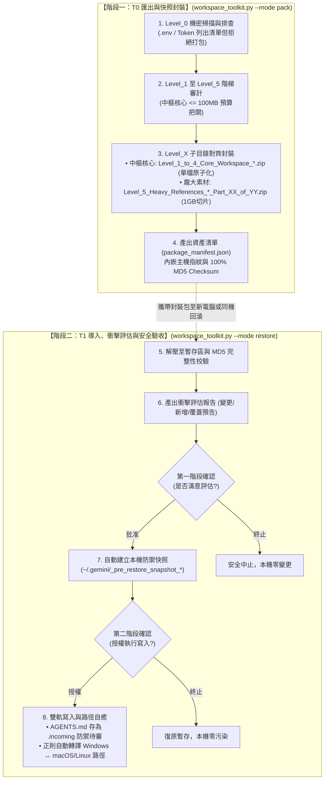

# Universal AI Agent Workspace Toolkit (日本語完全マニュアル)
**汎用 AI エージェント ワークスペース全域管理・無損失移行・スナップショット自己修復ハブ**

<p align="center">
  <a href="README.md"><b>English (Master)</b></a> •
  <a href="README_zh-TW.md"><b>🇹🇼 繁體中文說明</b></a> •
  <a href="README_ja.md"><b>🇯🇵 日本語マニュアル</b></a>
</p>

---

## 🇯🇵 日本語の概要

**Universal AI Agent ワークスペース管理ハブ**は、最新の AI 開発・エンジニアリングチーム向けに設計された、クロスプラットフォーム対応の環境管理・無損失移行・スナップショット自己修復ツールです。Google Antigravity、Cursor、Claude Code、VS Code (Cline / Roo) をフルサポートします。

### 6つの基本原則 (Core Invariants)
1. **単一コンソール統合 (`workspace_toolkit.py`)**：従来の散在した A/B スクリプトや OS 依存の `.bat`/`.sh` を廃止し、単一の純粋な Python スクリプトで全環境を横断サポート。
2. **Level_0 機密セキュリティゲート**：`.env`、API キー、秘密鍵、トークンを自動検出し、アーカイブへの混入を 100% 遮断。パスワードマネージャーでの安全管理を案内。
3. **階層構造の完全対称性**：圧縮ファイル名、内部サブディレクトリ、Manifest キー名を Level 1〜5 で 100% 厳密に統一。
4. **中核資産の原子化パッケージ**：エージェントの中核（Level 1〜4）は総容量 $\le 100\text{ MB}$ に制御し、単一 ZIP で出力して欠落リスクをゼロ化。
5. **大容量メディアの分割管理 (`Part_XX_of_YY`)**：巨大素材（Level 5）は 1GB 単位で分割し、総数と連番を明記（例: `Part_01_of_03.zip`）して安全に転送。
6. **2段階承認ゲートと自動保護**：展開前に影響評価レポートを出力 ➔ 第1承認 ➔ 自動スナップショット作成 ➔ 第2承認 ➔ `AGENTS.md` を `.incoming` として安全配置し、既存環境を破壊しません。


---

## 💡 Why This Toolkit? / 痛點分析與解決方案 / 開発背景と解決する課題

| # | 痛點維度 / Dimension / 課題分類 | 傳統困境 / Legacy Problem / 従来の課題 | 本工具解決方案 / Our Solution / 本ツールの解決策 |
| :-: | :--- | :--- | :--- |
| **1** | **跨設備遷移耗時<br>Multi-Device Setup<br>環境移行の手間** | **分散碎片化**：Agent 規則、技能、MCP 配置散落各處，更換電腦或在多台工作站切換需手動尋找路徑並重新配置數小時。<br>*Fragmented configurations across paths require hours of manual copying and path patching on new machines.*<br>*各種設定が散在し、端末切り替え時に手動コピーとパス修正に数時間を要する。* | **一鍵無痛遷移**：單一命令自動採集 Level 1~5 全棧資產，並動態自癒跨系統路徑（自動轉譯 Windows ↔ macOS/Linux），5 秒完成還原。<br>*1-click packaging and deployment with automatic path normalization across OS platforms.*<br>*単一コマンドで全階層資産を自動収集し、OS間のパス差分を自動吸収して即時復元。* |
| **2** | **機密憑證外洩風險<br>Secret Leakage Risk<br>機密情報漏洩リスク** | **誤打包 API Keys**：傳統整包壓縮常不慎包含 `.env`、私鑰或私人 Token，上傳至雲端或公開代碼庫引發嚴重資安危機。<br>*Traditional full-folder archiving easily leaks `.env`, API keys, or private SSH keys into shared clouds.*<br>*全フォルダの一括圧縮により、.env や API キーが誤って共有ストレージへ流出する危険。* | **Level_0 零信任守門**：封裝前強制以正則深度掃描整個工作區，嚴格拒絕打包任何機密，並主動提示使用密碼管理器安全同步。<br>*Strict Level_0 pre-flight security scanner that refuses to bundle secrets and guides secure vault sync.*<br>*Level_0 セキュリティゲートが機密を検知してパッケージングを遮断、安全な同期を案内。* |
| **3** | **粗暴覆蓋踩死現有配置<br>Destructive Overwrite<br>既存設定の上書き破壊** | **盲目解壓覆蓋**：還原時直接蓋過目標目錄，抹殺現存的最新 Agent 規範與工作成果，且無法回滾撤銷。<br>*Blind extraction overwrites existing configurations without warning, destroying active work with zero rollback.*<br>*解凍時に既存の最新ルールや設定が無警告で上書きされ、復旧も不可能。* | **雙重門禁 + 自動回滾快照**：還原前呈現衝擊評估清單，自動建立全環境快照備份，且 Agent 憲章存為 `.incoming` 雙軌待審。<br>*2-step confirmation gate, automatic pre-restore backup snapshot, and `.incoming` dual-track staging.*<br>*2段階承認ゲート、復元前の自動スナップショット生成、および `.incoming` 二重化保存。* |
| **4** | **平台與 Shell 依賴陷阱<br>Platform & Shell Lock-in<br>プラットフォーム依存** | **綁定特定系統腳本**：過度依賴 Windows `.bat` 或 Linux `.sh`，遇到跨平台環境時執行中斷，且需安裝繁重的第三方依賴包。<br>*Dependent on OS-specific `.bat` or `.sh` scripts and heavy external dependencies, failing on cross-OS workflows.*<br>*特定の OS 向けシェルスクリプトや重い外部ライブラリに依存し、別環境で動作不能になる。* | **100% Agent-Native 純 Python**：僅使用標準函式庫（零外部依賴），跨 Windows/macOS/Linux 完全原生通用，Agent 可直接以自然語言驅動。<br>*100% pure Python standard library (zero external pip packages), fully agent-native and cross-platform.*<br>*100% Python 標準ライブラリのみで構築（追加依存ゼロ）。自然言語プロンプトで直接実行可能。* |
| **5** | **輕重資產混雜與容量超限<br>Monolithic Archive Bloat<br>大容量アーカイブの破綻** | **單一巨型壓縮包崩潰**：數十 GB 的資料集/PDF 與幾十 KB 的核心 Skills 混在一起打包，超出雲端與 GitHub 上傳上限，傳輸極易中斷。<br>*Bundling multi-GB datasets with lightweight rule files into a single huge zip breaches cloud limits and risks corruption.*<br>*巨大データと軽量ルールを単一 ZIP に混載し、クラウド転送制限超過や破損を頻発。* | **輕重資產智能分流**：核心神經層 ($\le 100\text{ MB}$) 單一原子封裝；海量素材層 (Level 5) 自動切為 1GB 獨立分卷 (`Part_XX_of_YY.zip`)，靈活傳輸。<br>*Separation of core workspace ($\le 100\text{ MB}$, unfragmented atomic package) and heavy media (1GB chunks).*<br>*中核設定（$\le 100$MB 原子パッケージ）と大容量素材（1GB 分割ボリューム）のスマート分離。* |


---

## 🧩 AI Agent 生態相容性矩陣 (Ecosystem Compatibility Matrix)

| AI Agent 環境 / Platform | 核心憲法指引 (Directives) | 工具擴充 (MCP Servers) | 技能擴充 (Skills) | IDE 協議免警告注入 (Bypass) |
| :--- | :---: | :---: | :---: | :---: |
| **Google Antigravity** | `AGENTS.md` | `~/.gemini/antigravity/mcp/` | `~/.gemini/config/skills/` | ✅ 自動注入 |
| **Cursor** | `.cursorrules` / `.cursor/rules` | `~/.cursor/mcp.json` | 轉換為 Rules 規範 | ✅ 自動注入 |
| **Claude (Code / Desktop)** | `CLAUDE.md` | `claude_desktop_config.json` | 支援 Custom Commands | ✅ 自動適配 |
| **VS Code (Cline / Roo)** | `.clinerules` | `cline_mcp_settings.json` | 增量導入 | ✅ 自動注入 |
| **Windsurf** | `.windsurfrules` | 通用 JSON 規範 | 增量導入 | ✅ 自動注入 |


---

## 🛡️ 六級資產防禦階梯 (Asset Defense Hierarchy)

| 級別 / Level | 目錄名稱 / Directory | 包含內容 / Contained Assets | 防禦策略 / Defense Strategy |
| :--- | :--- | :--- | :--- |
| **Level_0<br>(機密憑證)** | *(不建立目錄)* | `.env`, API Keys, 私鑰, 憑證 (`id_rsa`, `auth.json`) | **❌ 100% 拒絕打包 (Strict Exclusion)**：主動掃描路徑，提示使用者透過密碼管理器手動備份。<br>*Never packaged; strictly advises manual password manager sync.* |
| **Level_1<br>(智能體憲法)** | `Level_1_Agent_Directives/` | `AGENTS.md`, `CLAUDE.md`, `.cursorrules` | **🔴 極高危單例保護 (Single Instance Gate)**：預設 100% 保留本機舊檔，新版存為 `.incoming` 雙軌比對，需兩次確認始准覆蓋。<br>*100% preserve existing; incoming staged as `.incoming`.* |
| **Level_2<br>(系統底層設定)** | `Level_2_System_Settings/` | `ide_user_settings.json`, MCP 伺服器配置 | **🟠 僅做 Patch 增補 (Incremental Patch)**：僅注入通訊協議（如 `file:///` 免警告），絕不覆蓋本機原有外觀與個人化設定。<br>*Only patches protocol keys; preserves user UI/theme.* |
| **Level_3<br>(模組化技能庫)** | `Level_3_Modular_Skills/` | 各獨立 Skill 資料夾 (`SKILL.md`, scripts, manifest) | **🟢 無損導入 (Lossless Import)**：可插拔模組化元件，同名技能安全跳過，新技能自動增補。<br>*Pluggable modules; skips existing names, adds new skills.* |
| **Level_4<br>(專案工程文檔)** | `Level_4_Workspace_Docs/` | Markdown 筆記、SOP、S-Curve 腳本、日常工作檔 | **🔵 增量同步 (Incremental Sync)**：工作區檔案增量同步（目標目錄已有之同名檔案保留本機最新版）。<br>*Incremental sync; preserves target-newer files.* |
| **Level_5<br>(龐大素材資料)** | `Level_5_Heavy_References/` | 大型 PDF、影音多媒體、大資料庫 (>10MB 或數 GB) | **🟣 大檔可選分卷 (1GB Chunk Volumes)**：採用 1GB 大顆粒切片 (`Part_XX_of_YY.zip`)，由使用者自決是否傳輸與解壓。<br>*Auto-chunked 1GB parts; user chooses when to transfer.* |


---

## 📊 視覺化架構流程圖 (Visual Architecture Flow)




---

## 🚀 Quick Start (クイックスタート)

### 1. 🤖 Agent-Native モード (自然言語対話 · 推奨)
コマンドを覚える必要はありません。普段利用している AI エージェント（Antigravity、Cursor、Claude Code、Cline）のチャット欄で指示するだけで自動実行されます：

* **【シナリオ A：日常のスナップショットバックアップとエクスポート】**
  - 💬 `「AI ワークスペースのスナップショットを作成・エクスポートしてください」`
  *(エージェントが Level_0 機密検知、資産監査を行い、packages/ ディレクトリへ自動圧縮出力)*

* **【シナリオ B：安全なインポートと検証付きリストア】**
  - 💬 `「packages/ のパッケージを確認して復元してください。まず影響評価を出力してください」`
  *(詳細な影響評価レポートを出力し、第1承認でバックアップスナップショットを作成、第2承認で安全に配置)*

* **【シナリオ C：整合性監査とヘルスチェック】**
  - 💬 `「package_manifest.json を読み込み、全ファイルの MD5 チェックサムを照合してください」`
  *(完全な読み取り専用検証。ファイル変更ゼロで破損を防止)*

### 2. 💻 ターミナル CLI モード (高度な操作・自動化)
ターミナルでの直接操作や CI/CD パイプラインでの自動実行向け：

```bash
# 対話型コンソール起動 (システム言語を自動判定)
python workspace_toolkit.py

# ワークスペースのスナップショット出力
python workspace_toolkit.py --mode pack

# 検証付きリストア (影響評価と2段階承認ゲート付き)
python workspace_toolkit.py --mode restore

# 整合性監査 (読み取り専用・変更なし)
python workspace_toolkit.py --mode inspect

# 言語を手動指定
python workspace_toolkit.py --lang ja
```


---

## ❓ FAQ (よくある質問)

### Q1: APIキーやパスワードが誤ってアーカイブされたりGitHubに流出することはありますか？
**絶対にありません。** 本ツールには強制的な「Level_0 機密セキュリティゲート」が備わっており、スキャン段階で `.env`、API キー、トークン、秘密鍵を自動検知して除外リストに登録し、パッケージングを 100% 拒否します。また厳格な `.gitignore` によりリポジトリへの誤混入も防止します。

### Q2: 復元先PCに既存の `AGENTS.md` がある場合、上書き破壊されますか？
**絶対にありません。** リストア実行時に環境状態を判定します。「既存環境」の場合、最高レベルの保護ポリシーが発動し、復元先の現行ファイルが 100% 保持されます。アーカイブ内の指示書は `AGENTS.md.incoming` として二重化保存され、手動比較・マージが可能です。

### Q3: 同一PC上での日常的なスナップショットバックアップとロールバックに利用できますか？
**はい、標準で対応しています。** パッケージのマニフェストに記録された `machine_fingerprint`（ホスト名とユーザー名）を照合し、同一端末であることを検出すると自動的に「ローカルタイムマシンモード」に切り替わり、パス書き換えを行わずに安全なロールバックを実行します。

### Q4: Windows と macOS/Linux 間でパス記述の差異はどのように処理されますか？
内蔵の**動的パス自己修復エンジン**が自動解決します。異なるOS間での移行時、Markdown や JSON 設定ファイル内の絶対パス（例: `file:///C:/Users/UserA/`）を正規表現で検知し、移行先PCのパス形式（例: `file:///Users/UserB/`）へと自動置換します。


---

## 📁 Repository Structure (倉庫目錄結構)

```text
universal-agent-workspace-toolkit/
├── workspace_toolkit.py          # Unified Master CLI & Agent-Native Console
├── toolkit_i18n.py               # Internationalization Engine (EN / ZH-TW / JA)
├── toolkit_scanner.py            # Level_0 Credential & Level_1~5 Asset Scanner
├── toolkit_pack.py               # Staging, Manifest & Zip Compression Engine
├── toolkit_restore.py            # Impact Assessment, Rollback Snapshot & Deployer
├── SKILL.md                      # Antigravity Skill Definition & Metadata
├── AGENTS.md                     # Universal Agent Bootstrap Directives
├── AI_GUIDED_WIZARD_PROMPTS.md   # Prompt Templates for AI Assistants
├── README.md                     # Master Trilingual Documentation
├── README_zh-TW.md               # 繁體中文完整說明手冊
├── README_ja.md                  # 日本語完全マニュアル
└── .gitignore                    # Security Exclusions & Cache Filters
```

## 📄 License
This project is licensed under the MIT License - see the [LICENSE](LICENSE) file for details.

